# APPFLOW — Application Flow — FluxyRH

| | |
|---|---|
| **Produit** | FluxyRH — SIRH SaaS multi-entreprises |
| **Éditeur** | RIYADA ONE TECHNOLOGIES SARL |
| **Version du document** | 1.0 (brouillon) — 2026-10-27 |
| **Lecteurs** | Équipe technique et produit |
| **Statut** | Parcours **cibles** à construire |
| **Documents liés** | PRD (`F-*`), TRD (`T-*`), BACKEND SCHEMA (tables, statuts), UX/UI DESIGN |

---

## Sommaire

1. Objet et conventions
2. Carte des espaces
3. Flux d'entrée : invitation, connexion, carte, borne
4. Navigation par rôle (web et mobile)
5. Flux de bout en bout
   - 5.1 Ouverture d'une entreprise cliente
   - 5.2 Mise en place de l'entreprise
   - 5.3 Invitation → dossier → complétion → vérification
   - 5.4 Modifier une donnée déjà vérifiée
   - 5.5 Cycle de la carte NFC
   - 5.6 Pointage
   - 5.7 Heures supplémentaires
   - 5.8 Congés et absences
   - 5.9 Contrat : rédaction → signature → fin
   - 5.10 Paie d'une période
   - 5.11 Avances et prêts
   - 5.12 Événements RH, workflows d'entrée, de sortie et de mutation
   - 5.13 Courriers en masse et formulaires types
   - 5.14 Évaluation 360°
   - 5.15 Import Jobyflow
   - 5.16 Déclarations et export comptable
   - 5.17 Simulation de la masse salariale
   - 5.18 Notifications et annonces
   - 5.19 Droits : délégations et exclusions
   - 5.20 Archive mensuelle des données
   - 5.21 Charte graphique des documents (module Identité)
6. Catalogue des écrans et des permissions
7. États d'erreur et cas limites transverses
8. Questions ouvertes

---

## 1. Objet et conventions

Ce document décrit **comment on circule dans FluxyRH** : par où chaque personne entre, ce qu'elle voit, et comment une donnée passe d'un acteur à l'autre. Il sert de référence aux écrans (UX/UI DESIGN) et à la liste des permissions (`Permission`, section 6).

**Conventions** :

- `S-12` = écran n° 12 du catalogue (section 6) ; `/employees` = chemin web sur `{slug}.fluxyrh.app` ; `📱 Onglet` = onglet de l'app Entreprise ; `🖥 Borne` = app Borne ; `🛰 Console` = app Console.
- Dans les diagrammes : rectangle = écran ou action, losange = décision du système, `[Statut]` = statut en base (BACKEND SCHEMA §6).
- Rôles abrégés : **PLT** admin plateforme, **ADM** admin entreprise, **DIR** direction, **RH** responsable RH, **PAIE** gestionnaire de paie, **MGR** manager, **EMP** employé, **SYS** système.
- Tout acteur qui a un dossier employé (RH, PAIE, DIR, MGR, EMP) dispose **aussi** de l'espace personnel de l'employé.

---

## 2. Carte des espaces

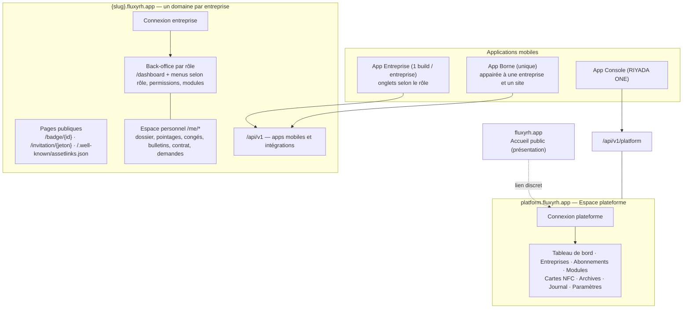

| Espace | Qui | Entrée |
|---|---|---|
| Accueil racine | Futurs clients | `https://fluxyrh.app` |
| Plateforme | PLT | `https://platform.fluxyrh.app/login` ou 🛰 Console |
| Back-office | ADM, DIR, RH, PAIE, MGR | `https://{slug}.fluxyrh.app/login` puis `/dashboard` |
| Espace personnel | Tout titulaire d'un dossier | `/me` (web) ou 📱 |
| Borne | Employés d'un site | 🖥 Borne appairée |
| Badge public | N'importe qui | `/badge/{identifiant}` (carte approchée d'un téléphone sans l'app) |

---

## 3. Flux d'entrée : invitation, connexion, carte, borne

### 3.1 Invitation et premier accès

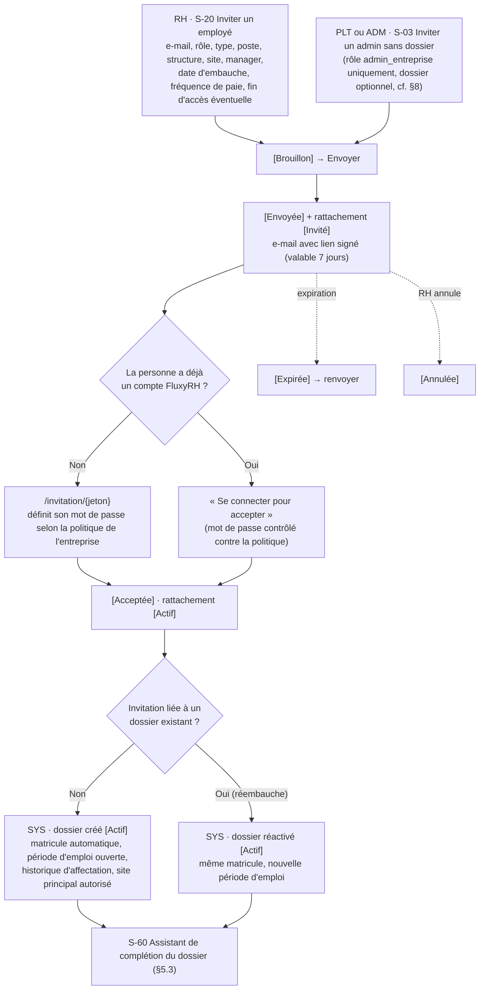

- Après l'acceptation, la fiche « Application mobile » de l'entreprise envoie aussi le lien d'installation de l'app (F-PLT-08).
- Une personne déjà rattachée à une autre entreprise garde son compte : une identité, plusieurs rattachements.

### 3.2 Connexion web entreprise

1. `https://{slug}.fluxyrh.app/login` : e-mail + mot de passe, ou passkey.
2. Si la 2FA est activée **ou imposée à son rôle** : code TOTP ou code de récupération ; si elle est imposée mais pas encore configurée, configuration obligatoire avant d'aller plus loin.
3. Si le mot de passe a expiré ou n'est pas conforme à la politique de l'entreprise : **changement obligatoire** (S-07).
4. À **chaque requête** : rattachement actif, date de fin d'accès non dépassée, abonnement actif ; sinon déconnexion avec message.
5. Arrivée sur `/dashboard` du rôle ; un EMP sans autre rôle arrive sur `/me`.

### 3.3 Connexion mobile (app Entreprise)

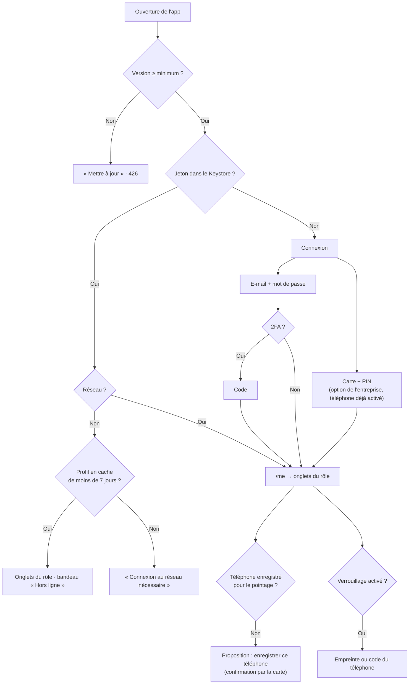

- La déconnexion efface le jeton et le cache ; un avertissement s'affiche s'il reste des envois en attente.
- La connexion carte + PIN se met en place depuis 📱 Profil → « Connexion par carte » (carte active posée sur le téléphone, choix du PIN).

### 3.4 Une carte NFC approchée d'un téléphone

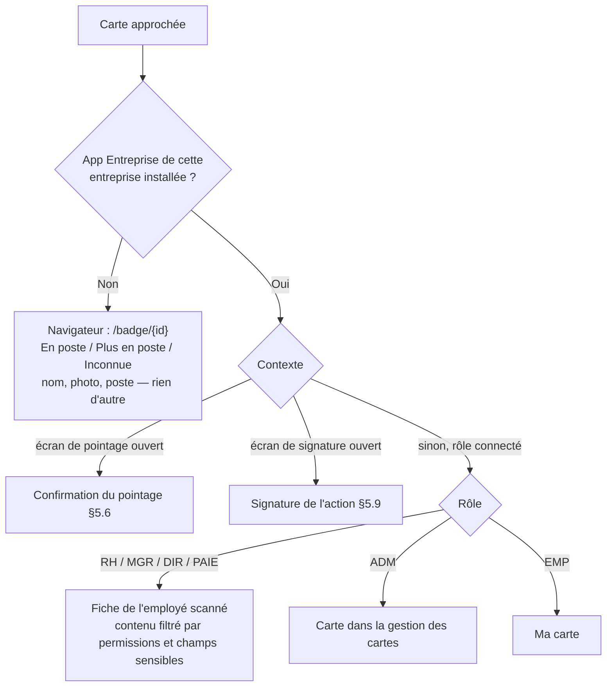

### 3.5 Appairage d'une borne

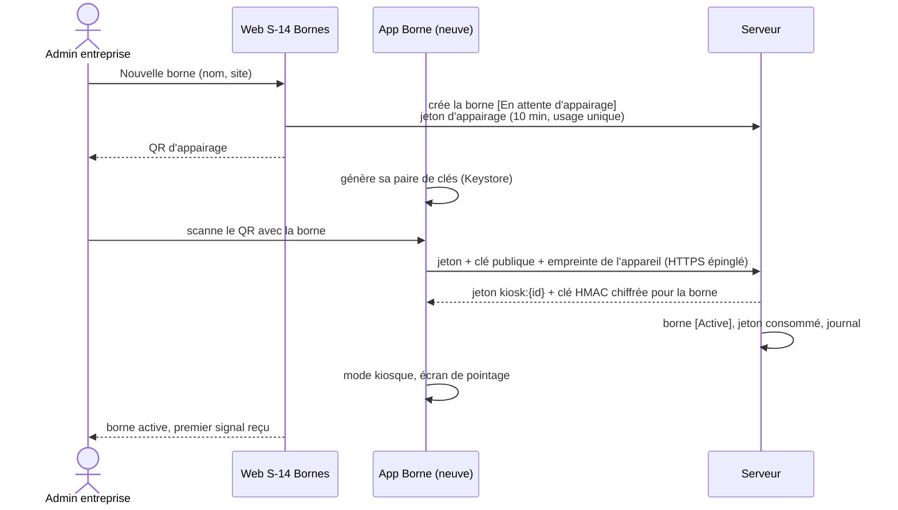

### 3.6 Connexion plateforme

Web : `https://platform.fluxyrh.app/login` (mot de passe, passkey, 2FA). 🛰 Console : même compte ; onglets Accueil, Cartes, Entreprises, Journal, Profil.

---

## 4. Navigation par rôle (web et mobile)

Le menu web et les onglets mobiles sont filtrés par **rôle**, **permissions** (délégations et exclusions) et **modules souscrits**. Les champs sensibles sont masqués selon `FieldAccess`, quel que soit l'écran (TRD §9).

### 4.1 Administrateur plateforme

| Web | 🛰 Console |
|---|---|
| `/dashboard`, `/companies` (création, fiche, modules, application mobile), `/subscriptions`, `/nfc-cards` (file, livraison), `/archives` (demandes d'archive), `/activity-log`, `/settings` | Accueil · Cartes (à encoder → encodage) · Entreprises · Journal · Profil |

### 4.2 Administrateur entreprise

| Web | 📱 |
|---|---|
| `/dashboard`, `/users` (S-02), `/invitations` (S-03), `/roles-permissions` (S-04), `/connected-users` (S-05), `/configuration` (S-10 : entreprise, matricule, mots de passe, pointage, relances), `/org-units` (S-11), `/sites` (S-12), `/kiosks` (S-14), `/document-branding` (S-19, carte : design neutre au socle, 20 designs et chartes avec le module Identité), `/employee-types` et `/document-types` (S-15), `/nfc-cards` (S-16 préparation), `/activity-log` (S-06), `/help` (S-90), `/archives` (S-17) | Utilisateurs · Invitations · Bornes (état, suspendre) · Cartes · Journal · Profil |

L'admin ne voit **jamais** de salaire, de bulletin ni de coordonnée bancaire.

### 4.3 Direction

| Web | 📱 |
|---|---|
| `/dashboard` (S-80), `/approvals` (S-81 : périodes de paie, avances, contrats à signer), `/payroll-periods` (lecture), `/simulations` (S-82, module Masse salariale), `/compensation-models` (S-83), `/reports` (S-84, module Pilotage), `/sensitive-views` (S-85), `/announcements` | Accueil (indicateurs) · Approbations · Équipe (si manager) · Moi |

### 4.4 Responsable RH

| Web | 📱 |
|---|---|
| `/employees` + fiche (S-21), `/invitations/employees` (S-20), `/verifications` (S-22), `/org-chart` (S-23), `/work-schedules` (S-30), `/holidays` (S-31), `/attendance` (S-32), `/overtime` (S-34 validation), `/leave-types` (S-35), `/leave-requests` (S-36), `/contracts` (S-40), `/contract-clauses` et `/contract-templates` (S-41), `/nfc-cards/handover` (S-18), `/payroll-periods/{id}/variables` (S-52), `/announcements` (S-70), modules : `/hr-events` (S-71), `/workflows` (S-72), `/letters` (S-73), `/form-requests` (S-74), `/evaluations` (S-75), `/skills` (S-76), `/recruitment-imports` (S-77) | Validations (données, congés, heures sup) · Employés (recherche, scan de carte) · Cartes (remise) · Moi |

### 4.5 Gestionnaire de paie

| Web | 📱 |
|---|---|
| `/payroll-parameters` (S-50), `/employee-compensation` (S-51), `/payroll-periods` (S-52 à S-55), `/bank-verifications` (S-56), `/payments` (S-57), `/banks` et `/transfer-formats` (S-58), `/advances` (S-59), modules : `/declarations` (S-78), `/accounting` (S-79), `/simulations` (S-82) | Validations (banque, avances) · Paie (état de la période, lecture) · Moi |

### 4.6 Manager

| Web | 📱 |
|---|---|
| `/team` (S-24 : présences du jour, calendrier d'absences), `/team/attendance` (S-33 corrections), `/team/overtime` (S-34 déclaration), `/team/leave-requests` (S-36 approbation), `/team/hr-events` (S-71 proposition), `/evaluations/to-fill` (S-75) | **Équipe** (présences du jour, approbations, corrections, heures sup) · Moi |

### 4.7 Employé (espace personnel, pour tous les titulaires d'un dossier)

| Web `/me` | 📱 |
|---|---|
| `/me` (S-60 accueil et complétion), `/me/file` (S-61 dossier par blocs), `/me/documents` (S-62), `/me/clockings` (S-63), `/me/leave` (S-64), `/me/payslips` (S-65, cumuls annuels), `/me/contract` (S-66), `/me/requests` (S-67 : avances, formulaires), `/me/signatures` (S-68 à signer), `/me/card` (S-69), `/me/evaluations`, `/announcements`, `/notifications` | **Accueil** (pointer, tâches, soldes) · **Pointer** · **Demandes** (congés, avances, formulaires) · **Documents** (bulletins, contrat, courriers) · **Profil** (dossier, carte, appareils, PIN, verrouillage) |

Pour un manager, RH, PAIE ou DIR, ces écrans personnels sont regroupés sous l'onglet 📱 **Moi**.

### 4.8 Borne (🖥)

Un seul écran en usage courant : QR dynamique + « Posez votre carte ». Écrans annexes : appairage, confirmation du pointage, état hors ligne (nombre de pointages en attente), sortie du mode kiosque protégée par code admin.

---

## 5. Flux de bout en bout

### 5.1 Ouverture d'une entreprise cliente

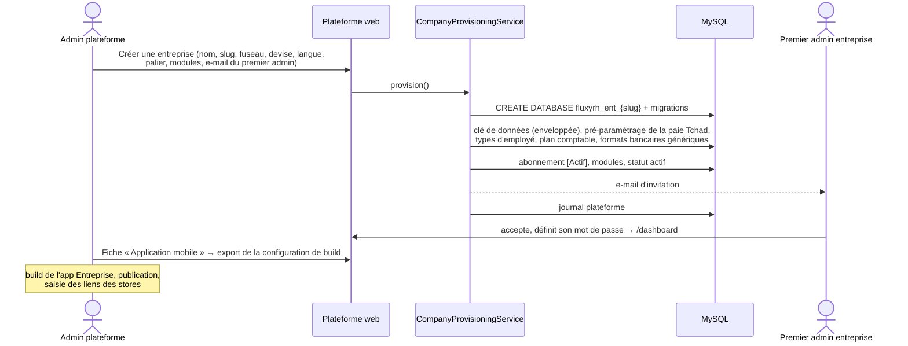

### 5.2 Mise en place de l'entreprise

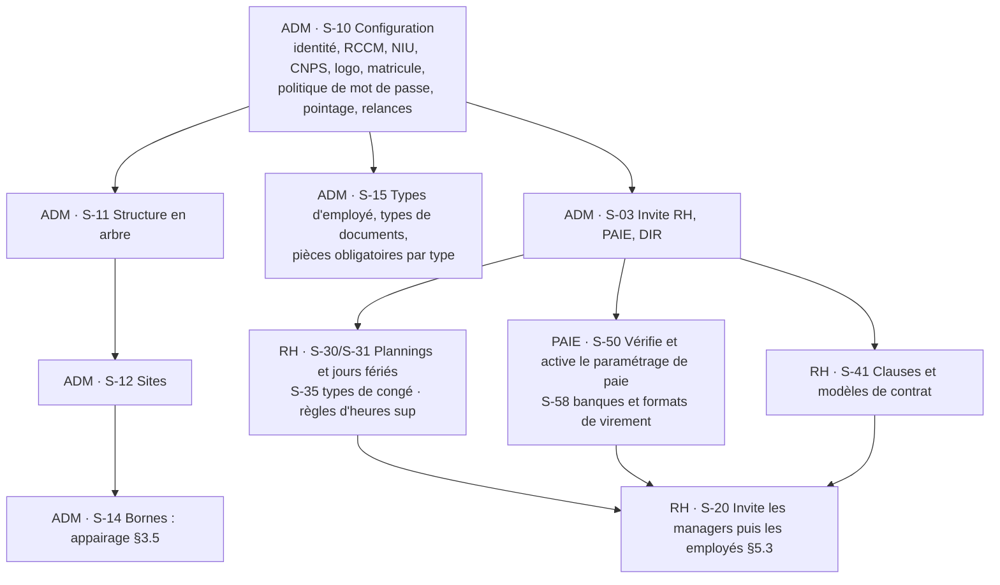

L'accueil de l'admin affiche une **liste de démarrage** (étapes faites / à faire) tant que la mise en place n'est pas terminée.

### 5.3 Invitation → dossier → complétion → vérification

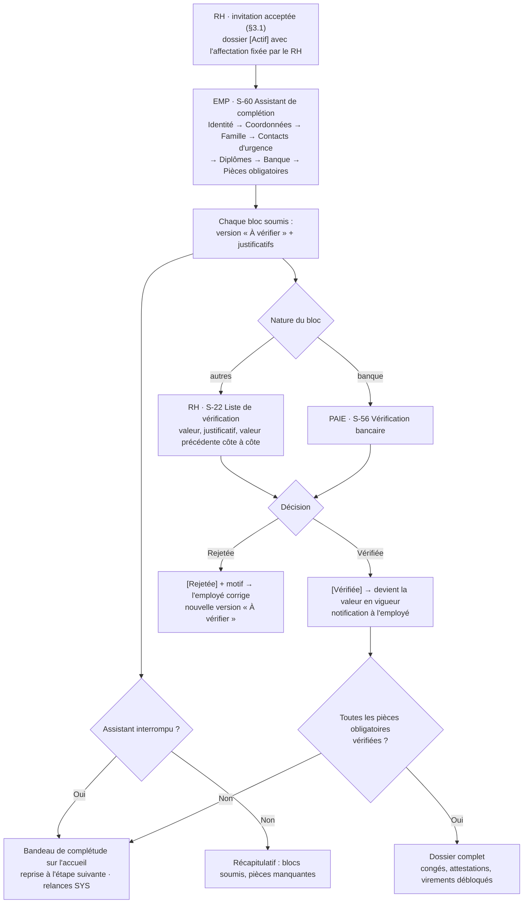

- Personne ne vérifie ses **propres** données. Les données de **tout RH** sont vérifiées par la **direction** (S-22 lui est ouvert pour ces seuls dossiers), **sauf sa banque**, qui reste vérifiée par le gestionnaire de paie (S-56). La banque d'un gestionnaire de paie est vérifiée par la direction.
- Les données importées de Jobyflow (§5.15) arrivent déjà dans l'assistant, pré-remplies, au statut « À vérifier ».

### 5.4 Modifier une donnée déjà vérifiée

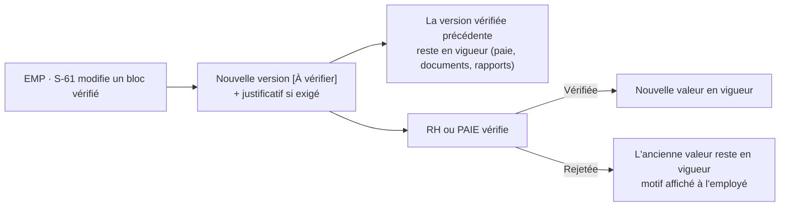

L'employé voit, bloc par bloc, la valeur en vigueur et, s'il y en a une, la modification en attente.

### 5.5 Cycle de la carte NFC

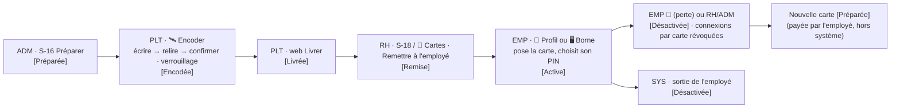

Tant que la carte n'est pas `Active`, l'employé ne peut pas pointer : il le signale à son manager, qui saisit une correction motivée (§5.6).

### 5.6 Pointage

```mermaid
flowchart TD
    subgraph Téléphone["Parcours téléphone (📱 Pointer)"]
        T1[Scanne le QR affiché par la borne] --> T2[Pose sa carte au dos du téléphone]
    end
    subgraph Borne["Parcours borne (🖥)"]
        B1[Pose sa carte sur la borne]
    end
    T2 --> V{Contrôles}
    B1 --> V
    V --> C1{Code du QR valide pour ce pas ?<br/>carte active et à lui ?<br/>site autorisé ? téléphone enregistré ?<br/>déjà pointé sur ce code ?}
    C1 -- Non --> KO[Refus avec motif affiché]
    C1 -- Oui --> D["Sens déterminé automatiquement<br/>(1er du jour = entrée, puis alternance)"]
    D --> CF["Confirmation : nom, photo, Entrée / Sortie, heure<br/>bouton « Inverser » pendant 10 s"]
    CF --> N{Réseau ?}
    N -- Oui --> S["Envoi immédiat → [Acceptée] / [Refusée]"]
    N -- Non --> Q["File locale chiffrée · bandeau « N en attente »<br/>envoi au retour du réseau"]
    Q --> W{Reçu dans la fenêtre<br/>(48 h) et période ouverte ?}
    W -- Oui --> S
    W -- Non --> RF["[Refusée] visible par le manager"]
    S --> J["SYS · journée recalculée<br/>heures, retard, départ anticipé, statut"]
    J --> OT{Au-delà du planning ?}
    OT -- Oui --> PR["Heures sup [Proposée] (§5.7)"]
    RF --> COR["MGR · S-33 Correction motivée<br/>(oubli, carte perdue, borne en panne)"]
    COR --> J
```

### 5.7 Heures supplémentaires

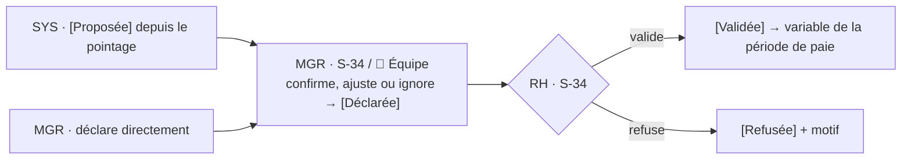

Les majorations viennent des règles de l'entreprise (seuils, nuit, repos, jour férié, plafond).

### 5.8 Congés et absences

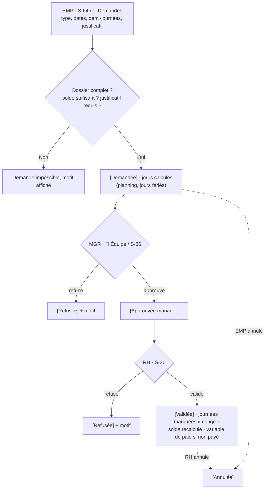

Hors ligne, la demande part en file et s'affiche « en attente d'envoi » ; le contrôle de solde définitif est fait par le serveur.

### 5.9 Contrat : rédaction → signature → fin

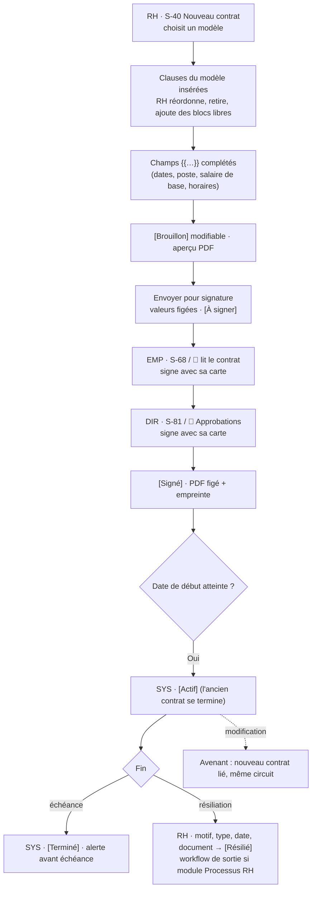

Un employé sans contrat actif ne peut pas être payé : le contrôle apparaît dans la checklist de paie.

### 5.10 Paie d'une période

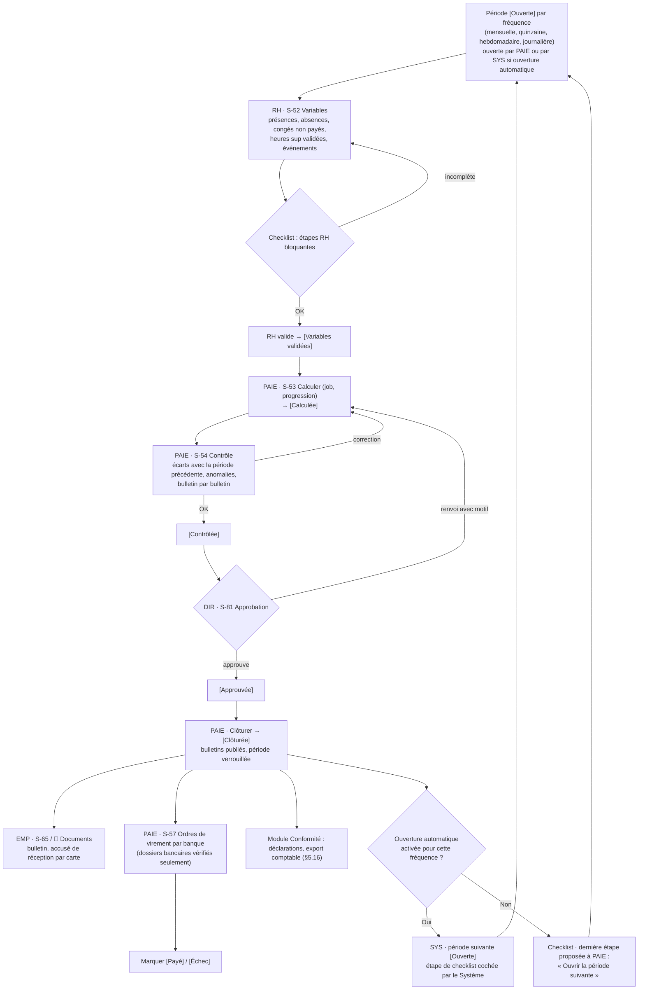

La première période d'une fréquence est ouverte manuellement par le gestionnaire de paie (S-53) ; le réglage d'ouverture automatique se trouve dans S-50.

### 5.11 Avances et prêts

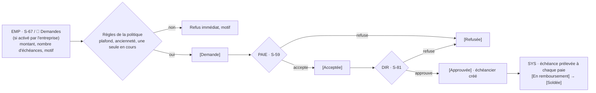

### 5.12 Événements RH, workflows d'entrée, de sortie et de mutation (module Processus RH)

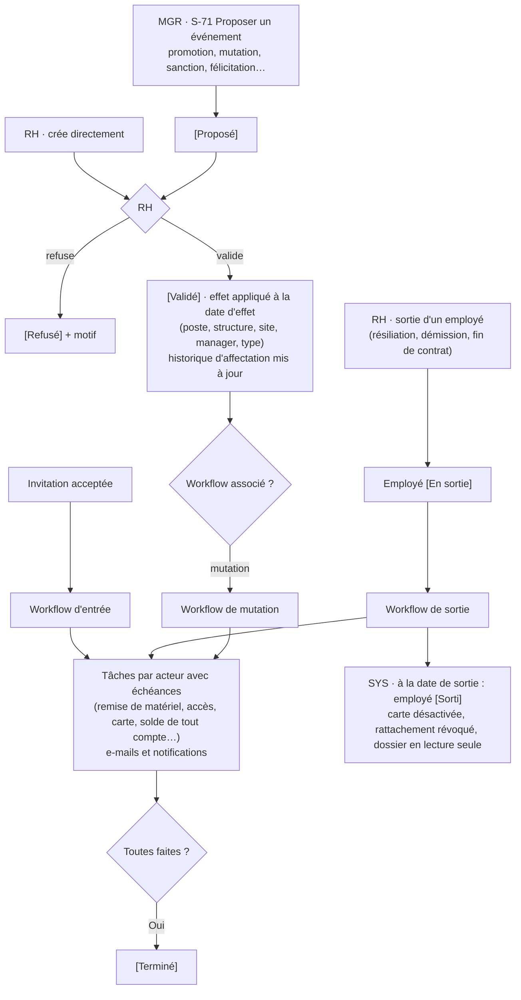

Sans le module, la sortie se fait directement par la résiliation du contrat et le passage du dossier à `Sorti`.

### 5.13 Courriers en masse et formulaires types (module Processus RH)

- **Courriers** : RH · S-73 choisit un modèle → sélectionne les destinataires (structure, site, type, liste) → aperçu → envoi : un PDF par destinataire dans 📱 Documents + e-mail ; accusé de réception par carte si exigé ; suivi des accusés.
- **Formulaires** : EMP · S-67 demande une attestation → `[Demandé]` → RH · S-74 vérifie et génère → `[Prêt]` (ou `[Refusé]` avec motif) → l'employé télécharge → `[Remis]`. Bloqué si le dossier est incomplet.

### 5.14 Évaluation 360° (module Talents)

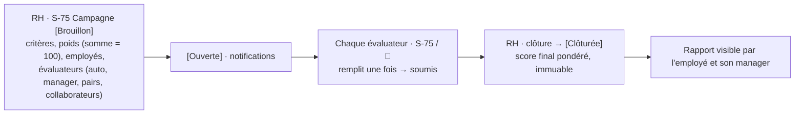

### 5.15 Import Jobyflow (module Talents)

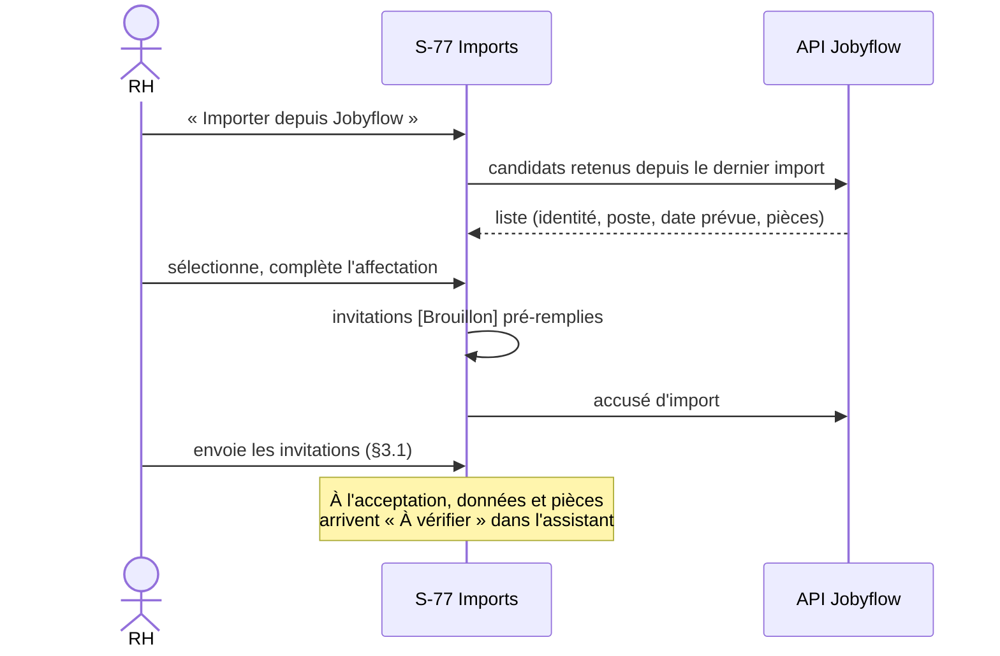

### 5.16 Déclarations et export comptable (module Conformité)

- **Déclaration** : PAIE · S-78 crée une déclaration (CNPS, fiscale, bilan social) sur une ou plusieurs périodes **clôturées** → lignes calculées automatiquement + informations complémentaires saisies → `[Préparée]` (export du fichier) → dépôt manuel auprès de l'organisme → `[Déposée]` avec la référence.
- **Export comptable** : PAIE · S-79 choisit une période clôturée, le format (générique CSV / XLSX, Sage) et le regroupement → fichier généré, journalisé, rejouable.

### 5.17 Simulation de la masse salariale (module Masse salariale)

DIR ou PAIE · S-82 : choisit une période de référence → ajoute des hypothèses (hausse globale ou ciblée, rubrique ajoutée / retirée / modifiée, variation d'effectif) → calcule → résultats par périmètre → enregistre → compare plusieurs simulations côte à côte.

### 5.18 Notifications et annonces

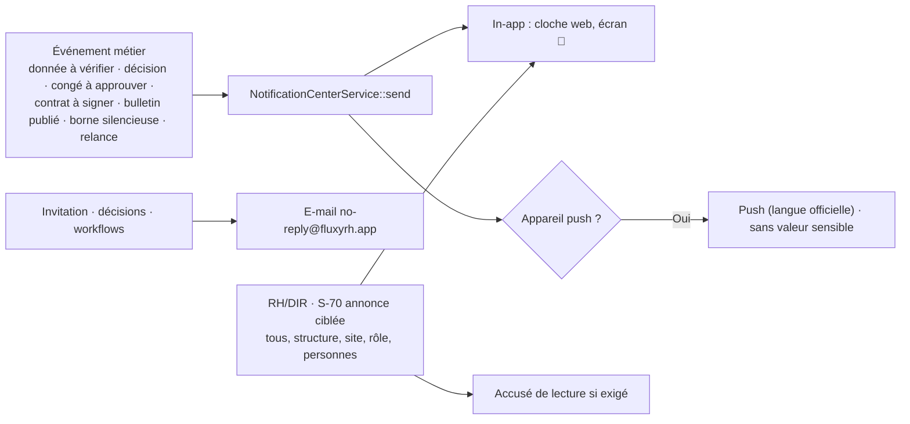

### 5.19 Droits : délégations et exclusions

ADM · S-04 Rôles et permissions : la matrice croise les écrans (section 6) et les rôles. Cocher un écran le **délègue** à un rôle ; une **exclusion** retire un écran à une personne. Effet immédiat sur le web, les onglets mobiles (`/me` renvoie les permissions) et les contrôles serveur. Les écrans d'un module non souscrit sont grisés. Les **champs sensibles** ne se délèguent pas (TRD §9.1).

### 5.20 Archive mensuelle des données

ADM ou DIR · S-17 demande l'archive du mois → `[Demandée]` → PLT / SYS prépare (tableurs par domaine, PDF des contrats et bulletins, pièces ; données sensibles seulement si le demandeur y a droit) → `[Prête]` : lien signé, valable 7 jours → `[Expirée]`.

### 5.21 Charte graphique des documents (module Identité)

```mermaid
flowchart TD
    A["ADM · S-19 Charte graphique"] --> M{Module Identité souscrit ?}
    M -- Non --> N["Charte neutre (noir et blanc, logo, mentions légales)<br/>design de carte neutre · bouton « Découvrir le module »"]
    M -- Oui --> B["Choisit un des 12 modèles<br/>→ version [Brouillon]"]
    B --> C["Règle : couleur de la palette, en-tête et pied,<br/>cachet, filigrane, design de carte (1 à 20)"]
    C --> P["Aperçu : bulletin, contrat, attestation, e-mail, carte<br/>(documents fictifs, rien n'est enregistré)"]
    P --> V["ADM · Activer → [Active]<br/>l'ancienne version passe [Archivée] · journalisé"]
    V --> G["Documents générés ensuite : nouvelle charte<br/>documents déjà générés : inchangés"]
    S["DIR · S-08 dépose sa signature (image)"] --> SG["Apposée seulement sur les documents<br/>qu'il signe par carte (contrat, avenant, courrier)"]
```

- La charte ne change **pas** l'interface web, mobile ou borne (identité FluxyRH neutre, nom et logo du client).
- Arrêt du module : les nouveaux documents reprennent la charte neutre et la carte le design neutre ; les cartes déjà imprimées et les PDF déjà générés ne changent pas.
- Personne d'autre que le directeur ne peut déposer, remplacer ou retirer sa signature ; un directeur qui quitte l'entreprise voit sa signature révoquée.

---

## 6. Catalogue des écrans et des permissions

Les écrans marqués **délégable** sont des valeurs de l'enum `Permission` (BACKEND SCHEMA §7) ; les autres sont câblés à un rôle ou à l'espace personnel. Les écrans des modules sont fermés si le module n'est pas souscrit.

### 6.1 Administration et organisation

| Écran | Chemin | Rôles par défaut | Délégable | Module |
|---|---|---|---|---|
| S-02 Utilisateurs | `/users` | ADM | ✅ `users` | Socle |
| S-03 Invitations (comptes) | `/invitations` | ADM | ✅ `invitations` | Socle |
| S-04 Rôles et permissions | `/roles-permissions` | ADM | ❌ | Socle |
| S-05 Utilisateurs connectés | `/connected-users` | ADM | ✅ `connected_users` | Socle |
| S-06 Journal d'audit | `/activity-log` | ADM, DIR | ✅ `activity_log` | Socle |
| S-07 Changement de mot de passe | `/settings/password` | tous | ❌ | Socle |
| S-08 Ma signature | `/settings/signature` | DIR | ❌ (propriétaire seulement) | Identité |
| S-10 Configuration | `/configuration` | ADM | ✅ `configuration` | Socle |
| S-11 Structure | `/org-units` | ADM, RH | ✅ `org_units` | Socle |
| S-12 Sites | `/sites` | ADM | ✅ `sites` | Socle |
| S-14 Bornes | `/kiosks` | ADM | ✅ `kiosks` | Socle |
| S-15 Types d'employé et de documents | `/employee-types`, `/document-types` | ADM, RH | ✅ `reference_types` | Socle |
| S-16 Préparation des cartes | `/nfc-cards` | ADM | ✅ `card_preparation` | Socle |
| S-17 Archives | `/archives` | ADM, DIR | ✅ `archives` | Socle |
| S-18 Remise des cartes | `/nfc-cards/handover` | RH | ✅ `card_handover` | Socle |
| S-19 Charte graphique des documents (et design de carte) | `/document-branding` | ADM | ✅ `document_branding` | Socle (charte neutre, design neutre) / Identité (modèles, réglages, 20 designs) |

### 6.2 Collaborateurs

| Écran | Chemin | Rôles par défaut | Délégable | Module |
|---|---|---|---|---|
| S-20 Inviter des employés | `/invitations/employees` | RH | ✅ `employee_invitations` | Socle |
| S-21 Employés et fiche | `/employees` | RH, DIR | ✅ `employees` | Socle |
| S-22 Vérifications | `/verifications` | RH | ✅ `verifications` | Socle |
| S-23 Organigramme | `/org-chart` | RH, DIR, MGR | ✅ `org_chart` | Socle |
| S-24 Mon équipe | `/team` | MGR | ❌ (périmètre d'équipe) | Socle |

### 6.3 Temps et congés

| Écran | Chemin | Rôles par défaut | Délégable | Module |
|---|---|---|---|---|
| S-30 Plannings | `/work-schedules` | RH | ✅ `work_schedules` | Socle |
| S-31 Jours fériés | `/holidays` | RH | ✅ `holidays` | Socle |
| S-32 Présences | `/attendance` | RH, DIR | ✅ `attendance` | Socle |
| S-33 Corrections de pointage | `/team/attendance` | MGR | ✅ `attendance_corrections` | Socle |
| S-34 Heures supplémentaires | `/overtime` | MGR (déclarer), RH (valider) | ✅ `overtime` | Socle |
| S-35 Types de congé et règles d'heures sup | `/leave-types` | RH | ✅ `leave_settings` | Socle |
| S-36 Demandes de congé | `/leave-requests` | MGR (approuver), RH (valider) | ✅ `leave_requests` | Socle |

### 6.4 Contrats

| Écran | Chemin | Rôles par défaut | Délégable | Module |
|---|---|---|---|---|
| S-40 Contrats | `/contracts` | RH | ✅ `contracts` | Socle |
| S-41 Clauses et modèles | `/contract-clauses`, `/contract-templates` | RH | ✅ `contract_library` | Socle |

### 6.5 Paie

| Écran | Chemin | Rôles par défaut | Délégable | Module |
|---|---|---|---|---|
| S-50 Paramétrage de paie | `/payroll-parameters` | PAIE | ✅ `payroll_parameters` | Socle |
| S-51 Rémunération des employés | `/employee-compensation` | PAIE | ✅ `employee_compensation` | Socle |
| S-52 Période : variables | `/payroll-periods/{id}/variables` | RH | ✅ `payroll_variables` | Socle |
| S-53 Période : calcul | `/payroll-periods/{id}` | PAIE | ✅ `payroll_compute` | Socle |
| S-54 Période : contrôle et bulletins | `/payroll-periods/{id}/payslips` | PAIE | ✅ `payroll_control` | Socle |
| S-55 Checklist de paie | `/payroll-periods/{id}/checklist` | RH, PAIE | ✅ `payroll_checklist` | Socle |
| S-56 Vérification bancaire | `/bank-verifications` | PAIE | ✅ `bank_verifications` | Socle |
| S-57 Paiements et virements | `/payments` | PAIE | ✅ `payments` | Socle |
| S-58 Banques et formats | `/banks`, `/transfer-formats` | PAIE | ✅ `bank_settings` | Socle |
| S-59 Avances et prêts | `/advances` | PAIE | ✅ `advances` | Socle |

Les écrans de paie restent soumis aux champs sensibles : déléguer `payroll_variables` à un rôle ne lui montre aucun montant.

### 6.6 Direction et pilotage

| Écran | Chemin | Rôles par défaut | Délégable | Module |
|---|---|---|---|---|
| S-80 Tableau de bord | `/dashboard` | tous (widgets selon rôle) | ❌ | Pilotage (widgets) ; sinon tâches en attente |
| S-81 Approbations | `/approvals` | DIR | ✅ `approvals` | Socle |
| S-82 Simulations | `/simulations` | DIR, PAIE | ✅ `simulations` | Masse salariale |
| S-83 Modèles de rémunération | `/compensation-models` | PAIE, DIR | ✅ `compensation_models` | Masse salariale |
| S-84 Rapports et états personnalisés | `/reports` | DIR, RH, PAIE | ✅ `reports` | Pilotage |
| S-85 Consultations sensibles | `/sensitive-views` | DIR | ❌ | Socle |
| S-86 Jetons d'intégration | `/integrations` | ADM | ✅ `integrations` | Pilotage |

### 6.7 Communication, processus, talents, conformité, aide

| Écran | Chemin | Rôles par défaut | Délégable | Module |
|---|---|---|---|---|
| S-70 Annonces | `/announcements` | RH, DIR | ✅ `announcements` | Socle |
| S-71 Événements RH | `/hr-events` | MGR (proposer), RH (valider) | ✅ `hr_events` | Processus RH |
| S-72 Workflows | `/workflows` | RH | ✅ `workflows` | Processus RH |
| S-73 Courriers | `/letters` | RH | ✅ `letters` | Processus RH |
| S-74 Formulaires | `/form-requests` | RH | ✅ `form_requests` | Processus RH |
| S-75 Évaluations | `/evaluations` | RH (campagnes), évaluateurs | ✅ `evaluations` | Talents |
| S-76 Compétences et carrières | `/skills` | RH | ✅ `skills` | Talents |
| S-77 Imports de recrutement | `/recruitment-imports` | RH | ✅ `recruitment_imports` | Talents |
| S-78 Déclarations | `/declarations` | PAIE | ✅ `declarations` | Conformité |
| S-79 Export comptable et plan comptable | `/accounting` | PAIE | ✅ `accounting` | Conformité |
| S-90 Centre d'aide (édition) | `/help` | ADM, RH | ✅ `help_articles` | Socle |

### 6.8 Espace personnel (non délégable, toujours limité à soi)

S-60 Accueil et assistant de complétion · S-61 Mon dossier · S-62 Mes documents · S-63 Mes pointages · S-64 Mes congés · S-65 Mes bulletins et cumuls · S-66 Mon contrat · S-67 Mes demandes · S-68 À signer · S-69 Ma carte · Mes évaluations · Annonces · Notifications · Aide (lecture).

---

## 7. États d'erreur et cas limites transverses

| Situation | Web | Mobile / Borne |
|---|---|---|
| Rôle ou permission manquants | 403 | Onglet ou bouton masqué ; 403 si appel forcé |
| Champ sensible non autorisé | Valeur masquée (« •••• ») ; jamais dans les exports | Idem |
| Module non souscrit | 404 « module non souscrit », menu retiré | Bouton masqué ; 404 |
| Rattachement suspendu, révoqué ou accès expiré ; abonnement suspendu | Déconnexion avec message | 401/403 → connexion |
| Mot de passe expiré ou non conforme | Changement obligatoire (S-07) | Changement demandé au web |
| App trop ancienne | — | 426 → « Mettre à jour » |
| Hors ligne | — | Bandeau ; cache ; pointages et demandes en file ; refus motivés affichés |
| Pointage refusé (code expiré, carte inactive, site non autorisé, appareil inconnu, rejeu, fenêtre dépassée, période clôturée) | Visible par le manager (S-33) | Message explicite à l'employé |
| Borne révoquée ou suspendue | — | Écran « Borne désactivée, contactez l'administrateur » |
| Dossier incomplet | Congés, attestations, virements bloqués avec la liste des pièces manquantes | Idem |
| Période de paie clôturée | Actions désactivées sur ses données | Refus 422 |
| Checklist non satisfaite | Étapes bloquantes ❌ listées, action désactivée | — |
| Vérification de ses propres données | Action absente | — |
| Erreur de validation | Messages traduits sous les champs | Message du serveur traduit |
| Suppression | Corbeille restaurable | — |
| Page publique trop sollicitée | 429 | — |

---

## 8. Décisions (2026-10-27)

| Sujet | Décision |
|---|---|
| Dossier de l'admin entreprise | **Optionnel** : un admin peut être interne (avec dossier, carte, pointage, espace personnel) ou externe (prestataire IT, sans dossier ni espace personnel). L'invitation « compte sans dossier » (§3.1) est réservée au rôle `admin_entreprise` ; un admin sans dossier peut en recevoir un plus tard par une invitation employé liée à son compte |
| Vérification des données d'un RH | **Toujours la direction**, qu'il y ait un ou plusieurs RH (§5.3), sauf ses coordonnées bancaires, vérifiées par le gestionnaire de paie |
| Charte graphique | Documents générés seulement (PDF, e-mails, carte) ; socle neutre ; module Identité hors pack : 12 modèles, palette fermée, cachet, signature déposée par le directeur, filigrane, 20 designs de carte (§5.21) |
| Ouverture des périodes de paie | La **dernière étape de la checklist** d'une période est « Ouvrir la période suivante » : à la clôture, le système la **propose** au gestionnaire de paie. L'entreprise peut activer l'**ouverture automatique** par fréquence ; la période suivante est alors ouverte par le système dès la clôture (§5.10) |
