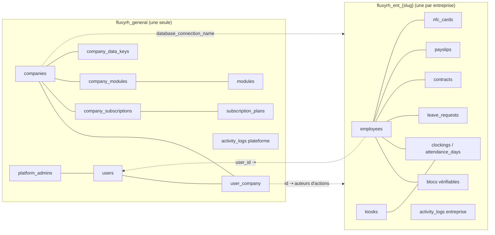
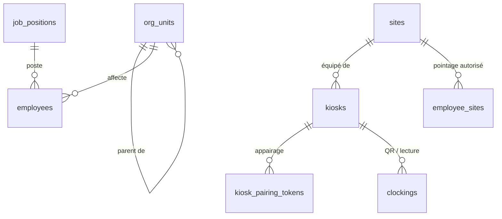
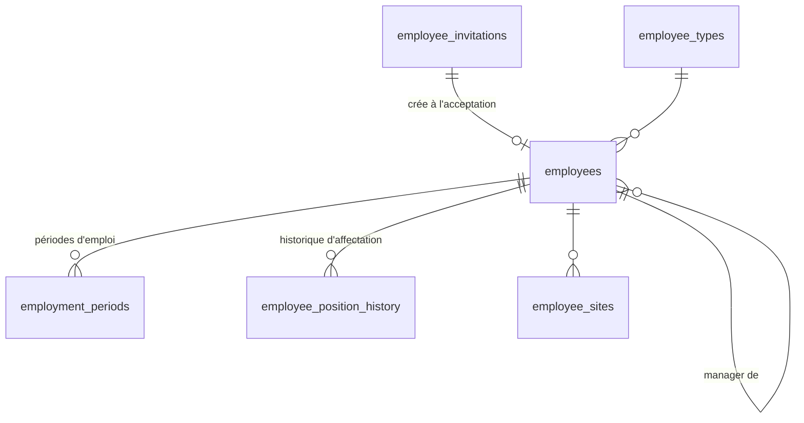
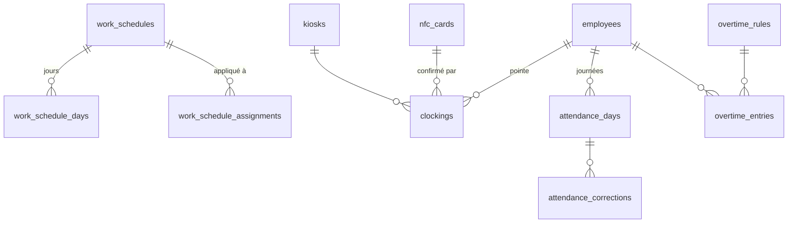
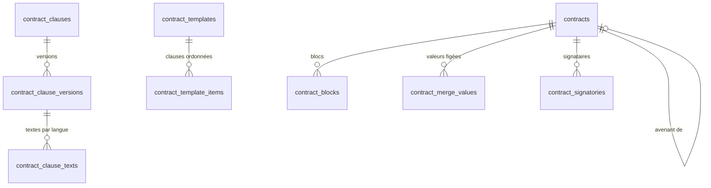
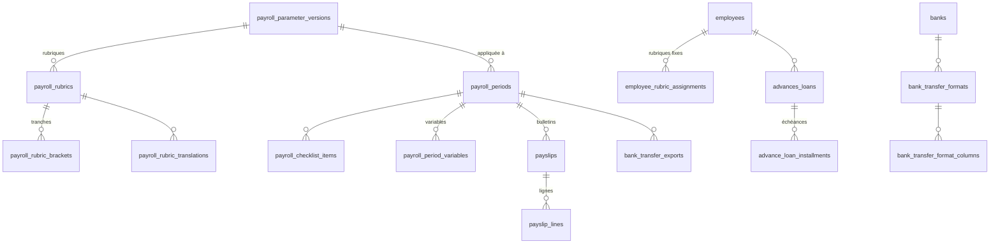

# BACKEND SCHEMA — FluxyRH

| | |
|---|---|
| **Produit** | FluxyRH — SIRH SaaS multi-entreprises |
| **Éditeur** | RIYADA ONE TECHNOLOGIES SARL |
| **Version du document** | 1.0 (brouillon) — 2026-10-27 |
| **Lecteurs** | Équipe technique |
| **Statut** | Modèle **cible** à construire (aucune base existante). Conventions héritées d'UnivPlus |
| **Documents liés** | PRD (exigences `F-*`), TRD (§5 multi-base, §9 chiffrement, §10 données vérifiables, §23 conventions), APPFLOW, UX/UI DESIGN |

---

## Sommaire

1. Lecture du document
2. Vue d'ensemble : deux niveaux de base
3. Références entre les deux bases
4. Base générale
5. Base d'une entreprise
   - 5.1 Paramètres de l'entreprise
   - 5.2 Organisation, sites et bornes
   - 5.3 Invitations et dossier employé
   - 5.4 Données vérifiables (blocs versionnés)
   - 5.5 Cartes NFC, appareils et signatures
   - 5.6 Temps de travail, pointage, heures supplémentaires
   - 5.7 Congés et absences
   - 5.8 Contrats
   - 5.9 Paie
   - 5.10 Module Masse salariale
   - 5.11 Module Processus RH
   - 5.12 Module Talents
   - 5.13 Module Conformité
   - 5.14 Communication
   - 5.15 Droits, pilotage, intégrations, journal, aide
   - 5.16 Module Identité : chartes documentaires
6. Cycles de vie (statuts et transitions)
7. Enums de référence (valeurs stockées)
8. Règles d'intégrité appliquées par le code
9. Points d'attention

---

## 1. Lecture du document

Les colonnes `created_at`, `updated_at` et `deleted_at` sont omises : elles existent sur **toutes** les tables métier (suppression logique), sauf mention contraire.

| Notation | Sens |
|---|---|
| `id` | Clé primaire **UUID v7** (`char(36)`) |
| `str` / `str64` | `varchar(255)` / `varchar(64)` |
| `dec` | `decimal(15,2)` (montants) ; `dec(9,4)` pour les taux ; `dec(6,2)` pour les jours et heures |
| `enc` | Colonne **chiffrée** avec la clé de l'entreprise (`text`, cast `EncryptedWithCompanyKey`, TRD §9.3) ; jamais filtrée, triée ni agrégée en SQL |
| `bool`, `date`, `time`, `dt`, `ts`, `text` | booléen, date, heure, datetime, timestamp, texte |
| `?` | Colonne nullable |
| `→ table` | Clé étrangère SQL vers `table` (même base) |
| `⇢ users` | Référence **applicative** vers une identité de la base générale |
| `⇢ uc` | Référence applicative vers un **rattachement** `user_company` (l'auteur d'une action, dans son rôle) |
| `= valeur` | Valeur par défaut |
| **UQ** | Contrainte d'unicité |
| **⟨V⟩** | Colonnes de vérification communes (§5.4) |

**Chiffres** (indicatifs) : base générale ≈ 20 tables ; base d'une entreprise ≈ 140 tables, dont ≈ 30 pour les modules.

---

## 2. Vue d'ensemble : deux niveaux de base

- `companies.database_connection_name` donne le nom de la base de l'entreprise.
- Aucune clé étrangère ni jointure SQL entre les deux niveaux (TRD §5.3).

---

## 3. Références entre les deux bases

| Cible | Usage |
|---|---|
| `users.id` | `employees.user_id`, `nfc_cards.encoded_by` (admin plateforme), `card_login_devices.user_id`, `activity_logs.actor_user_id` |
| `user_company.id` (`⇢ uc`) | Tout **auteur** d'action : invitations, vérifications, décisions de congé et d'heures sup, corrections de pointage, rédaction de contrat, transitions de paie, événements, exports, notifications, préférences, exclusions de permission |
| `personal_access_tokens.id` | `integration_tokens.personal_access_token_id`, `kiosks.personal_access_token_id` |

Règle : la **personne concernée** par une donnée est désignée par `employees.id` (clé SQL dans la base de l'entreprise) ; l'**auteur** d'une action est désigné par son rattachement (`⇢ uc`), pour savoir dans quel rôle il a agi.

---

## 4. Base générale (`fluxyrh_general`)

### 4.1 Identité et accès

| Table | Colonnes | Contraintes / notes |
|---|---|---|
| `users` | `id`, `first_name` str, `last_name` str, `email` str, `phone` str?, `locale` str(2)?, `password` str, `password_changed_at` ts?, `two_factor_secret` text?, `two_factor_recovery_codes` text?, `two_factor_confirmed_at` ts?, `email_verified_at` ts?, `remember_token` str(100)? | **UQ** `email`. Une identité par personne, toutes entreprises confondues |
| `user_company` | `id`, `user_id` → users, `company_id` → companies, `role` str, `status` str = `invite`, `invited_at` dt?, `activated_at` dt?, `suspended_at` dt?, `revoked_at` dt?, `revoked_reason` str?, `access_ends_at` dt? | **UQ** (`user_id`, `company_id`). `role` ∈ `UserCompanyRole`, `status` ∈ `UserCompanyStatus`. `access_ends_at` : fin d'accès automatique (F-ADM-01) |
| `password_histories` | `id`, `user_id` → users, `password_hash` str | Historique pour la politique « N derniers interdits » ; pas de suppression logique |
| `platform_admins` | `id`, `user_id` → users | **UQ** `user_id` |
| `passkeys` | (structure du paquet laravel/passkeys) | Exception aux conventions |
| `personal_access_tokens` | `id`, `tokenable_type` str, `tokenable_id` uuid, `name` text, `token` str64, `abilities` text?, `last_used_at` ts?, `expires_at` ts? | **UQ** `token`. Abilities : `company:{id}`, `kiosk:{id}`, `data:read`, `platform` |
| `push_devices` | `id`, `user_id` → users, `company_id` → companies, `personal_access_token_id` → personal_access_tokens, `fcm_token` str(512), `app_id` str?, `app_version` str(32)?, `last_seen_at` ts? | **UQ** `fcm_token` |
| `sessions` | `id` str, `user_id` uuid?, `company_id` uuid?, `ip_address`, `user_agent`, `payload`, `last_activity` | Sessions web ; `company_id` sert à la liste des connectés (F-ADM-06) |
| `password_reset_tokens` | `email`, `token` | Fortify |

### 4.2 Entreprises, abonnements, modules, clés

| Table | Colonnes | Contraintes / notes |
|---|---|---|
| `companies` | `id`, `name` str, `slug` str, `database_connection_name` str, `currency_code` str(3) = `XAF`, `official_locale` str(2) = `fr`, `timezone` str64 = `Africa/Ndjamena`, `card_login_enabled` bool = 0, `status` str = `inactive`, `mobile_android_package` str?, `mobile_ios_bundle_id` str?, `mobile_android_url` str?, `mobile_ios_url` str? | **UQ** `slug`, `mobile_android_package`, `mobile_ios_bundle_id` ; `status` ∈ `CompanyStatus` |
| `company_data_keys` | `id`, `company_id` → companies, `key_version` uint, `wrapped_key` text, `master_key_version` uint, `activated_at` ts, `retired_at` ts? | Clé de données (DEK) enveloppée par la clé maître ; une seule active par entreprise (TRD §9.3) |
| `subscription_plans` | `id`, `code` str, `min_employees` uint, `max_employees` uint?, `pack_monthly_price_fcfa` dec?, `core_monthly_price_fcfa` dec?, `module_price_multiplier` dec(4,2) = 1 | **UQ** `code` ∈ `moins_25`, `moins_75`, `moins_200`, `sur_devis` (PRD §8.3) |
| `modules` | `id`, `code` str, `name` str, `included_in_pack` bool = 1 | **UQ** `code` ∈ `ModuleCode` ; `identite` : `included_in_pack` = 0 (option hors pack, PRD §8.3) |
| `subscription_plan_module_prices` | `id`, `subscription_plan_id` → subscription_plans, `module_id` → modules, `monthly_price_fcfa` dec | **UQ** (`subscription_plan_id`, `module_id`) |
| `company_modules` | `id`, `company_id` → companies, `module_id` → modules, `enabled_at` dt | **UQ** (`company_id`, `module_id`) ; ligne présente = module souscrit |
| `company_subscriptions` | `id`, `company_id` → companies, `subscription_plan_id` → subscription_plans, `billing_frequency` str, `negotiated_monthly_price_fcfa` dec?, `status` str = `actif`, `started_at` date, `current_period_ends_at` date? | Prix négocié seulement pour `sur_devis` |

### 4.3 Pilotage plateforme et journal

| Table | Colonnes | Notes |
|---|---|---|
| `platform_statistics_snapshots` | `id`, `generated_at` dt, `metric_type` str, `company_id` → companies ?, `value` dec | Instantané nocturne ; aucune donnée nominative ni salariale |
| `platform_dashboard_widget_selections` | `id`, `platform_admin_id` → platform_admins, `widget_code` str, `position` uint = 0 | |
| `activity_logs` | `id`, `actor_user_id` → users ?, `company_id` → companies ?, `action` str, `subject_type` str, `subject_id` uuid?, `description` str, `description_en` text?, `description_ar` text? | Journal plateforme + miroir des événements d'entreprise **sans valeurs** ; pas de suppression logique |

### 4.4 Tables techniques Laravel

`cache`, `cache_locks`, `jobs`, `job_batches`, `failed_jobs`, `migrations` : structures standard, hors conventions métier.

---

## 5. Base d'une entreprise (`fluxyrh_ent_{slug}`)

### 5.1 Paramètres de l'entreprise

Tables à une ligne (réglages).

| Table | Colonnes | Notes |
|---|---|---|
| `company_profile` | `id`, `legal_name` str, `trade_name` str?, `logo_path` str?, `rccm` str?, `niu` str?, `cnps_employer_number` str?, `address` str?, `city` str?, `phone` str?, `email` str?, `sector` str? | Mentions légales des documents et bulletins (F-ADM-07) |
| `employee_number_settings` | `id`, `format` str = `EMP-{annee}-{sequentiel}`, `sequence_padding` tinyint = 4, `next_sequence` uint = 1 | Matricule (F-EMP-01) |
| `password_policies` | `id`, `min_length` tinyint = 12, `require_uppercase` bool = 1, `require_lowercase` bool = 1, `require_digit` bool = 1, `require_symbol` bool = 0, `expiry_days` smallint?, `history_count` tinyint = 0 | F-ADM-05 |
| `two_factor_required_roles` | `id`, `role` str | **UQ** `role` ; 2FA imposée à ces rôles |
| `clocking_settings` | `id`, `code_step_seconds` smallint = 30, `offline_window_hours` smallint = 48, `kiosk_silence_alert_minutes` smallint = 30, `phone_clocking_enabled` bool = 1 | TRD §12 |
| `advance_policies` | `id`, `enabled` bool = 0, `max_percent_of_net` dec(5,2)?, `max_installments` tinyint?, `min_seniority_months` tinyint?, `max_open_per_employee` tinyint = 1 | F-PAY-10 |
| `card_design_settings` | `id`, `structure_index` tinyint = 0, `show_photo` bool = 1 | `0` = design neutre (socle) ; `1` à `20` = designs du module Identité (`config/cards.php`), aux couleurs de la charte active (F-NFC-07, F-IDN-04, UX/UI §13.3) |
| `payroll_frequency_settings` | `id`, `frequency` str, `is_used` bool = 0, `auto_open_next_period` bool = 0 | **UQ** `frequency` ; ouverture automatique de la période suivante à la clôture (APPFLOW §5.10) |
| `reminder_settings` | `id`, `incomplete_file_every_days` tinyint = 7, `document_expiry_notice_days` smallint = 30, `contract_end_notice_days` smallint = 30 | F-EMP-05, F-EMP-10, F-CTR-03 |

### 5.2 Organisation, sites et bornes

| Table | Colonnes | Contraintes / notes |
|---|---|---|
| `org_units` | `id`, `parent_id` → org_units ?, `name` str, `code` str, `type_label` str, `head_employee_id` → employees ? | **UQ** `code` ; arbre libre (F-ORG-01) ; suppression refusée si employés ou sous-unités actifs |
| `job_positions` | `id`, `code` str, `title` str, `org_unit_id` → org_units ?, `description` text? | **UQ** `code` ; référentiel des postes (dossier, contrats, Talents) |
| `sites` | `id`, `code` str, `name` str, `address` str?, `city` str?, `timezone` str64?, `is_active` bool = 1 | **UQ** `code` (F-ORG-02) |
| `kiosks` | `id`, `site_id` → sites, `name` str, `status` str = `en_attente_appairage`, `public_key` text?, `secret` enc?, `secret_version` uint = 1, `personal_access_token_id` uuid?, `device_model` str?, `os_version` str?, `installation_id_hash` str64?, `app_version` str(32)?, `paired_at` ts?, `last_heartbeat_at` ts?, `battery_level` tinyint?, `pending_clockings` uint = 0, `clock_drift_seconds` int?, `suspended_at` ts?, `revoked_at` ts?, `revoked_reason` str? | ∈ `KioskStatus` ; `secret` = clé HMAC **propre à la borne** (TRD §12.1) ; `public_key` = clé de signature des requêtes (TRD §12.5) |
| `kiosk_pairing_tokens` | `id`, `kiosk_id` → kiosks, `token_hash` str64, `expires_at` ts, `used_at` ts?, `created_by` ⇢ uc | **UQ** `token_hash` ; validité 10 min, usage unique |

### 5.3 Invitations et dossier employé

| Table | Colonnes | Contraintes / notes |
|---|---|---|
| `employee_types` | `id`, `code` str, `label` str, `enters_payroll` bool = 1, `default_pay_frequency` str = `mensuelle`, `is_system` bool = 0 | **UQ** `code` ; système : `cdi`, `cdd`, `stagiaire`, `apprenti`, `journalier`, `saisonnier`, `prestataire`, `interimaire`, `consultant` ; extensible (F-EMP-02) |
| `employee_invitations` | `id`, `email` str, `first_name` str, `last_name` str, `role` str, `employee_type_id` → employee_types, `job_position_id` → job_positions, `org_unit_id` → org_units, `primary_site_id` → sites, `manager_employee_id` → employees ?, `hired_at` date, `pay_frequency` str, `access_ends_at` dt?, `status` str = `brouillon`, `token_hash` str64?, `sent_at` ts?, `expires_at` ts?, `accepted_at` ts?, `user_company_id` uuid?, `invited_by` ⇢ uc, `recruitment_import_id` → recruitment_imports ?, `existing_employee_id` → employees ? | ∈ `InvitationStatus` ; porte l'affectation fixée par le RH ; `existing_employee_id` = réembauche (même dossier) |
| `employees` | `id`, `user_id` ⇢ users, `user_company_id` ⇢ uc, `employee_number` str, `status` str = `actif`, `employee_type_id` → employee_types, `job_position_id` → job_positions, `org_unit_id` → org_units, `primary_site_id` → sites, `manager_employee_id` → employees ?, `pay_frequency` str, `hired_at` date, `current_identity_version_id` uuid?, `current_contact_version_id` uuid? | **UQ** `employee_number`, `user_id`. ∈ `EmployeeStatus`, `PayFrequency`. Une seule ligne par personne et par entreprise, conservée en cas de réembauche |
| `employment_periods` | `id`, `employee_id` → employees, `hired_at` date, `exited_at` date?, `exit_type` str?, `exit_reason` text? | Une ligne par embauche ; une seule ouverte (F-EMP-07) |
| `employee_position_history` | `id`, `employee_id` → employees, `job_position_id` → job_positions, `org_unit_id` → org_units, `site_id` → sites, `manager_employee_id` → employees ?, `started_on` date, `ended_on` date?, `hr_event_id` → hr_events ? | Historique de l'affectation ; mis à jour à l'embauche et par les événements validés |
| `employee_sites` | `id`, `employee_id` → employees, `site_id` → sites | **UQ** (`employee_id`, `site_id`) ; sites où l'employé peut pointer (le site principal y figure toujours) |

### 5.4 Données vérifiables (blocs versionnés)

Principe (PRD P2, P3 ; TRD §10) : chaque **bloc** du dossier est une suite de **versions**. Modifier un champ crée une nouvelle version du bloc entier, `a_verifier`. Seule la dernière version `verifiee` fait foi ; un pointeur `current_*_version_id` la désigne.

**Colonnes ⟨V⟩** présentes sur chaque table de versions : `status` str = `a_verifier` (∈ `VerificationStatus`), `submitted_by` ⇢ uc, `submitted_at` ts, `verified_by` ⇢ uc ?, `verified_at` ts?, `rejection_reason` text?, `previous_version_id` → même table ?.

**Blocs uniques** (un par employé, pointeur sur `employees`) :

| Table | Colonnes métier | Vérifiée par |
|---|---|---|
| `employee_identity_versions` | `id`, `employee_id` → employees, `civility` str?, `first_name` str, `last_name` str, `birth_name` str?, `birth_date` date, `birth_place` str?, `gender` str, `nationality` str(2), `marital_status` str, `national_id_type` str?, `national_id_number` str?, `national_id_expires_at` date?, `cnps_number` str?, `niu` str?, `photo_path` str?, ⟨V⟩ | RH |
| `employee_contact_versions` | `id`, `employee_id` → employees, `personal_email` str?, `phone` str, `phone_alt` str?, `address` str?, `city` str?, `country` str(2)?, ⟨V⟩ | RH |

**Blocs multiples** (une ligne « entité » + ses versions) :

| Entité | Versions | Vérifiée par |
|---|---|---|
| `employee_family_members` : `id`, `employee_id` → employees, `relationship` str, `current_version_id` uuid? | `employee_family_member_versions` : `id`, `family_member_id` → employee_family_members, `first_name` str, `last_name` str, `birth_date` date?, `gender` str?, `is_dependent` bool = 0, `marriage_date` date?, ⟨V⟩ | RH |
| `employee_emergency_contacts` : `id`, `employee_id` → employees, `current_version_id` uuid? | `employee_emergency_contact_versions` : `id`, `emergency_contact_id` → employee_emergency_contacts, `full_name` str, `relationship_label` str, `phone` str, ⟨V⟩ | RH |
| `employee_qualifications` : `id`, `employee_id` → employees, `current_version_id` uuid? | `employee_qualification_versions` : `id`, `qualification_id` → employee_qualifications, `kind` str, `title` str, `institution` str?, `field_of_study` str?, `level` str?, `obtained_on` date?, ⟨V⟩ | RH |
| `employee_bank_accounts` : `id`, `employee_id` → employees, `is_primary` bool = 0, `current_version_id` uuid? | `employee_bank_account_versions` : `id`, `bank_account_id` → employee_bank_accounts, `method` str, `bank_id` → banks ?, `holder_name` enc, `account_number` enc?, `bank_code` enc?, `branch_code` enc?, `rib_key` enc?, `iban` enc?, `mobile_money_operator` str?, `mobile_money_number` enc?, ⟨V⟩ | **Gestionnaire de paie** |

`relationship` ∈ `FamilyRelationship` ; `kind` ∈ `QualificationKind` ; `method` ∈ `PaymentChannel`. Un seul compte `is_primary` par employé (service).

**Justificatifs** : une version peut porter un ou plusieurs justificatifs.

| Table | Colonnes | Notes |
|---|---|---|
| `verification_proofs` | `id`, `verifiable_type` str, `verifiable_id` uuid, `employee_document_id` → employee_documents | Lien polymorphe version ↔ document déposé |

**Documents de l'employé** (F-EMP-05) : le document est lui-même versionné par remplacement.

| Table | Colonnes | Contraintes / notes |
|---|---|---|
| `document_types` | `id`, `code` str, `label` str, `uploaded_by` str, `is_verifiable` bool = 1, `has_expiry` bool = 0, `visible_to_employee` bool = 1 | **UQ** `code` ; `uploaded_by` ∈ `DocumentUploader` (`employe`, `rh`) ; types paramétrés par l'entreprise |
| `document_type_requirements` | `id`, `document_type_id` → document_types, `employee_type_id` → employee_types | **UQ** (`document_type_id`, `employee_type_id`) ; pièces **obligatoires** par type d'employé (F-EMP-09) |
| `employee_documents` | `id`, `employee_id` → employees, `document_type_id` → document_types, `file_path` str, `file_hash` str64, `original_name` str, `issued_on` date?, `expires_on` date?, `replaces_document_id` → employee_documents ?, `acknowledged_signature_id` → action_signatures ?, ⟨V⟩ | Un document remplacé reste consultable ; ⟨V⟩ ignoré si le type n'est pas vérifiable |

### 5.5 Cartes NFC, appareils et signatures

| Table | Colonnes | Contraintes / notes |
|---|---|---|
| `nfc_cards` | `id`, `employee_id` → employees, `encrypted_identifier` str?, `status` str = `preparee`, `prepared_by` ⇢ uc, `encoded_by` ⇢ users ?, `prepared_at` ts, `encoded_at` ts?, `locked_at` ts?, `delivered_at` ts?, `issued_at` ts?, `activated_at` ts?, `deactivated_at` ts?, `deactivation_reason` str? | **UQ** `encrypted_identifier` ; ∈ `NfcCardStatus` ; une seule carte `active` par employé (service) |
| `employee_devices` | `id`, `employee_id` → employees, `installation_id_hash` str64, `device_name` str, `platform` str, `registered_at` ts, `last_used_at` ts?, `revoked_at` ts? | **UQ** `installation_id_hash` ; téléphones autorisés au pointage personnel (TRD §12.2) |
| `card_login_devices` | `id`, `employee_id` → employees, `user_id` ⇢ users, `device_name` str, `device_key_hash` str64, `pin_hash` str, `failed_attempts` tinyint = 0, `last_used_at` ts?, `revoked_at` ts?, `revoked_reason` str? | **UQ** `device_key_hash` ; 5 essais (F-NFC-05) |
| `action_signatures` | `id`, `employee_id` → employees, `nfc_card_id` → nfc_cards, `action` str, `subject_type` str, `subject_id` uuid, `document_hash` str64?, `channel` str, `employee_device_id` → employee_devices ?, `kiosk_id` → kiosks ?, `signed_at` ts | ∈ `SignatureAction`, `ClockingChannel` ; jamais modifiée ni supprimée (F-NFC-06) |

### 5.6 Temps de travail, pointage, heures supplémentaires

| Table | Colonnes | Contraintes / notes |
|---|---|---|
| `holidays` | `id`, `date` date, `label` str, `is_recurring` bool = 0 | **UQ** `date` |
| `work_schedules` | `id`, `code` str, `name` str, `weekly_hours` dec(6,2), `late_tolerance_minutes` smallint = 0 | **UQ** `code` |
| `work_schedule_days` | `id`, `work_schedule_id` → work_schedules, `weekday` tinyint, `is_working_day` bool, `start_time` time?, `end_time` time?, `break_minutes` smallint = 0 | **UQ** (`work_schedule_id`, `weekday`) ; `weekday` 1 = lundi |
| `work_schedule_assignments` | `id`, `work_schedule_id` → work_schedules, `target` str, `org_unit_id` → org_units ?, `site_id` → sites ?, `employee_id` → employees ?, `starts_on` date, `ends_on` date? | `target` ∈ `ScheduleTarget` ; une seule cible renseignée ; priorité employé > site > structure (TRD §12.3) |
| `clockings` | `id` (UUID **généré par l'appareil**), `employee_id` → employees, `kiosk_id` → kiosks, `nfc_card_id` → nfc_cards, `channel` str, `employee_device_id` → employee_devices ?, `code_step` bigint, `captured_at` ts, `sent_at` ts?, `received_at` ts, `effective_at` ts, `direction` str?, `direction_inverted_at` ts?, `status` str, `refusal_reason` str? | **UQ** (`employee_id`, `kiosk_id`, `code_step`) (anti-rejeu) ; ∈ `ClockingChannel`, `ClockingStatus`, `ClockingDirection` ; `effective_at` = heure corrigée (TRD §12.4) ; jamais modifié, sauf l'inversion du sens dans les 10 s (`direction_inverted_at`) : au-delà, on corrige la journée |
| `attendance_days` | `id`, `employee_id` → employees, `work_date` date, `work_schedule_id` → work_schedules ?, `first_in_at` ts?, `last_out_at` ts?, `worked_minutes` int = 0, `late_minutes` int = 0, `early_leave_minutes` int = 0, `status` str, `is_corrected` bool = 0, `payroll_period_id` → payroll_periods ?, `computed_at` ts | **UQ** (`employee_id`, `work_date`) ; ∈ `AttendanceDayStatus` ; recalculée par le système ; figée quand la période est clôturée |
| `attendance_corrections` | `id`, `attendance_day_id` → attendance_days, `from_in_at` ts?, `from_out_at` ts?, `to_in_at` ts?, `to_out_at` ts?, `from_status` str?, `to_status` str?, `reason` text, `corrected_by` ⇢ uc, `corrected_at` ts | Motif obligatoire (F-TPS-05) |
| `overtime_rules` | `id`, `code` str, `label` str, `kind` str, `rate_percent` dec(9,4), `daily_threshold_minutes` smallint?, `weekly_threshold_minutes` smallint?, `night_starts_at` time?, `night_ends_at` time?, `weekly_cap_minutes` smallint?, `rank` tinyint | **UQ** `code` ; ∈ `OvertimeKind` (F-TPS-06) |
| `overtime_entries` | `id`, `employee_id` → employees, `work_date` date, `overtime_rule_id` → overtime_rules, `minutes` int, `source` str, `status` str, `proposed_at` ts?, `declared_by` ⇢ uc ?, `declared_at` ts?, `decided_by` ⇢ uc ?, `decided_at` ts?, `refusal_reason` text?, `payroll_period_id` → payroll_periods ? | ∈ `OvertimeSource`, `OvertimeStatus` |

### 5.7 Congés et absences

| Table | Colonnes | Contraintes / notes |
|---|---|---|
| `leave_types` | `id`, `code` str, `label` str, `category` str, `annual_entitlement_days` dec(6,2) = 0, `accrual` str, `requires_proof` bool = 0, `payroll_impact` str, `counts` str = `jours_ouvres`, `max_consecutive_days` smallint?, `requires_complete_file` bool = 1 | **UQ** `code` ; ∈ `LeaveCategory`, `LeaveAccrual`, `LeavePayrollImpact`, `LeaveCountBasis` (F-ABS-01) |
| `leave_allocations` | `id`, `employee_id` → employees, `leave_type_id` → leave_types, `year` smallint, `adjustment_days` dec(6,2), `reason` str, `created_by` ⇢ uc | Ajustements du droit annuel ; **pas de table de soldes** : solde = droit + ajustements − pris, calculé (F-ABS-03) |
| `leave_requests` | `id`, `employee_id` → employees, `leave_type_id` → leave_types, `starts_on` date, `ends_on` date, `starts_half_day` bool = 0, `ends_half_day` bool = 0, `days` dec(6,2), `reason` text?, `proof_document_id` → employee_documents ?, `status` str = `demandee`, `manager_decided_by` ⇢ uc ?, `manager_decided_at` ts?, `hr_decided_by` ⇢ uc ?, `hr_decided_at` ts?, `refusal_reason` text?, `cancelled_by` ⇢ uc ?, `cancelled_at` ts?, `client_uuid` uuid? | ∈ `LeaveRequestStatus` ; `client_uuid` = création idempotente hors ligne |

### 5.8 Contrats

| Table | Colonnes | Contraintes / notes |
|---|---|---|
| `contract_clauses` | `id`, `code` str, `category` str, `current_version_id` uuid? | **UQ** `code` ; ∈ `ClauseCategory` |
| `contract_clause_versions` | `id`, `contract_clause_id` → contract_clauses, `version_no` uint, `published_at` ts?, `created_by` ⇢ uc | **UQ** (`contract_clause_id`, `version_no`) |
| `contract_clause_texts` | `id`, `contract_clause_version_id` → contract_clause_versions, `locale` str(2), `title` str, `body` text | **UQ** (`contract_clause_version_id`, `locale`) ; HTML assaini, champs `{{…}}` |
| `contract_templates` | `id`, `code` str, `name` str, `contract_kind` str | **UQ** `code` ; ∈ `ContractKind` |
| `contract_template_items` | `id`, `contract_template_id` → contract_templates, `contract_clause_id` → contract_clauses, `rank` smallint, `only_for_employee_type_id` → employee_types ? | Clause incluse sous condition |
| `contracts` | `id`, `employee_id` → employees, `contract_template_id` → contract_templates ?, `amends_contract_id` → contracts ?, `reference` str, `contract_kind` str, `locale` str(2), `job_position_id` → job_positions, `starts_on` date, `ends_on` date?, `trial_ends_on` date?, `weekly_hours` dec(6,2), `base_salary` enc, `status` str = `brouillon`, `drafted_by` ⇢ uc, `sent_for_signature_at` ts?, `signed_at` ts?, `activated_at` ts?, `ended_at` ts?, `termination_type` str?, `termination_reason` text?, `termination_document_id` → employee_documents ?, `pdf_path` str?, `pdf_hash` str64? | **UQ** `reference` ; ∈ `ContractStatus`, `TerminationType` ; une seule ligne `actif` par employé (service) ; `base_salary` : catégorie `remuneration_contractuelle` |
| `contract_blocks` | `id`, `contract_id` → contracts, `rank` smallint, `source_clause_version_id` → contract_clause_versions ?, `title` str?, `body` text | Texte du bloc **avec champs `{{…}}` non résolus** ; bloc libre si pas de clause source |
| `contract_merge_values` | `id`, `contract_id` → contracts, `field_code` str, `value` text?, `value_sensitive` enc? | **UQ** (`contract_id`, `field_code`) ; valeurs figées au passage `a_signer` ; résolues à l'affichage selon `FieldAccess` (TRD §15) |
| `contract_signatories` | `id`, `contract_id` → contracts, `party` str, `rank` tinyint, `signer` ⇢ uc ?, `action_signature_id` → action_signatures ?, `signed_at` ts? | ∈ `ContractParty` (`employe`, `direction`) |

### 5.9 Paie

**Paramétrage versionné** (F-PAY-01 à 03) :

| Table | Colonnes | Contraintes / notes |
|---|---|---|
| `payroll_parameter_versions` | `id`, `label` str, `effective_from` date, `status` str = `brouillon`, `created_by` ⇢ uc, `activated_by` ⇢ uc ?, `activated_at` ts? | ∈ `ParameterVersionStatus` ; une version `active` pour une date donnée ; une version utilisée par une période n'est plus modifiable |
| `payroll_rubrics` | `id`, `payroll_parameter_version_id` → payroll_parameter_versions, `code` str, `nature` str, `payer` str, `calc_mode` str, `base_variable` str?, `rate` dec(9,4)?, `amount` dec?, `floor` dec?, `ceiling` dec?, `formula` text?, `bracket_basis` str?, `rank` smallint, `is_taxable` bool = 0, `is_contributable` bool = 0, `on_payslip` bool = 1, `rounding` str = `unite`, `applies_to_frequency` str?, `debit_account` str?, `credit_account` str? | **UQ** (`payroll_parameter_version_id`, `code`) ; ∈ `RubricNature`, `RubricPayer`, `RubricCalcMode`, `BracketBasis`, `RoundingRule` ; comptes : module Conformité |
| `payroll_rubric_translations` | `id`, `payroll_rubric_id` → payroll_rubrics, `locale` str(2), `label` str | **UQ** (`payroll_rubric_id`, `locale`) |
| `payroll_rubric_brackets` | `id`, `payroll_rubric_id` → payroll_rubrics, `rank` tinyint, `lower_bound` dec, `upper_bound` dec?, `rate` dec(9,4)?, `fixed_amount` dec? | Barème par tranches (IRPP…) |
| `employee_rubric_assignments` | `id`, `employee_id` → employees, `rubric_code` str, `amount` enc?, `rate` enc?, `starts_on` date, `ends_on` date?, `assigned_by` ⇢ uc | Rubriques fixes individuelles ; par **code** pour traverser les versions ; catégorie `remuneration_paie` |

**Périodes, variables, bulletins** :

| Table | Colonnes | Contraintes / notes |
|---|---|---|
| `payroll_periods` | `id`, `frequency` str, `starts_on` date, `ends_on` date, `label` str, `payment_date` date?, `payroll_parameter_version_id` → payroll_parameter_versions ?, `status` str = `ouverte`, `variables_validated_by` ⇢ uc ?, `variables_validated_at` ts?, `computed_at` ts?, `controlled_by` ⇢ uc ?, `controlled_at` ts?, `approved_by` ⇢ uc ?, `approved_at` ts?, `closed_by` ⇢ uc ?, `closed_at` ts? | **UQ** (`frequency`, `starts_on`) ; ∈ `PayFrequency`, `PayrollPeriodStatus` (F-PAY-05) |
| `payroll_checklist_items` | `id`, `payroll_period_id` → payroll_periods, `step` str, `rank` tinyint, `is_blocking` bool, `status` str = `a_faire`, `done_by` ⇢ uc ?, `done_at` ts?, `note` text? | **UQ** (`payroll_period_id`, `step`) ; ∈ `PayrollChecklistStep`, `ChecklistItemStatus` |
| `payroll_period_variables` | `id`, `payroll_period_id` → payroll_periods, `employee_id` → employees, `variable_code` str, `value` dec, `source` str, `source_type` str?, `source_id` uuid?, `entered_by` ⇢ uc ? | ∈ `PayrollVariableSource` ; jours travaillés, absences, heures sup validées, événements, échéances d'avance… |
| `payslips` | `id`, `payroll_period_id` → payroll_periods, `employee_id` → employees, `contract_id` → contracts, `payroll_parameter_version_id` → payroll_parameter_versions, `worked_days` dec(6,2), `gross` enc, `taxable` enc, `contributable` enc, `employee_contributions` enc, `employer_contributions` enc, `taxes` enc, `net` enc, `employer_cost` enc, `status` str = `calcule`, `published_at` ts?, `payment_status` str = `a_payer`, `payment_channel` str?, `paid_at` ts?, `pdf_path` str?, `pdf_hash` str64?, `acknowledged_signature_id` → action_signatures ? | **UQ** (`payroll_period_id`, `employee_id`) ; ∈ `PayslipStatus`, `PaymentStatus`, `PaymentChannel` ; catégorie `remuneration_paie` |
| `payslip_lines` | `id`, `payslip_id` → payslips, `rank` smallint, `rubric_code` str, `label` str, `nature` str, `payer` str, `base` enc?, `rate` dec(9,4)?, `quantity` dec(9,2)?, `amount` enc | Copie figée du calcul : bulletin reproductible sans le paramétrage (TRD §14.3) |

Les **cumuls annuels** (F-EMP-08) sont calculés à partir des bulletins publiés : pas de table de cumuls.

**Avances et prêts** (F-PAY-10) :

| Table | Colonnes | Contraintes / notes |
|---|---|---|
| `advances_loans` | `id`, `employee_id` → employees, `kind` str, `amount` enc, `installments_count` tinyint, `reason` text?, `status` str = `demande`, `requested_at` ts, `accepted_by` ⇢ uc ?, `accepted_at` ts?, `approved_by` ⇢ uc ?, `approved_at` ts?, `refused_by` ⇢ uc ?, `refusal_reason` text?, `settled_at` ts? | ∈ `AdvanceKind`, `AdvanceStatus` |
| `advance_loan_installments` | `id`, `advance_loan_id` → advances_loans, `rank` tinyint, `amount` enc, `payroll_period_id` → payroll_periods ?, `payslip_id` → payslips ?, `status` str = `a_prelever` | ∈ `InstallmentStatus` |

**Banques et virements** (F-PAY-08, TRD §16.3) :

| Table | Colonnes | Contraintes / notes |
|---|---|---|
| `banks` | `id`, `code` str, `name` str, `swift` str?, `is_active` bool = 1 | **UQ** `code` |
| `bank_transfer_formats` | `id`, `bank_id` → banks ?, `name` str, `file_type` str, `separator` str(4)?, `encoding` str = `UTF-8`, `has_header` bool = 1, `has_total_line` bool = 0, `decimal_separator` str(1) = `.`, `date_format` str = `Y-m-d`, `is_default` bool = 0 | ∈ `TransferFileType` ; `bank_id` nul = format générique |
| `bank_transfer_format_columns` | `id`, `bank_transfer_format_id` → bank_transfer_formats, `rank` smallint, `column_code` str, `header_label` str?, `width` smallint?, `pad_char` str(1)?, `align` str? | ∈ `TransferColumn` (liste fermée) ; `width` pour le texte à largeur fixe |
| `bank_transfer_exports` | `id`, `payroll_period_id` → payroll_periods, `bank_id` → banks ?, `bank_transfer_format_id` → bank_transfer_formats, `employees_count` uint, `total` enc, `file_path` str, `file_hash` str64, `generated_by` ⇢ uc, `generated_at` ts | Journalisé (TRD §16.3) |

### 5.10 Module Masse salariale

| Table | Colonnes | Contraintes / notes |
|---|---|---|
| `payroll_simulations` | `id`, `label` str, `reference_period_id` → payroll_periods, `created_by` ⇢ uc, `computed_at` ts? | Enregistrée et comparable (F-MSA-03) |
| `payroll_simulation_hypotheses` | `id`, `payroll_simulation_id` → payroll_simulations, `rank` tinyint, `kind` str, `org_unit_id` → org_units ?, `site_id` → sites ?, `employee_type_id` → employee_types ?, `rubric_code` str?, `percent` dec(9,4)?, `amount` enc?, `headcount_delta` int?, `reference_salary` enc? | ∈ `SimulationHypothesisKind` (hausse globale ou ciblée, rubrique ajoutée / retirée / modifiée, variation d'effectif) |
| `payroll_simulation_results` | `id`, `payroll_simulation_id` → payroll_simulations, `scope` str, `scope_id` uuid?, `headcount` int, `total_gross` enc, `total_employer_cost` enc, `delta_employer_cost` enc | Résultat par périmètre (total, structure, site, type) |
| `compensation_models` | `id`, `code` str, `name` str, `description` text? | **UQ** `code` (F-MSA-04) |
| `compensation_model_items` | `id`, `compensation_model_id` → compensation_models, `rubric_code` str, `amount` enc?, `rate` enc? | |
| `compensation_model_assignments` | `id`, `compensation_model_id` → compensation_models, `job_position_id` → job_positions ?, `employee_type_id` → employee_types ? | Population cible |

### 5.11 Module Processus RH

| Table | Colonnes | Contraintes / notes |
|---|---|---|
| `hr_event_types` | `id`, `code` str, `label` str, `category` str, `effect` str = `aucun` | **UQ** `code` ; ∈ `HrEventCategory`, `HrEventEffect` (changement de poste, de structure, de site, de manager, de type…) |
| `hr_events` | `id`, `employee_id` → employees, `hr_event_type_id` → hr_event_types, `effective_on` date, `description` text, `status` str = `propose`, `proposed_by` ⇢ uc, `decided_by` ⇢ uc ?, `decided_at` ts?, `refusal_reason` text?, `new_job_position_id` → job_positions ?, `new_org_unit_id` → org_units ?, `new_site_id` → sites ?, `new_manager_employee_id` → employees ?, `new_employee_type_id` → employee_types ?, `document_id` → employee_documents ? | ∈ `HrEventStatus` ; un événement validé met à jour `employees` et `employee_position_history` (F-PRO-01) |
| `workflow_templates` | `id`, `kind` str, `name` str, `is_active` bool = 1 | ∈ `WorkflowKind` (`entree`, `sortie`, `mutation`) |
| `workflow_template_tasks` | `id`, `workflow_template_id` → workflow_templates, `rank` smallint, `title` str, `assignee_role` str, `due_offset_days` smallint = 0, `sends_email` bool = 1 | |
| `workflow_instances` | `id`, `workflow_template_id` → workflow_templates, `employee_id` → employees, `hr_event_id` → hr_events ?, `status` str = `en_cours`, `started_at` ts, `completed_at` ts? | ∈ `WorkflowStatus` |
| `workflow_tasks` | `id`, `workflow_instance_id` → workflow_instances, `rank` smallint, `title` str, `assignee_role` str, `assignee` ⇢ uc ?, `due_on` date?, `status` str = `a_faire`, `done_by` ⇢ uc ?, `done_at` ts?, `note` text? | ∈ `TaskStatus` |
| `letter_templates` | `id`, `code` str, `category` str | **UQ** `code` |
| `letter_template_texts` | `id`, `letter_template_id` → letter_templates, `locale` str(2), `subject` str, `body` text | **UQ** (`letter_template_id`, `locale`) |
| `letter_campaigns` | `id`, `letter_template_id` → letter_templates, `title` str, `status` str = `brouillon`, `requires_acknowledgement` bool = 0, `sent_by` ⇢ uc ?, `sent_at` ts? | ∈ `LetterCampaignStatus` |
| `letter_campaign_recipients` | `id`, `letter_campaign_id` → letter_campaigns, `employee_id` → employees, `pdf_path` str?, `emailed_at` ts?, `acknowledged_signature_id` → action_signatures ? | **UQ** (`letter_campaign_id`, `employee_id`) |
| `form_types` | `id`, `code` str, `label` str, `letter_template_id` → letter_templates, `requires_complete_file` bool = 1 | **UQ** `code` ; attestation de travail, de salaire… |
| `form_requests` | `id`, `employee_id` → employees, `form_type_id` → form_types, `status` str = `demande`, `requested_at` ts, `processed_by` ⇢ uc ?, `ready_at` ts?, `refusal_reason` text?, `pdf_path` str?, `delivered_at` ts?, `acknowledged_signature_id` → action_signatures ? | ∈ `FormRequestStatus` (F-PRO-04) |

### 5.12 Module Talents

| Table | Colonnes | Contraintes / notes |
|---|---|---|
| `evaluation_campaigns` | `id`, `title` str, `period_label` str, `starts_on` date, `ends_on` date, `status` str = `brouillon`, `created_by` ⇢ uc | ∈ `EvaluationCampaignStatus` |
| `evaluation_campaign_weights` | `id`, `evaluation_campaign_id` → evaluation_campaigns, `evaluator_type` str, `weight` tinyint | **UQ** (`evaluation_campaign_id`, `evaluator_type`) ; somme = 100 (service) |
| `evaluation_criteria` | `id`, `evaluation_campaign_id` → evaluation_campaigns, `rank` smallint, `label` str, `description` text?, `scale_max` tinyint = 5 | |
| `evaluations` | `id`, `evaluation_campaign_id` → evaluation_campaigns, `employee_id` → employees, `status` str = `en_cours`, `final_score` dec(5,2)?, `closed_at` ts? | **UQ** (`evaluation_campaign_id`, `employee_id`) ; ∈ `EvaluationStatus` ; immuable une fois clôturée |
| `evaluation_evaluators` | `id`, `evaluation_id` → evaluations, `evaluator_employee_id` → employees, `evaluator_type` str, `status` str = `a_faire`, `submitted_at` ts? | **UQ** (`evaluation_id`, `evaluator_employee_id`) ; ∈ `EvaluatorType` |
| `evaluation_answers` | `id`, `evaluation_evaluator_id` → evaluation_evaluators, `evaluation_criterion_id` → evaluation_criteria, `score` tinyint, `comment` text? | **UQ** (`evaluation_evaluator_id`, `evaluation_criterion_id`) |
| `skills` | `id`, `code` str, `label` str, `category` str? | **UQ** `code` |
| `employee_skills` | `id`, `employee_id` → employees, `skill_id` → skills, `level` tinyint, `assessed_by` ⇢ uc ?, `assessed_at` ts? | **UQ** (`employee_id`, `skill_id`) |
| `job_position_skills` | `id`, `job_position_id` → job_positions, `skill_id` → skills, `required_level` tinyint | **UQ** (`job_position_id`, `skill_id`) |
| `career_paths` | `id`, `name` str, `description` text? | |
| `career_path_steps` | `id`, `career_path_id` → career_paths, `rank` smallint, `job_position_id` → job_positions, `min_months` smallint? | |
| `recruitment_sources` | `id`, `provider` str = `jobyflow`, `base_url` str, `api_key` enc, `is_active` bool = 1, `last_sync_at` ts? | Une par fournisseur (TRD §16.1) |
| `recruitment_imports` | `id`, `recruitment_source_id` → recruitment_sources, `external_id` str, `first_name` str, `last_name` str, `email` str, `phone` str?, `birth_date` date?, `proposed_job_title` str?, `planned_hire_date` date?, `planned_contract_kind` str?, `status` str = `importe`, `imported_by` ⇢ uc, `imported_at` ts | **UQ** (`recruitment_source_id`, `external_id`) ; ∈ `RecruitmentImportStatus` |
| `recruitment_import_documents` | `id`, `recruitment_import_id` → recruitment_imports, `document_type_id` → document_types ?, `file_path` str, `original_name` str | Pièces récupérées ; deviennent des `employee_documents` `a_verifier` à l'acceptation |

### 5.13 Module Conformité

| Table | Colonnes | Contraintes / notes |
|---|---|---|
| `declarations` | `id`, `type` str, `label` str, `starts_on` date, `ends_on` date, `status` str = `brouillon`, `prepared_by` ⇢ uc ?, `prepared_at` ts?, `filed_by` ⇢ uc ?, `filed_at` ts?, `filing_reference` str?, `file_path` str? | ∈ `DeclarationType`, `DeclarationStatus` (F-CNF-01 à 03) |
| `declaration_payroll_periods` | `id`, `declaration_id` → declarations, `payroll_period_id` → payroll_periods | **UQ** (`declaration_id`, `payroll_period_id`) ; périodes clôturées consolidées |
| `declaration_lines` | `id`, `declaration_id` → declarations, `employee_id` → employees ?, `field_code` str, `value_amount` enc?, `value_text` str?, `source` str | ∈ `DeclarationLineSource` (`calcul`, `saisie`) ; « on saisit seulement les informations liées » |
| `chart_of_accounts` | `id`, `code` str, `label` str, `class` tinyint | **UQ** `code` ; pré-rempli SYSCOHADA, modifiable |
| `accounting_exports` | `id`, `payroll_period_id` → payroll_periods, `format` str, `grouping` str, `file_path` str, `file_hash` str64, `generated_by` ⇢ uc, `generated_at` ts | ∈ `AccountingExportFormat`, `AccountingGrouping` (F-CNF-04) |

### 5.14 Communication

| Table | Colonnes | Contraintes / notes |
|---|---|---|
| `announcements` | `id`, `title` str, `body` text, `type` str, `status` str = `brouillon`, `requires_read_receipt` bool = 0, `published_by` ⇢ uc ?, `published_at` ts?, `archived_at` ts? | ∈ `AnnouncementType`, `AnnouncementStatus` |
| `announcement_targets` | `id`, `announcement_id` → announcements, `target` str, `org_unit_id` → org_units ?, `site_id` → sites ?, `role` str?, `employee_id` → employees ? | ∈ `AnnouncementTarget` (`tous`, `structure`, `site`, `role`, `employe`) |
| `announcement_reads` | `id`, `announcement_id` → announcements, `employee_id` → employees, `read_at` ts | **UQ** (`announcement_id`, `employee_id`) |
| `notifications` | `id`, `user_company_id` ⇢ uc, `type` str, `title` str, `body` text, `link` str?, `read_at` ts? | Jamais de valeur sensible (TRD §19) |

### 5.15 Droits, pilotage, intégrations, journal, aide

| Table | Colonnes | Contraintes / notes |
|---|---|---|
| `role_permission_overrides` | `id`, `role` str, `permission` str, `granted` bool | **UQ** (`role`, `permission`) ; délégation d'écran (F-ADM-03) |
| `permission_exclusions` | `id`, `user_company_id` ⇢ uc, `permission` str | **UQ** (`user_company_id`, `permission`) |
| `dashboard_widget_selections` | `id`, `user_company_id` ⇢ uc, `widget_code` str, `chart_type` str?, `position` uint = 0 | **UQ** (`user_company_id`, `widget_code`) (F-PIL-01) |
| `custom_reports` | `id`, `name` str, `dataset` str, `created_by` ⇢ uc, `is_shared` bool = 0 | ∈ `ReportDataset` (F-PIL-03) |
| `custom_report_columns` | `id`, `custom_report_id` → custom_reports, `rank` smallint, `field_code` str, `aggregate` str? | Champs pris dans une liste fermée par jeu de données, filtrés par `FieldAccess` |
| `custom_report_filters` | `id`, `custom_report_id` → custom_reports, `field_code` str, `operator` str, `value` str | |
| `integration_tokens` | `id`, `name` str, `personal_access_token_id` uuid, `created_by` ⇢ uc, `expires_at` ts?, `revoked_at` ts? | Accès externe aux données (F-PIL-04) |
| `integration_token_datasets` | `id`, `integration_token_id` → integration_tokens, `dataset` str | **UQ** (`integration_token_id`, `dataset`) |
| `sensitive_data_views` | `id`, `viewer` ⇢ uc, `employee_id` → employees ?, `category` str, `subject_type` str, `subject_id` uuid?, `viewed_at` ts | Journal des consultations sensibles (TRD §9.4) ; pas de suppression logique |
| `activity_logs` | `id`, `actor_user_id` ⇢ users ?, `actor_user_company_id` ⇢ uc ?, `action` str, `subject_type` str, `subject_id` uuid?, `description` str, `description_en` text?, `description_ar` text?, `ip_address` str(45)?, `device` str? | Ni modifiable ni supprimable ; auteur nul = « Système » |
| `activity_log_changes` | `id`, `activity_log_id` → activity_logs, `field` str, `before_value` text?, `after_value` text?, `before_value_sensitive` enc?, `after_value_sensitive` enc? | Valeurs avant / après (sans JSON) ; champ sensible stocké chiffré |
| `help_categories` | `id`, `code` str, `rank` smallint | **UQ** `code` |
| `help_category_translations` | `id`, `help_category_id` → help_categories, `locale` str(2), `label` str | **UQ** (`help_category_id`, `locale`) |
| `help_articles` | `id`, `help_category_id` → help_categories, `status` str = `brouillon`, `published_at` ts?, `is_platform` bool = 0 | ∈ `HelpArticleStatus` ; `is_platform` = article fourni par RIYADA ONE |
| `help_article_translations` | `id`, `help_article_id` → help_articles, `locale` str(2), `title` str, `body` text | **UQ** (`help_article_id`, `locale`) |
| `company_archive_requests` | `id`, `requested_by` ⇢ uc, `status` str = `demandee`, `includes_sensitive` bool = 0, `ready_at` ts?, `file_path` str?, `expires_at` ts?, `downloaded_at` ts? | ∈ `ArchiveRequestStatus` (F-PLT-06) |

### 5.16 Module Identité : chartes documentaires

La charte neutre du socle n'a pas de ligne : c'est le comportement par défaut (`template_code` = `neutre`, couleur `noir`). Les versions concernent les documents générés, jamais l'interface (PRD §7.18).

| Table | Colonnes | Contraintes / notes |
|---|---|---|
| `document_branding_versions` | `id`, `template_code` str, `color_code` str, `show_logo` bool = 1, `header_legal_lines` text?, `website` str?, `footer_text` str?, `stamp_path` str?, `stamp_hash` str64?, `watermark_kind` str = `aucun`, `watermark_text` str?, `status` str = `brouillon`, `created_by` ⇢ uc, `activated_by` ⇢ uc ?, `activated_at` ts? | ∈ `BrandingTemplate`, `BrandingColor`, `WatermarkKind`, `BrandingVersionStatus` ; une seule `active` ; une version activée n'est plus modifiable (on en crée une nouvelle) ; cachet sur disque privé (F-IDN-02, F-IDN-03, F-IDN-06) |
| `branding_signatures` | `id`, `user_company_id` ⇢ uc, `image_path` str, `image_hash` str64, `uploaded_at` ts, `revoked_at` ts? | Signature **déposée par le directeur lui-même** ; une seule non révoquée par personne ; fichier chiffré avec la DEK ; apposée seulement sur un document qu'il a signé par carte (F-IDN-05) |

---

## 6. Cycles de vie (statuts et transitions)

Chaque transition est une méthode de service (TRD §11.2). Rôles abrégés : **ADM** admin entreprise, **DIR** direction, **RH**, **PAIE** gestionnaire de paie, **MGR** manager, **EMP** employé, **PLT** plateforme, **SYS** système.

| Objet (table.colonne) | Transitions | Acteur |
|---|---|---|
| Rattachement `user_company.status` | `invite` → `actif` ⇄ `suspendu` → `revoque` | ADM/RH invite ; la personne accepte ; ADM suspend / révoque ; SYS révoque à `access_ends_at` |
| Invitation `employee_invitations.status` | `brouillon` → `envoyee` → `acceptee` / `expiree` / `annulee` | RH ; acceptation → création ou réactivation de `employees` |
| Employé `employees.status` | `actif` → `en_sortie` → `sorti` ; `sorti` → `actif` (réembauche) | RH (Processus RH : workflow de sortie) |
| Bloc vérifiable ⟨V⟩ `status` | `a_verifier` → `verifiee` / `rejetee` | EMP soumet ; RH vérifie, PAIE pour la banque, DIR pour les données d'un RH (hors banque) et la banque d'un PAIE ; jamais le propriétaire |
| Borne `kiosks.status` | `en_attente_appairage` → `active` ⇄ `suspendue` → `revoquee` | ADM |
| Carte `nfc_cards.status` | `preparee` → `encodee` → `livree` → `remise` → `active` → `desactivee` | ADM prépare ; PLT encode (Console) et livre ; RH remet ; EMP active avec son PIN (téléphone ou borne) ; ADM/RH ou EMP (perte) désactive ; SYS à la sortie |
| Pointage `clockings.status` | `acceptee` / `refusee` (à la réception) | SYS |
| Heures sup `overtime_entries.status` | `proposee` (SYS) → `declaree` (MGR) → `validee` / `refusee` (RH) ; ou `declaree` directement par MGR | MGR, RH |
| Congé `leave_requests.status` | `demandee` → `approuvee_manager` → `validee` ; `refusee` à chaque étape ; `annulee` | EMP, MGR, RH ; annulation d'un congé validé : RH |
| Contrat `contracts.status` | `brouillon` → `a_signer` → `signe` → `actif` → `termine` / `resilie` | RH rédige ; EMP puis DIR signent (carte) ; SYS active à `starts_on` ; RH résilie ; SYS termine à `ends_on` |
| Version de paramétrage `payroll_parameter_versions.status` | `brouillon` → `active` → `archivee` | PAIE |
| Période `payroll_periods.status` | `ouverte` → `variables_validees` → `calculee` → `controlee` → `approuvee` → `cloturee` ; retour `calculee` possible avant `approuvee` | RH, PAIE, DIR ; clôture par PAIE après approbation |
| Bulletin `payslips.status` | `calcule` → `publie` | SYS à la clôture |
| Paiement `payslips.payment_status` | `a_payer` → `paye` / `echec` | PAIE |
| Avance `advances_loans.status` | `demande` → `acceptee` → `approuvee` → `en_remboursement` → `soldee` ; `refusee` | EMP, PAIE, DIR ; SYS au prélèvement |
| Événement `hr_events.status` | `propose` → `valide` / `refuse` | MGR propose ; RH décide |
| Workflow `workflow_instances.status` | `en_cours` → `termine` / `annule` | SYS crée ; acteurs des tâches |
| Formulaire `form_requests.status` | `demande` → `pret` / `refuse` → `remis` | EMP, RH |
| Campagne d'évaluation `evaluation_campaigns.status` | `brouillon` → `ouverte` → `cloturee` | RH |
| Déclaration `declarations.status` | `brouillon` → `preparee` → `deposee` | PAIE |
| Annonce `announcements.status` | `brouillon` → `publiee` → `archivee` | RH, DIR |
| Charte `document_branding_versions.status` | `brouillon` → `active` → `archivee` (à l'activation d'une autre version) | ADM |
| Archive `company_archive_requests.status` | `demandee` → `en_preparation` → `prete` → `expiree` | ADM/DIR demande ; PLT/SYS prépare |
| Abonnement `company_subscriptions.status` | `actif` ⇄ `suspendu` → `resilie` | PLT |

---

## 7. Enums de référence (valeurs stockées)

| Enum | Valeurs |
|---|---|
| `UserCompanyRole` | `admin_entreprise`, `direction`, `rh`, `gestionnaire_paie`, `manager`, `employe` |
| `UserCompanyStatus` | `invite`, `actif`, `suspendu`, `revoque` |
| `CompanyStatus` | `active`, `inactive` |
| `ModuleCode` | `pilotage`, `masse_salariale`, `talents`, `conformite`, `processus_rh`, `identite` |
| `BrandingTemplate` | `neutre` (socle) ; module : `classique`, `moderne`, `institutionnel`, `epure`, `bandeau`, `encadre`, `lateral`, `minimal`, `corporate`, `elegant`, `technique`, `contemporain` |
| `BrandingColor` | `noir`, `ardoise`, `marine`, `bleu`, `petrole`, `foret`, `bordeaux`, `rouge`, `ocre`, `brun`, `violet` (valeurs hexadécimales : UX/UI §13.5) |
| `WatermarkKind` | `aucun`, `logo`, `confidentiel`, `copie`, `texte` |
| `BrandingVersionStatus` | `brouillon`, `active`, `archivee` |
| `InvitationStatus` | `brouillon`, `envoyee`, `acceptee`, `expiree`, `annulee` |
| `EmployeeStatus` | `actif`, `en_sortie`, `sorti` |
| `PayFrequency` | `mensuelle`, `quinzaine`, `hebdomadaire`, `journaliere` |
| `VerificationStatus` | `a_verifier`, `verifiee`, `rejetee` |
| `FamilyRelationship` | `conjoint`, `enfant` |
| `QualificationKind` | `diplome`, `certificat`, `attestation`, `permis`, `autre` |
| `DocumentUploader` | `employe`, `rh` |
| `KioskStatus` | `en_attente_appairage`, `active`, `suspendue`, `revoquee` |
| `NfcCardStatus` | `preparee`, `encodee`, `livree`, `remise`, `active`, `desactivee` |
| `SignatureAction` | `contrat`, `avenant`, `bulletin`, `document`, `courrier`, `formulaire`, `materiel`, `pointage` |
| `ClockingChannel` | `telephone`, `borne` |
| `ClockingStatus` | `acceptee`, `refusee` |
| `ClockingDirection` | `entree`, `sortie` |
| `ScheduleTarget` | `structure`, `site`, `employe` |
| `AttendanceDayStatus` | `present`, `retard`, `demi_journee`, `absent`, `conge`, `ferie`, `repos` |
| `OvertimeKind` | `jour_ouvre`, `nuit`, `repos_hebdomadaire`, `jour_ferie` |
| `OvertimeSource` | `pointage`, `manager` |
| `OvertimeStatus` | `proposee`, `declaree`, `validee`, `refusee` |
| `LeaveCategory` | `conge`, `absence` |
| `LeaveAccrual` | `annuelle`, `mensuelle`, `aucune` |
| `LeavePayrollImpact` | `paye`, `non_paye` |
| `LeaveCountBasis` | `jours_ouvres`, `jours_calendaires` |
| `LeaveRequestStatus` | `demandee`, `approuvee_manager`, `validee`, `refusee`, `annulee` |
| `ContractKind` | `cdi`, `cdd`, `stage`, `apprentissage`, `journalier`, `saisonnier`, `prestation`, `interim`, `consultant` |
| `ContractStatus` | `brouillon`, `a_signer`, `signe`, `actif`, `termine`, `resilie` |
| `ContractParty` | `employe`, `direction` |
| `TerminationType` | `demission`, `licenciement`, `fin_de_contrat`, `rupture_periode_essai`, `retraite`, `deces`, `autre` |
| `ClauseCategory` | `objet`, `duree`, `periode_essai`, `remuneration`, `horaires`, `conges`, `confidentialite`, `non_concurrence`, `resiliation`, `autre` |
| `ParameterVersionStatus` | `brouillon`, `active`, `archivee` |
| `RubricNature` | `gain`, `cotisation`, `impot`, `retenue`, `information` |
| `RubricPayer` | `salarie`, `employeur` |
| `RubricCalcMode` | `fixe`, `pourcentage`, `bareme`, `formule` |
| `BracketBasis` | `mensuelle`, `annualisee` |
| `RoundingRule` | `aucun`, `unite`, `dizaine`, `centaine` |
| `PayrollPeriodStatus` | `ouverte`, `variables_validees`, `calculee`, `controlee`, `approuvee`, `cloturee` |
| `PayrollChecklistStep` | liste fermée des contrôles (embauches, sorties, contrats actifs, variables, heures sup, congés, avances, calcul, contrôle, approbation, publication, virements, **`ouverture_periode_suivante`** en dernière étape) |
| `ChecklistItemStatus` | `a_faire`, `fait`, `ignore` |
| `PayrollVariableSource` | `pointage`, `conge`, `heures_sup`, `evenement`, `avance`, `saisie` |
| `PayslipStatus` | `calcule`, `publie` |
| `PaymentStatus` | `a_payer`, `paye`, `echec` |
| `PaymentChannel` | `virement`, `mobile_money`, `especes`, `cheque` |
| `AdvanceKind` | `avance`, `pret` |
| `AdvanceStatus` | `demande`, `acceptee`, `approuvee`, `refusee`, `en_remboursement`, `soldee` |
| `InstallmentStatus` | `a_prelever`, `preleve` |
| `TransferFileType` | `csv`, `txt_largeur_fixe`, `xlsx` |
| `TransferColumn` | `matricule`, `nom`, `banque`, `code_banque`, `code_guichet`, `numero_compte`, `cle_rib`, `iban`, `montant`, `libelle`, `date_valeur` |
| `SimulationHypothesisKind` | `hausse_globale`, `hausse_ciblee`, `rubrique_ajout`, `rubrique_retrait`, `rubrique_variation`, `effectif_variation` |
| `HrEventCategory` | `carriere`, `disciplinaire`, `reconnaissance`, `administratif` |
| `HrEventEffect` | `aucun`, `poste`, `structure`, `site`, `manager`, `type_employe` |
| `HrEventStatus` | `propose`, `valide`, `refuse` |
| `WorkflowKind` | `entree`, `sortie`, `mutation` |
| `WorkflowStatus` | `en_cours`, `termine`, `annule` |
| `TaskStatus` | `a_faire`, `faite`, `ignoree` |
| `LetterCampaignStatus` | `brouillon`, `envoyee` |
| `FormRequestStatus` | `demande`, `pret`, `refuse`, `remis` |
| `EvaluationCampaignStatus` | `brouillon`, `ouverte`, `cloturee` |
| `EvaluationStatus` | `en_cours`, `cloturee` |
| `EvaluatorType` | `auto`, `manager`, `pair`, `collaborateur` |
| `RecruitmentImportStatus` | `importe`, `invitation_envoyee`, `ignore` |
| `DeclarationType` | `cnps`, `fiscale`, `bilan_social` |
| `DeclarationStatus` | `brouillon`, `preparee`, `deposee` |
| `DeclarationLineSource` | `calcul`, `saisie` |
| `AccountingExportFormat` | `generique_csv`, `generique_xlsx`, `sage` |
| `AccountingGrouping` | `par_compte`, `par_employe` |
| `AnnouncementType` | `general`, `evenement`, `politique`, `urgent` |
| `AnnouncementStatus` | `brouillon`, `publiee`, `archivee` |
| `AnnouncementTarget` | `tous`, `structure`, `site`, `role`, `employe` |
| `HelpArticleStatus` | `brouillon`, `publie` |
| `ArchiveRequestStatus` | `demandee`, `en_preparation`, `prete`, `expiree` |
| `SensitiveField` (catégories) | `remuneration_contractuelle`, `remuneration_paie`, `bancaire` |
| `Permission` | Écrans délégables listés dans l'APPFLOW §6 (`users`, `invitations`, `connected_users`, `activity_log`, `configuration`, `org_units`, `sites`, `kiosks`, `reference_types`, `card_preparation`, `archives`, `card_handover`, `employee_invitations`, `employees`, `verifications`, `org_chart`, `work_schedules`, `holidays`, `attendance`, `attendance_corrections`, `overtime`, `leave_settings`, `leave_requests`, `contracts`, `contract_library`, `payroll_parameters`, `employee_compensation`, `payroll_variables`, `payroll_compute`, `payroll_control`, `payroll_checklist`, `bank_verifications`, `payments`, `bank_settings`, `advances`, `approvals`, `simulations`, `compensation_models`, `reports`, `integrations`, `announcements`, `hr_events`, `workflows`, `letters`, `form_requests`, `evaluations`, `skills`, `recruitment_imports`, `declarations`, `accounting`, `help_articles`, `document_branding`) |
| `ReportDataset` | `effectifs`, `presences`, `absences`, `heures_sup`, `paie`, `contrats`, `evenements`, … |

Les libellés affichés viennent de `label()` (traduits) ; une valeur stockée ne change jamais sans migration de données.

---

## 8. Règles d'intégrité appliquées par le code

| Règle | Où |
|---|---|
| Seule la dernière version `verifiee` d'un bloc fait foi ; le pointeur `current_*_version_id` ne bouge qu'à la vérification | `VerifiableDataService` |
| Le vérificateur n'est jamais le propriétaire de la donnée ; la banque est vérifiée par PAIE ; les données d'un RH (sauf sa banque, vérifiée par PAIE) et la banque d'un PAIE sont vérifiées par DIR | `VerifiableDataService` |
| Un `admin_entreprise` peut n'avoir aucune ligne `employees` ; tout autre rôle en a une | `InvitationService` |
| Dossier incomplet (pièces obligatoires non `verifiee`) : pas de congé (si `requires_complete_file`), pas de formulaire, pas de virement | `CompletenessService`, services concernés |
| Un seul contrat `actif` par employé ; contrat modifiable seulement en `brouillon` ; un contrat `signe` est figé (PDF + empreinte) | `ContractService` |
| Une seule carte `active` par employé | `NfcCardService` |
| Une seule `employment_periods` ouverte par employé | `EmployeeService` |
| Un seul compte bancaire `is_primary` par employé | `VerifiableDataService` |
| Pointage : code valide pour le pas, carte active de l'employé, site autorisé, appareil enregistré (téléphone), fenêtre hors ligne, période non clôturée, anti-rejeu | `ClockingService` |
| Une seule cible par affectation de planning ; priorité employé > site > structure | `WorkScheduleService` |
| Solde de congé calculé à la volée (droit + ajustements − pris) | `LeaveService::balance()` |
| Somme des poids d'une campagne d'évaluation = 100 ; une réponse par évaluateur ; évaluation clôturée immuable | `EvaluationService` |
| Une version de paramétrage utilisée par une période n'est plus modifiable ; pas de dépendance circulaire entre rubriques | `PayrollParameterService` |
| Période `cloturee` : pointages, journées, variables, bulletins, heures sup, congés de la période en lecture seule | Services concernés |
| Devise verrouillée dès la première rubrique de paie | `CurrencyService` |
| Champs `enc` jamais filtrés, triés ni agrégés en SQL ; lus via `FieldAccess` | Casts, services, ressources |
| Unicité + suppression logique : restauration plutôt que recréation | Services (`withTrashed()->restore()`) |
| Références vers la base générale valides | Résolution applicative, aucune cascade SQL |
| Tout PDF généré enregistre la charte utilisée : les tables portant `pdf_path` (ou `file_path` d'un document) portent `document_branding_version_id` (nul = charte neutre) ; un PDF n'est jamais régénéré avec une autre charte | `DocumentRenderer` |
| Sans module `identite` : charte neutre et design de carte `0`, quels que soient les réglages enregistrés | `DocumentBrandingService` |

---

## 9. Points d'attention

1. **Volume des blocs vérifiables** : chaque modification crée une version ; prévoir des index (`employee_id`, `status`) et une liste de travail paginée pour le vérificateur.
2. **Colonnes chiffrées** : impossible de trier les employés par salaire en SQL ; les écrans de paie trient en PHP après déchiffrement (volumes compatibles, TRD §9.3).
3. **`clockings.id` généré par l'appareil** : seule exception à « UUID v7 généré par le serveur » ; l'appareil génère un UUID v7, le serveur refuse un identifiant déjà utilisé.
4. **Pointeurs `current_*_version_id`** sans clé SQL vers la table de versions (éviter la dépendance circulaire à la création) : cohérence garantie par le service et un test.
5. **Pré-paramétrage de la paie** : chargé par le provisionnement depuis un seeder versionné ; taux à valider (PRD annexe 14.3).
6. **Liste des permissions d'écran** : établie dans l'APPFLOW §6 ; catalogue des widgets à établir avec l'UX/UI DESIGN.
7. **Activation de la carte** : `issued_at` = remise par le RH (`remise`), `activated_at` = activation par l'employé avec son PIN (`active`) (APPFLOW §5.5).
8. **Sens du pointage** : `clockings.direction` est déterminé automatiquement (alternance) et peut être inversé par l'employé dans les 10 s ; l'inversion est journalisée (APPFLOW §5.6).
9. **Charte des documents** : la couleur est un code de palette, jamais une valeur libre ; dompdf ne lit pas les variables CSS, la valeur hexadécimale est injectée au rendu (TRD §15).
