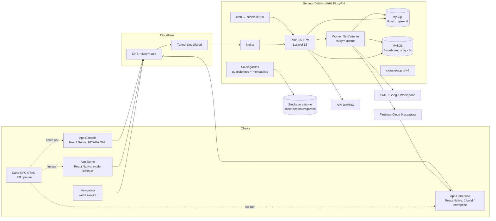

# TRD — Technical Requirements Document — FluxyRH

| | |
|---|---|
| **Produit** | FluxyRH — SIRH SaaS multi-entreprises |
| **Éditeur** | RIYADA ONE TECHNOLOGIES SARL |
| **Version du document** | 1.0 (brouillon) — 2026-10-27 |
| **Lecteurs** | Équipe technique |
| **Statut** | Cible à construire (refonte complète). La stack et les conventions reprennent celles d'UnivPlus (`univplus/docs-reference/UnivPlus_TRD_v1.0.md`), éprouvées en production de démonstration |
| **Documents liés** | PRD (exigences `F-*` / `NF-*`), APPFLOW, UX/UI DESIGN, BACKEND SCHEMA |

---

## Sommaire

1. Objet et périmètre technique
2. Vue d'ensemble de l'architecture
3. Technologies et versions
4. Organisation des dépôts et du code
5. Multi-entreprise (tenancy)
6. Domaines, routage et chaîne des middlewares
7. Authentification, sessions et politique de mot de passe
8. Autorisation : rôle, écran, module, champ
9. Confidentialité et chiffrement des données sensibles
10. Données vérifiables (saisie par le propriétaire)
11. Couche métier : services et cycles de vie
12. Pointage : QR dynamique, carte NFC, bornes
13. Cartes NFC et signature d'actions
14. Moteur de paie
15. Contrats et courriers : clauses, blocs, champs de fusion
16. Intégrations : Jobyflow, export comptable, accès externe aux données
17. API mobile `/api/v1`
18. Applications mobiles (Entreprise, Borne, Console)
19. Notifications, e-mails, push, files d'attente
20. Internationalisation, devise, fuseau horaire
21. Traçabilité et journal d'audit
22. Sécurité
23. Données : conventions de schéma
24. Tests et qualité
25. Environnements, déploiement, sauvegardes et exploitation
26. Pièges connus hérités d'UnivPlus
27. Questions techniques ouvertes
28. Exigences techniques récapitulées

---

## 1. Objet et périmètre technique

Ce document décrit **comment** FluxyRH doit être construit : architecture, technologies, conventions et contraintes que tout développement doit respecter. Il couvre le web, les trois applications mobiles et l'exploitation. Les tables sont détaillées dans le **BACKEND SCHEMA**, les écrans dans l'**APPFLOW** et l'**UX/UI DESIGN**.

Les règles marquées **[OBLIGATOIRE]** sont vérifiées en revue ou par un test ; y déroger demande une décision explicite consignée au JOURNAL du projet.

---

## 2. Vue d'ensemble de l'architecture



**Principes structurants** :

- **Monolithe Laravel** unique pour le web, l'API mobile, l'espace plateforme et la page publique ; pas de micro-services.
- **Deux niveaux de base** : une base générale et une base MySQL par entreprise (§5).
- **Rendu serveur** : Livewire 4 (composants single-file) + Flux UI ; pas de SPA web.
- **Mobile natif** React Native CLI, qui ne parle qu'à l'API REST versionnée `/api/v1`.
- **Tâches longues** (calcul de paie, génération des PDF, e-mails, push, imports Jobyflow) en file d'attente.
- **Serveur dédié** à FluxyRH, isolé d'UnivPlus.

---

## 3. Technologies et versions

Versions de référence : celles d'UnivPlus au 2026-10-27. Elles sont relevées à jour au démarrage du projet.

### 3.1 Web (`FluxyRH-web/app/`)

| Couche | Technologie | Version de référence |
|---|---|---|
| Langage | PHP (extension `intl`, `bcmath` obligatoires) | 8.5 |
| Framework | Laravel | 13.x |
| UI serveur | Livewire (composants single-file `⚡*.blade.php`) | 4.x |
| Composants | Flux UI | 2.x |
| Optimisation Blade | livewire/blaze | 1.x |
| Authentification | Laravel Fortify (2FA TOTP) | 1.x |
| Passkeys | laravel/passkeys | 0.x |
| Jetons API | Laravel Sanctum | 4.x |
| Contrat API | dedoc/scramble | 0.x |
| PDF | barryvdh/laravel-dompdf | 3.x |
| Arabe dans les PDF | khaled.alshamaa/ar-php | 7.x |
| QR code | endroid/qr-code | 6.x |
| Formules de paie | symfony/expression-language | 7.x |
| Assainissement HTML | symfony/html-sanitizer | 7.x |
| Éditeur de texte riche | Tiptap (npm), dans un composant Livewire maison | — |
| Calcul décimal | brick/math (ou `bcmath`) | — |
| Import / export tableur | openspout/openspout ou spatie/simple-excel | — |
| CSS / build | Tailwind CSS 4, Vite | — |
| Graphiques | ApexCharts | 5.x |
| Téléphone international | intl-tel-input | — |
| Base de données | MySQL 8 (production), SQLite (tests) | — |
| Tests / qualité | PHPUnit 12, Larastan, Pint | — |
| Outillage IA | Laravel Boost (MCP + skills) | — |

### 3.2 Mobile (`FluxyRH-mobile/entreprise/`, `borne/`, `console/`)

Pile identique à UnivPlus : React Native CLI (bare), TypeScript strict, React Navigation 7, TanStack Query + persister, openapi-fetch / openapi-react-query, react-native-mmkv (chiffré), react-native-keychain, NetInfo, react-native-nfc-manager, Firebase Messaging (app Entreprise), react-native-config (flavors), i18next, Jest + RNTL, ESLint, Prettier. S'y ajoute un lecteur de QR (`react-native-vision-camera` + scanner de codes) pour l'app Entreprise. L'app Entreprise est construite pour **Android et iOS** (iOS : Core NFC, builds sur un Mac ou un service de build en ligne) ; les apps Borne et Console pour Android seulement.

**[OBLIGATOIRE]** Avant d'utiliser une bibliothèque, consulter sa documentation à jour (MCP `context7` côté mobile, `search-docs` de Boost côté Laravel).

---

## 4. Organisation des dépôts et du code

### 4.1 Dépôts (GitHub privé `riyadaOne`)

Les dépôts sont rangés dans un dossier d'espace de travail `FluxyRH/`, qui n'est pas lui-même un dépôt ; Claude Code est lancé depuis ce dossier. `FluxyRH-web/` et `FluxyRH-mobile/` ne sont pas des dépôts non plus : ce sont des dossiers qui regroupent plusieurs projets, **chacun avec son propre dépôt**.

| Dépôt | Chemin local | Contenu |
|---|---|---|
| fluxyrh-docs | `FluxyRH-docs/` | Orchestration : spécifications (PRD, TRD, APPFLOW, UX/UI, BACKEND SCHEMA), architecture, ROADMAP, recette, livraisons (JOURNAL), exploitation, commercial, originaux de la configuration Claude Code |
| fluxyrh-w-app | `FluxyRH-web/app/` | Application Laravel |
| fluxyrh-m-entreprise | `FluxyRH-mobile/entreprise/` | App de l'entreprise, un flavor par entreprise |
| fluxyrh-m-borne | `FluxyRH-mobile/borne/` | App de borne de site |
| fluxyrh-m-console | `FluxyRH-mobile/console/` | App plateforme (encodage NFC) |
| fluxyrh-marketing | `FluxyRH-marketing/` | Vidéos, carrousels, flyers, présentations |
| — | `_local/` | Fichiers du poste, jamais versionnés |

```
FluxyRH/                       ← espace de travail (pas un dépôt) : on lance « claude » ici
├── CLAUDE.md                  ← importe FluxyRH-docs/CLAUDE.md
├── .mcp.json, .claude/        ← copiés depuis FluxyRH-docs/claude/ par scripts\installer-espace.cmd
├── FluxyRH-docs/
├── FluxyRH-web/               ← dossier de regroupement (pas un dépôt)
│   └── app/                   ← application Laravel
├── FluxyRH-mobile/            ← dossier de regroupement (pas un dépôt)
│   ├── entreprise/
│   ├── borne/
│   └── console/
├── FluxyRH-marketing/
└── _local/
```

Un nouveau projet web ou mobile s'ajoute comme un nouveau sous-dossier avec son dépôt, puis une ligne dans ce tableau. Chaque projet Laravel a son serveur Laravel Boost dans `FluxyRH-docs/claude/mcp.json`.

Les trois apps mobiles utilisent les mêmes bibliothèques et la même organisation du code (§3.2), comme Campus et Console chez UnivPlus. Il n'existe pas de bibliothèque commune : une amélioration de ce code commun faite dans une app est recopiée dans les autres.

### 4.2 Arborescence Laravel (repères)

```
app/
  Enums/General/        rôles plateforme, abonnements, modules…
  Enums/Tenant/         statuts de cycle de vie, permissions (écrans), champs sensibles…
  Models/General/, Models/Tenant/
  Services/             Tenancy/, Platform/, Tenant/, Payroll/, Api/, Push/, Integrations/
  Http/Controllers/Api/ contrôleurs regroupés par espace (Employee, Manager, Hr, Payroll,
                        Direction, Admin, Kiosk, Platform)
  Http/Middleware/
  Support/              Money, CompanyTimezone, FieldAccess, TimeBasedCode…
database/migrations/            base générale
database/migrations/tenant/     bases d'entreprise
resources/views/pages/          composants Livewire single-file
routes/  web.php · platform.php · tenant.php · settings.php · api.php · console.php
lang/{fr,en,ar}/                fichiers PHP par module
deploy/debian/                  scripts du serveur
tests/                          PHPUnit (Feature, Unit)
```

### 4.3 Conventions de code web

- **[OBLIGATOIRE]** Écran de gestion = composant Livewire single-file `⚡nom.blade.php` en liste + modales Flux ; page dédiée seulement pour les écrans complexes (paie, éditeur de contrat).
- **[OBLIGATOIRE]** La logique métier vit dans les **services**, réutilisés par le web et l'API ; un composant ou un contrôleur n'implémente jamais une transition de statut.
- Règles `exists:` toujours qualifiées par la connexion (`exists:tenant.table,col`).
- `vendor/bin/pint --dirty --format agent` après toute modification PHP.

---

## 5. Multi-entreprise (tenancy)

Mécanique identique à UnivPlus.

### 5.1 Deux connexions

| Connexion | Base | Contenu |
|---|---|---|
| `general` (défaut) | `fluxyrh_general` | Identité (`users`), entreprises, rattachements (`user_company`), admins plateforme, plans, abonnements, modules, jetons API (personnes, bornes, intégrations), appareils push, journal plateforme, sessions, jobs, cache, clés de chiffrement des entreprises (enveloppées) |
| `tenant` | `fluxyrh_ent_{slug}` (une par entreprise) | Tout le reste : structure, sites, **bornes**, employés, données vérifiables, cartes NFC, pointages, congés, contrats, paie, documents, journal de l'entreprise. La file des cartes à encoder de la Console est construite en parcourant les entreprises actives |

### 5.2 Résolution par requête

1. `ResolveCompany` lit le **nom d'hôte** (jamais un paramètre de route) et en extrait le slug ; alias de développement acceptés.
2. `TenantConnectionResolver::connectTo($company)` réécrit la base de la connexion `tenant`, purge la connexion, applique le fuseau horaire et **charge la clé de données de l'entreprise** (§9).
3. `CompanyContext` (singleton) expose `current()` et `currentRattachement()`.

### 5.3 Règles **[OBLIGATOIRE]**

- Aucune clé étrangère SQL ni jointure entre les deux bases ; une référence croisée est une colonne `uuid` résolue par une méthode applicative.
- Un job ne transporte jamais un model `tenant` : `companyId` + identifiants scalaires, puis `connectTo()` dans le job.
- Migrations : base générale dans `database/migrations/`, entreprise dans `database/migrations/tenant/`.
- Provisionnement par `CompanyProvisioningService` (étapes idempotentes : base, migrations, clé de données, données techniques, abonnement, modules, invitation du premier admin, journal ; aucune donnée propre à un pays, décision 0002). La commande de provisionnement **efface la base** : uniquement pour une entreprise neuve. Migrations des entreprises existantes par `deploy/debian/migrate-tenants.php`.

---

## 6. Domaines, routage et chaîne des middlewares

### 6.1 Domaines

| Usage | Production | Développement |
|---|---|---|
| Accueil public | `fluxyrh.app` | — |
| Plateforme | `platform.fluxyrh.app` | `platform.fluxyrh.test` |
| Entreprise + API + badge public | `{slug}.fluxyrh.app` | `{slug}.fluxyrh.test`, `{slug}.127.0.0.1.nip.io` |

Configuration : `PLATFORM_DOMAIN`, `TENANT_BASE_DOMAIN`, alias de développement. HTTPS local par mkcert (passkeys).

### 6.2 Chaîne `web`

`SetLocale` → `ResolveCompany` → `SetPasskeysAllowedOrigin` → `CheckCompanyAccess` → `EnforcePasswordPolicy`.

- `CheckCompanyAccess` déconnecte si le rattachement est suspendu, révoqué ou **arrivé à sa date de fin**, ou si l'abonnement n'est pas actif.
- `EnforcePasswordPolicy` redirige vers le changement de mot de passe s'il a expiré selon la politique de l'entreprise.
- `ResolveCompany` est placé avant `auth` (`prependToPriorityList`).
- Alias `module` → `EnsureModule` (404 « module non souscrit »).

### 6.3 Chaîne `api`

`ResolveCompany` → `EnsureSupportedAppVersion` (426) → `auth:sanctum` → `EnsureApiRattachement` (ability `company:{id}`) → `EnsureApiRole` → `EnsureApiPermission` → `module:`.

Espace borne : `ResolveCompany` → `EnsureSupportedAppVersion` → `auth:sanctum` → `EnsureKiosk` (ability `kiosk:{id}`, borne non révoquée). Espace plateforme : `EnsurePlatformHost` → `auth:sanctum` → `EnsurePlatformAdmin`.

---

## 7. Authentification, sessions et politique de mot de passe

### 7.1 Gardes

| Garde | Utilisateurs | Mise en œuvre |
|---|---|---|
| `web` | Personnes rattachées à une entreprise | Fortify (connexion, réinitialisation, 2FA, confirmation) ; inscription publique désactivée |
| `platform` | Admins RIYADA ONE (créés par la commande `fluxyrh:platform-admin`) | Contrôleurs dédiés, 2FA obligatoire en production, passkeys |
| `sanctum` | Apps mobiles et bornes | Jetons personnels (UUID, suppression logique) ; un jeton de borne n'est lié à aucune personne |

**Une identité, plusieurs entreprises** : un `users` par personne, un `user_company` par entreprise (rôle, statut, `access_ends_at` facultatif). L'acceptation d'une invitation distingue un compte neuf d'un compte existant et **crée le dossier employé** (F-EMP-01) dans la même transaction.

### 7.2 Politique de mot de passe (F-ADM-05)

- Paramètres par entreprise : longueur minimale, classes de caractères exigées, expiration en jours, historique des N derniers mots de passe interdits, 2FA imposée par rôle.
- Le mot de passe appartient à l'identité (`users`) mais la politique dépend de l'entreprise : à la connexion dans une entreprise, le mot de passe est contrôlé contre **sa** politique ; s'il n'y est pas conforme ou a expiré, le changement est imposé avant l'accès. Le nouveau mot de passe doit satisfaire la politique la plus stricte parmi les entreprises actives de la personne.
- Hachage des anciens mots de passe pour l'historique (`password_histories`).

### 7.3 Sessions et utilisateurs connectés (F-ADM-06)

- Sessions web en base (`sessions`, base générale) enrichies de `company_id` ; jetons Sanctum avec `last_used_at`.
- La liste des connectés d'une entreprise agrège sessions web actives et jetons mobiles utilisés récemment ; la **déconnexion forcée** supprime la session ou révoque le jeton et journalise l'action.

### 7.4 Expiration des accès

Commande planifiée quotidienne : passe en `Révoqué` les rattachements dont `access_ends_at` est dépassé (`logAsSystem`), révoque leurs jetons. `CheckCompanyAccess` contrôle aussi la date à chaque requête.

### 7.5 Limites de débit

`login`, `two-factor`, `api-login`, `card-login`, `badge-verification` (page publique de la carte, 20/min), `kiosk-pairing`.

---

## 8. Autorisation : rôle, écran, module, champ

Quatre niveaux, évalués côté serveur pour le web **et** l'API :

1. **Rôle** du rattachement courant (`UserCompanyRole` : `admin_entreprise`, `direction`, `rh`, `gestionnaire_paie`, `manager`, `employe`).
2. **Permission d'écran délégable** (`App\Enums\Tenant\Permission`) évaluée par `PermissionService::allows()` : rôles par défaut + délégations de l'entreprise − exclusions nominatives (mécanique UnivPlus).
3. **Module souscrit** (`Permission::requiredModule()`, middleware `module:`). Un module manquant gagne sur toute permission.
4. **Accès par champ** (`FieldAccess`), décrit au §9 : **non délégable**. Aucune délégation d'écran ne donne accès à un champ sensible.

S'y ajoutent des **contrôles de périmètre** dans les services : un manager n'agit que sur son équipe (`TeamScope`, hiérarchie descendante directe et indirecte), un employé que sur lui-même, un vérificateur jamais sur ses propres données.

---

## 9. Confidentialité et chiffrement des données sensibles

### 9.1 Champs sensibles

`App\Enums\Tenant\SensitiveField` liste les champs protégés, regroupés en catégories :

| Catégorie | Exemples | Lecture autorisée |
|---|---|---|
| `remuneration_contractuelle` | Salaire de base et avantages du contrat | Gestionnaire de paie, direction, RH, employé concerné |
| `remuneration_paie` | Rubriques individuelles, bulletins, cumuls, avances, simulations nominatives | Gestionnaire de paie, direction, employé concerné |
| `bancaire` | Banque, titulaire, numéro de compte, RIB, mobile money | Gestionnaire de paie, direction, employé concerné |

L'admin entreprise n'a **jamais** accès à ces catégories (P6). La matrice est **codée** (enum + `FieldAccess::canRead/canWrite`), pas paramétrable par l'entreprise.

### 9.2 Contrôle applicatif **[OBLIGATOIRE]**

- Toute lecture d'un champ sensible passe par `FieldAccess` : composants Livewire, ressources API (`when(FieldAccess::canRead(...))`), exports, rapports, états personnalisés, champs de fusion des contrats et courriers, notifications, journal d'audit.
- Les agrégats (masse salariale par structure) ne sont visibles que des rôles autorisés sur `remuneration_paie`.
- **Test de non-fuite** : pour chaque écran, export et point d'API, un test vérifie qu'un admin entreprise et un RH (pour `remuneration_paie` et `bancaire`) n'obtiennent aucune valeur sensible.

### 9.3 Chiffrement au repos

- **Clé de données par entreprise** (DEK, AES-256-GCM) générée au provisionnement, stockée dans la base générale **enveloppée** par une clé maître (`FLUXYRH_MASTER_KEY`, hors base, hors dépôt).
- Les colonnes sensibles sont chiffrées par un cast Eloquent dédié (`EncryptedWithCompanyKey`) ; un accès direct à la base ne révèle aucun montant ni coordonnée bancaire.
- Conséquences **[OBLIGATOIRE]** : aucune agrégation, tri ou filtre SQL sur une colonne chiffrée ; les sommes et comparaisons se font dans les services, en PHP, sur des valeurs déchiffrées. Volume visé (≤ quelques milliers d'employés par entreprise) compatible avec ce choix.
- Rotation de la clé maître : ré-enveloppement des DEK sans rechiffrer les données ; rotation d'une DEK : job de rechiffrement.
- Les sauvegardes contiennent les colonnes chiffrées et les DEK enveloppées ; la clé maître est sauvegardée **séparément**.

### 9.4 Journal des consultations

Toute consultation d'un dossier sensible (bulletin, coordonnées bancaires, simulation nominative) est journalisée (qui, quoi, quand), consultable par la direction.

---

## 10. Données vérifiables (saisie par le propriétaire)

### 10.1 Principe

Les données du dossier saisies par l'employé (état civil, coordonnées, pièces, diplômes, banque…) suivent `À vérifier` → `Vérifiée` / `Rejetée`. Toute modification crée une **nouvelle version** `À vérifier` ; la dernière version `Vérifiée` reste la **valeur en vigueur** (P3).

### 10.2 Mise en œuvre

- Chaque donnée vérifiable est un enregistrement **versionné** dans une table dédiée à sa nature (ex. `employee_identity_versions`, `employee_bank_account_versions`, `employee_documents`) : valeur(s), statut, justificatif(s), auteur, vérificateur, date, motif de rejet. Pas de table générique clé/valeur ni de JSON (T-06).
- Le dossier pointe vers la **version en vigueur** de chaque donnée (pointeurs `current_*_version_id`, Backend Schema §5.4), mise à jour uniquement par `VerifiableDataService::verify()`.
- `VerifiableDataService` : `submit()` (propriétaire), `verify()` / `reject()` (vérificateur habilité, jamais le propriétaire lui-même), notifications, journal. Le vérificateur dépend de la nature et du propriétaire : RH en général, gestionnaire de paie pour la banque, **direction** pour les données d'un RH (sa banque reste vérifiée par le gestionnaire de paie) et pour la banque d'un gestionnaire de paie.
- La paie, les contrats, les documents et les rapports lisent **toujours** la version en vigueur.
- `CompletenessService` calcule la complétude à partir des pièces obligatoires configurées par type d'employé (F-EMP-09) et expose `isComplete()` utilisé par les services de congés et de formulaires types (et affiché comme signalement dans le suivi des paiements).

---

## 11. Couche métier : services et cycles de vie

### 11.1 Services principaux (`app/Services/Tenant`, `app/Services/Payroll`)

| Domaine | Services |
|---|---|
| Plateforme | `CompanyService`, `CompanyProvisioningService`, `SubscriptionService`, `SubscriptionPricingService`, `CompanyModuleService`, `InvoiceService` |
| Accès et organisation | `InvitationService`, `RattachementService`, `OrganizationService`, `SiteService`, `KioskService`, `PermissionService`, `FieldAccess`, `PasswordPolicyService` |
| Dossier | `EmployeeService` (matricule, cycle), `VerifiableDataService`, `CompletenessService`, `EmployeeDocumentService` |
| Cartes | `NfcCardService`, `CardLoginService`, `ActionSignatureService`, `BadgeVerificationService` |
| Temps | `WorkScheduleService`, `ClockingService`, `TimeBasedCode`, `AttendanceComputationService`, `OvertimeService` |
| Congés | `LeaveService` (solde calculé à la volée), `HolidayService` |
| Contrats et courriers | `ClauseLibraryService`, `ContractService`, `MergeFieldResolver`, `DocumentRenderer`, `LetterCampaignService` |
| Paie | `PayrollParameterService` (versions), `PayrollEngine`, `PayrollPeriodService`, `PayslipService`, `AdvanceLoanService`, `PaymentRecordService`, `PayrollReportService` |
| Modules | `PayrollSimulationService`, `CompensationModelService` ; `HrEventService`, `WorkflowService`, `FormRequestService` ; `EvaluationService`, `SkillService`, `JobyflowImportService` ; `DeclarationService`, `AccountingExportService` ; `DashboardWidgetService`, `ReportingService`, `CustomReportService`, `DataAccessService` |
| Transverses | `NotificationCenterService`, `AnnouncementService`, `ActivityLogger`, `HelpCenterService` |

### 11.2 Règles des cycles de vie **[OBLIGATOIRE]**

- Chaque statut est un **enum PHP adossé à une chaîne**, stocké tel quel.
- Une transition = une méthode de service qui vérifie l'état de départ, le rôle / la permission / le champ / le périmètre, les préconditions (complétude, période clôturée…), écrit en transaction, journalise, puis notifie.
- Les **transitions interdites** sont testées.
- Les actions automatiques passent par `ActivityLogger::logAsSystem()`.

---

## 12. Pointage : QR dynamique, carte NFC, bornes

### 12.1 QR dynamique (F-ORG-03, F-TPS-02)

- Chaque borne possède **sa propre clé** (`kiosks.secret`, 256 bits) reçue à l'appairage et conservée dans le Keystore de l'appareil ; côté serveur, elle est chiffrée avec la DEK de l'entreprise.
- Le code est un **code temporel signé** (principe TOTP, RFC 6238) : `code = HMAC-SHA256(kiosk_secret, step)` tronqué, avec `step = floor(epoch / pas)`, pas réglé par l'entreprise (30 s par défaut).
- Le QR encode : `fluxyrh://clock?k={kiosk_id}&s={step}&c={code}`. Il est régénéré à chaque pas, sans réseau.
- Vérification serveur (`TimeBasedCode::verify`) : recalcul du HMAC pour `step` ; en ligne, tolérance de ±1 pas autour de l'heure serveur ; hors ligne, voir 12.4.
- **Anti-rejeu** : unicité `(employé, borne, step)` ; un même code ne vaut qu'un pointage par employé.

### 12.2 Deux parcours

| Parcours | Étapes | Preuves enregistrées |
|---|---|---|
| **Téléphone de l'employé** (app Entreprise, Android ou iPhone) | Scan du QR de la borne → lecture de **sa** carte NFC sur son téléphone → envoi | Code QR (borne, pas), identifiant de carte, identifiant de l'appareil, horodatages |
| **Borne** (app Borne) | L'employé pose sa carte sur la borne ; la borne connaît son propre code courant | Borne, pas, identifiant de carte |

Dans les deux cas, la carte doit être `Active` et appartenir à l'employé ; dans le parcours téléphone, l'appareil doit être enregistré au nom de l'employé.

**Sens du pointage** : `Entrée` ou `Sortie` est déduit automatiquement (alternance sur la journée, selon le dernier pointage connu de l'appareil ou du serveur). L'écran de confirmation propose « Inverser » pendant une **durée réglée par l'entreprise** (`clocking_settings.direction_inversion_seconds`, transmise aux apps et aux bornes) ; c'est la seule modification permise d'un pointage, tracée dans `direction_inverted_at` et journalisée. Au-delà, seule la correction motivée du manager s'applique (F-TPS-05), dans le délai réglé par l'entreprise.

**Journée de rattachement** : un pointage appartient à la journée planifiée dont la fenêtre le contient (de X minutes avant le début prévu à Y minutes après la fin prévue, réglés par l'entreprise, dans le fuseau du site) ; une journée qui passe minuit porte la mention « travail de nuit ».

**Pointage de secours** (F-TPS-08) : sur la borne, « Je n'ai pas ma carte » → matricule → photo prise par la borne → pointage `a_valider`, compté seulement après la validation du manager ; nombre maximal par employé et par mois réglé par l'entreprise.

### 12.3 Calculs

`AttendanceComputationService` rattache chaque pointage au planning applicable (employé > site > structure) et calcule heures travaillées, retard, départ anticipé, demi-journée (activation et seuils réglés par l'entreprise) et absence. **Les heures supplémentaires ne sont jamais déduites automatiquement** : le temps au-delà du planning n'est compté que pour une heure sup **établie à l'avance par le manager** (F-TPS-06) ; le système calcule alors les minutes réellement faites, dans la limite de ce qui a été établi, découpées selon les règles de l'entreprise, puis le RH valide.

### 12.4 Hors ligne (F-TPS-03, F-ORG-06)

- La borne et l'app Entreprise stockent les pointages dans une file chiffrée (MMKV) ; chaque pointage porte `captured_at` (horloge de l'appareil) et l'envoi porte `sent_at`.
- Le serveur **corrige l'horloge** : `heure réelle = captured_at + (heure serveur à réception − sent_at)`, puis vérifie le code pour le pas correspondant (tolérance ±2 pas hors ligne).
- Un pointage reçu au-delà de la fenêtre configurée (48 h par défaut) ou sur une période de paie clôturée est **refusé avec motif** et visible par le manager, qui peut saisir une correction motivée.
- Les envois sont des **créations idempotentes** identifiées par un UUID généré sur l'appareil.

### 12.5 Gestion des bornes

Une **application Borne unique** (une seule fiche store), qui s'appaire à n'importe quelle entreprise. Toute la sécurité repose sur l'appairage et sur des clés propres à chaque borne.

**Appairage sécurisé** :

1. L'admin entreprise crée la borne dans l'écran « Bornes » (nom, site) ; le serveur génère un **jeton d'appairage** à usage unique, valable **10 minutes**, affiché en QR. Il contient l'URL de l'entreprise (`https://{slug}.fluxyrh.app`), l'identifiant de la borne et le jeton.
2. La borne neuve génère localement **deux paires de clés** dans le Keystore Android (non exportables, matérielles si disponible) : ECDSA P-256 pour signer ses requêtes, RSA-OAEP 2048 pour recevoir sa clé HMAC ; puis elle scanne le QR.
3. La borne envoie en **HTTPS uniquement** (certificat épinglé sur `*.fluxyrh.app`) : jeton d'appairage, clé publique, empreinte de l'appareil (modèle, version Android, identifiant d'installation).
4. Le serveur vérifie le jeton (non expiré, non utilisé, borne `En attente`), enregistre la clé publique, puis renvoie le jeton Sanctum `kiosk:{id}` et la **clé HMAC de la borne, chiffrée pour elle seule** (chiffrement hybride avec la clé publique de la borne). Le jeton d'appairage est consommé.
5. La borne passe `Active` ; l'admin voit l'appareil appairé et peut le renommer.

**Fonctionnement** :

- Chaque requête de la borne est authentifiée par le jeton Sanctum **et signée** par sa clé privée (en-tête de signature sur le corps et l'horodatage) : un jeton volé sans l'appareil est inutilisable.
- Les pointages en file locale sont chiffrés (MMKV, clé dans le Keystore) et signés par la borne.
- **Battement de cœur** toutes les 5 minutes quand le réseau est disponible : version de l'app, niveau de batterie, nombre de pointages en attente, dérive d'horloge mesurée. Une borne silencieuse depuis un délai paramétrable déclenche une alerte à l'admin.
- **Configuration** (`/kiosk/config`) : entreprise, site, fuseau, pas du code, durée d'inversion, empreinte du code de sortie, son, et liste des cartes actives des employés autorisés sur le site (empreinte, nom, photo), gardée chiffrée pour confirmer un pointage hors ligne ; le serveur reste seul juge à la réception.
- **Renouvellement de la clé HMAC** : la nouvelle clé est livrée au signal de vie suivant, chiffrée pour la borne ; l'ancienne reste acceptée pour les pointages capturés avant, dans la fenêtre hors ligne.
- Mode kiosque Android : l'app est installée comme **propriétaire de l'appareil** (Device Owner, commande `adb` de la procédure d'installation) avec `startLockTask`, application de lancement, plein écran, écran toujours allumé, redémarrage automatique ; sortie protégée par un **code choisi par l'admin pour chaque borne** (stocké haché) ; aucune session personnelle. Version Android minimale : la plus basse qui prend en charge toutes ces fonctions.

**Cycle de vie** : `En attente d'appairage` → `Active` → `Suspendue` (temporaire) → `Révoquée`. La révocation invalide le jeton, la clé publique et la clé HMAC de cette borne ; les autres bornes du site, qui ont chacune leur propre clé, ne sont pas affectées. Les pointages signés par une borne révoquée et reçus après sa révocation sont refusés, sauf s'ils ont été capturés avant la révocation et sont validés par le manager.

**Écran « Bornes »** (admin entreprise) : liste par site, état, dernier signal, version, pointages en attente, actions (appairer, renommer, suspendre, révoquer, renouveler la clé). Toutes les actions sont journalisées.

---

## 13. Cartes NFC et signature d'actions

- **Support** : NFC Forum Type 2 (NTAG213/215/216). **Contenu** : un enregistrement NDEF URI `https://{slug}.fluxyrh.app/badge/{identifiant_opaque}` ; aucune donnée métier sur la puce.
- **Identifiant** : 128 bits aléatoires, générés à la réservation et renvoyés une seule fois à la Console ; en base, seule son **empreinte** (`identifier_hash`, HMAC-SHA256 avec une clé dérivée de la clé de l'entreprise) est stockée, pour retrouver la carte.
- **Encodage** dans l'app Console : réservation → écriture + relecture → confirmation (`Encodée`) → **verrouillage** de la puce, définitif, avec confirmation.
- **Page publique** `/badge/{identifiant}` (F-NFC-03) : `En poste` / `Plus en poste` (employé sorti) / `Inconnue` (carte inconnue ou désactivée), nom, photo, poste ; `noindex`, 20/min, journalisée.
- **Accès rapide** (F-NFC-04) : l'API renvoie le dossier filtré par `PermissionService` et `FieldAccess` de la personne qui scanne.
- **PIN** : un seul PIN par carte (`nfc_cards.pin_hash`), choisi à l'activation, sur le téléphone ou la borne.
- **Connexion carte + PIN** (F-NFC-05) : activée par chaque utilisateur pour ses appareils ; appareil enregistré, 5 essais, révocation à la désactivation de la carte.
- **Signature d'actions** (F-NFC-06) : `ActionSignatureService::sign(action, subject, method, proof, documentHash)` enregistre une `action_signature` (signataire, **moyen**, carte ou appareil ou borne, horodatage serveur, **empreinte SHA-256 du document signé**). Moyens : `carte` (app ou borne), `mot_de_passe` (web), `appareil` (code ou biométrie du téléphone enregistré). Le **pointage exige toujours la carte**. Le PDF d'un contrat signé est figé (fichier immuable + empreinte) ; toute modification ultérieure passe par un avenant.

---

## 14. Moteur de paie

### 14.1 Paramétrage versionné (F-PAY-01 à 03)

- **Rubriques** : code, libellé (3 langues), nature (`gain`, `cotisation`, `impot`, `retenue`, `information`) et payeur (`salarie`, `employeur`), ordre de calcul, indicateurs (imposable, soumis à cotisation, apparaît sur le bulletin), compte comptable (module Conformité).
- **Modes de calcul** : `fixe`, `pourcentage` (taux × base nommée, plafond / plancher), `bareme` (tranches progressives ou par paliers, base annualisée ou non), `formule`.
- **Versions** : chaque modification crée une **version du paramétrage** avec date d'effet ; une période de paie se calcule avec la version en vigueur à sa date et la **référence** ; les bulletins passés ne changent jamais.
- **Aucun paramétrage de pays livré** (décision 0002) : chaque entreprise saisit le sien ; l'exemple tchadien de l'annexe 14.3 du PRD n'est qu'un seeder de démonstration et de test, sans aucun taux dans le code.

### 14.2 Formules

- Évaluées par **Symfony ExpressionLanguage** dans un environnement restreint : variables nommées en lecture seule et fonctions autorisées (`min`, `max`, `arrondi`, `si`, `annuel`, `mensuel`) ; aucune fonction PHP, aucun accès aux objets.
- Variables disponibles (liste extensible, documentée dans l'aide) : `SALAIRE_BASE`, `BRUT`, `BRUT_COTISABLE`, `IMPOSABLE`, `JOURS_OUVRES`, `JOURS_TRAVAILLES`, `HEURES_SUP_<taux>`, `ANCIENNETE_ANNEES`, `ENFANTS_A_CHARGE`, `TYPE_EMPLOYE`, et le résultat de toute rubrique déjà calculée (`R_<CODE>`).
- Validation à l'enregistrement : syntaxe, variables connues, **absence de dépendance circulaire** (graphe des rubriques trié topologiquement).
- Prévisualisation : calcul de la formule sur un employé de test avant activation.

### 14.3 Calcul d'une période (F-PAY-05)

1. Préconditions : période `Variables validées`, checklist bloquante complète.
2. `PayrollEngine::compute(period)` en **job** par lots d'employés, avec progression visible ; objectif < 1 min pour 200 employés (NF-11).
3. Pour chaque employé : contrat actif (salaire de base), rubriques fixes de l'employé, variables de la période (présences, absences, heures sup validées, événements, avances), application des rubriques dans l'ordre topologique, **arithmétique décimale** (jamais de flottant), règles d'arrondi paramétrées.
4. Le bulletin stocke **toutes ses lignes** (base, taux, montant, part salariale / patronale) et la version du paramétrage : il est reproductible et ne dépend plus du paramétrage ensuite.
5. Recalcul possible tant que la période n'est pas `Approuvée` ; la clôture fige la période (P12).

### 14.4 Tests de paie **[OBLIGATOIRE]**

Jeux de cas chiffrés de référence (« bulletins dorés »), calculés sur un paramétrage de test (décision 0002), couvrant : plafond d'une cotisation, chaque tranche d'un impôt par barème, heures sup, absences, avance en remboursement, entrée et sortie en cours de mois, temps partiel. Toute modification du moteur doit les faire passer.

---

## 15. Contrats et courriers : blocs, champs de fusion

- **Bibliothèque de blocs** (F-CTR-01, F-PRO-03) : bloc = titre + texte riche + champs de fusion, **dans la langue officielle de l'entreprise**, versionné (brouillon modifiable, version publiée figée) ; catégorie ; **règles de proposition** (nature de contrat, type d'employé, inséré d'office ou seulement proposé). Aucun bloc n'est livré par défaut.
- **Rédaction** : à partir de la nature du contrat et du type d'employé, les blocs présélectionnés sont insérés et les autres proposés ; le RH réordonne, retire, ajoute n'importe quel bloc ou un **bloc libre** (qu'il peut enregistrer dans la bibliothèque). Le contrat stocke une **copie** du texte de chaque bloc, avec ses champs `{{…}}` non résolus ; les valeurs sont **figées** à l'envoi pour signature dans `contract_merge_values` (sensibles chiffrées) et résolues à l'affichage selon les droits du lecteur. Le PDF signé, lui, contient les valeurs.
- **Signature** : le RH choisit les signataires et leur ordre (l'employé et un ou plusieurs signataires de l'entreprise) ; le PDF à signer est figé à l'envoi ; le contrat reste modifiable en `À signer`, chaque modification créant une nouvelle version du PDF à signer (`contract_signing_versions`) et annulant les signatures déjà faites ; copies papier imprimées pour la signature manuscrite **et** signature de chacun dans le système (§13) ; à la dernière signature, PDF final figé avec le bloc des signataires.
- **Champs de fusion** `{{employe.nom}}`, `{{contrat.salaire_base}}`, `{{entreprise.raison_sociale}}`… : liste fermée déclarée dans `MergeFieldRegistry` ; `MergeFieldResolver` applique `FieldAccess` (un champ sensible est refusé à l'enregistrement d'un texte si l'auteur n'y a pas droit, et n'est jamais résolu pour un lecteur non autorisé).
- Éditeur web : **Tiptap** dans un composant Livewire maison (pas de licence Flux Pro), texte riche limité (gras, italique, listes, titres, tableaux simples) avec insertion des champs ; HTML assaini côté serveur (`symfony/html-sanitizer`, liste blanche de balises).
- **Rendu** : HTML → dompdf par `DocumentRenderer`, en-tête de l'entreprise, arabe par ar-php. Courriers en masse : un job par lot, un PDF par destinataire, **lien** envoyé par e-mail (jamais le PDF en pièce jointe), dépôt dans l'espace de l'employé ; signature de la direction avant l'envoi quand le modèle l'exige.

**Charte des documents (F-IDN, module Identité)**

- Un seul point de rendu : `DocumentRenderer` reçoit le type de document et ses données, demande la charte à `DocumentBrandingService::current()` et produit le PDF. Aucun gabarit de document ne choisit lui-même ses couleurs ni son en-tête.
- Sans module `identite` (ou sans version active), la charte est **neutre** ; le module coupé, les réglages restent en base mais ne s'appliquent plus.
- Les 12 modèles sont des gabarits Blade versionnés dans le code (`resources/views/documents/brands/{template}`) : en-tête, pied, titres, tableaux, bloc des signataires. Chaque modèle est livré pour les trois langues, arabe compris (RTL, ar-php).
- La **palette** est déclarée dans `config/branding.php` (code → hexadécimal) ; chaque couleur est testée en contraste (≥ 4,5:1 sur blanc) et en impression en niveaux de gris. dompdf ne lit pas les variables CSS : les valeurs sont injectées dans le gabarit au rendu.
- **Cachet** et **signature** : fichiers sur le disque privé, chiffrés avec la DEK de l'entreprise, PNG ou SVG assaini, taille limitée. La signature n'est déposée que par son propriétaire (direction) et `DocumentRenderer` ne l'appose que si le document porte une `action_signatures` de cette personne. Le cachet est apposé sur les contrats, avenants, attestations et courriers.
- **Filigrane** : logo ou mention, en opacité réduite, sous le texte.
- Chaque PDF enregistre `document_branding_version_id` ; il est figé avec son empreinte (T-13) et n'est jamais régénéré avec une autre charte.
- **E-mails** : layout Markdown de Laravel surchargé par la charte (logo, couleur du bouton et du filet, pied de page) ; texte brut toujours joint.
- **Aperçu** : l'écran de charte génère à la volée un bulletin, un contrat, une attestation et un e-mail fictifs avec la version en brouillon, sans les enregistrer.

---

## 16. Intégrations

### 16.1 Jobyflow (F-TAL-04)

- **FluxyRH tire** : le RH lance « Importer depuis Jobyflow », choisit les candidats retenus, puis complète l'affectation avant l'invitation.
- Connexion par entreprise : URL et clé d'API Jobyflow saisies par l'admin, chiffrées avec la DEK.
- `JobyflowClient` (HTTP, délai, nouvelles tentatives) ; `JobyflowImportService` crée des **invitations en brouillon** pré-remplies ; les données importées sont proposées en brouillon dans l'assistant de complétion, et c'est l'employé qui les soumet (P1, P2).
- **Jobyflow n'est pas encore développé** : c'est FluxyRH qui fixe le contrat d'interface que Jobyflow devra exposer. Contrat attendu (v1) :
  - authentification : clé d'API par entreprise, en-tête `Authorization: Bearer` ;
  - `GET /api/v1/hired-candidates?since={date}&status=retained` : liste paginée des candidats retenus ;
  - champs par candidat : identifiant Jobyflow, nom, prénoms, e-mail, téléphone, date de naissance, poste retenu, date d'embauche prévue, type de contrat prévu, pièces (URL signée, type, nom de fichier) ;
  - `POST /api/v1/hired-candidates/{id}/imported` : accusé d'import (identifiant FluxyRH), pour ne pas réimporter.
- Le client est développé derrière une interface (`RecruitmentSource`) avec un faux fournisseur pour les tests, en attendant Jobyflow.

### 16.2 Export comptable (F-CNF-04)

- Écritures générées depuis une période **clôturée** : correspondance rubrique → compte (plan comptable saisi ou importé par l'entreprise, SYSCOHADA ou autre), journal, sens, regroupement par compte ou par employé.
- Formats : **générique** (CSV et XLSX : journal, date, compte, libellé, débit, crédit, référence) et **Sage**. Produit retenu : **Sage 100 Comptabilité** ; l'export est conçu comme un **adaptateur** (`AccountingExportFormat`) pour ajouter un format sans toucher à la génération des écritures. Chaque export est journalisé et rejouable.

### 16.3 Paiements (F-PAY-08)

- Les paiements (virements, espèces, mobile money) se font **hors de FluxyRH** : aucun ordre ni fichier de virement n'est produit.
- Le gestionnaire de paie enregistre le résultat de chaque paiement (`paye` / `echec`, moyen, date, référence), un par un ou en groupe ; l'écran lui montre le net et le compte principal vérifié de chaque employé, et signale les dossiers incomplets et les comptes non vérifiés.
- L'export de la liste des paiements est réservé aux rôles autorisés sur la catégorie `bancaire` et journalisé.

### 16.4 Accès externe aux données (F-PIL-04)

- **Jetons d'intégration** par entreprise (Sanctum, ability `data:read`, liste de jeux de données autorisés, expiration), créés par l'admin entreprise.
- API de lecture paginée `/api/v1/data/{dataset}` ; les jeux de données contenant des champs sensibles exigent un jeton créé par un rôle autorisé (gestionnaire de paie, direction) et restent soumis à `FieldAccess`.

---

## 17. API mobile `/api/v1`

### 17.1 Organisation

| Préfixe | Garde | Exemples |
|---|---|---|
| `/login`, `/card-login`, `/me`, `/logout`, `/me/locale`, `/push-devices` | public limité / sanctum | connexion (2FA → 422 `two_factor`), carte + PIN, profil avec permissions, modules et droits par champ |
| `/employee/*` | tout rattachement | dossier et versions, pièces, pointage, congés, bulletins, contrat, signatures, avances, formulaires, annonces |
| `/manager/*` | rôle `manager` | équipe, validations de congés, corrections de pointage, heures sup, événements, évaluations |
| `/hr/*` | rôle `rh` + permission | vérifications, invitations, congés, heures sup, contrats, variables de paie |
| `/payroll/*` | rôle `gestionnaire_paie` + permission | vérification bancaire, contrôle de période, avances |
| `/direction/*` | rôle `direction` | tableau de bord, approbations (paie, contrats, avances) |
| `/admin/*` | rôle `admin_entreprise` | utilisateurs, invitations, bornes, cartes, journal, connectés |
| `/kiosk/*` | borne (`kiosk:{id}`) | appairage, configuration (dont la liste des cartes du site), envoi de pointages, pointages de secours, activation de carte, signal de vie |
| `/badge-link/{identifier}` | dans l'espace de chaque rôle | carte qui ouvre l'app |
| `/data/*` | jeton d'intégration | accès externe (module Pilotage) |
| `/platform/*` | admin plateforme (Console) | indicateurs, entreprises, factures, journal, file des cartes, encodage |

### 17.2 Contrat typé et versions **[OBLIGATOIRE]**

- Scramble décrit l'API ; `php artisan api:contract` écrit le `openapi.json` de chaque app ; `npm run api:sync` génère les types ; un test échoue si le contrat n'est pas à jour.
- On ne casse jamais `v1`. `X-App-Id` et `X-App-Version` obligatoires (426 sous le minimum de chaque app, défini en configuration). Langue de réponse par `Accept-Language`.

---

## 18. Applications mobiles

### 18.1 Trois applications

| | Entreprise | Borne | Console |
|---|---|---|---|
| Public | Les 6 rôles de l'entreprise | Appareil partagé d'un site | Admins RIYADA ONE |
| Plateformes | Android et iOS | Android | Android |
| Builds | Un flavor par entreprise (marque blanche) | Une seule app, appairée de façon sécurisée à une entreprise et un site (§12.5) | Une seule app |
| API | `https://{slug}.fluxyrh.app/api/v1` | idem, espace `/kiosk` | `https://platform.fluxyrh.app/api/v1/platform` |
| NFC | Lecture (pointage, accès rapide, signature) | Lecture | Écriture (encodage) |
| Hors ligne | Pointage, consultation, demandes | Pointage | Non |

### 18.2 Organisation et données

- Arborescence `src/app`, `src/shared`, `src/features/<fonctionnalité>`, imports par alias, frontières vérifiées par ESLint (conventions UnivPlus).
- TanStack Query branché sur NetInfo ; cache persistant **chiffré** (MMKV AES-256, clé dans le Keystore), durée de vie 7 jours, effacé à la déconnexion.
- **Mutations hors ligne** (app Entreprise) : pointage, demande de congé, saisie d'une donnée du dossier, demande d'avance, demande de formulaire ; chacune porte un UUID client (création idempotente) et `captured_at` / `sent_at` ; refus motivés affichés dans une file visible.
- Pièces justificatives : photo ou fichier compressé, mis en file avec la saisie.
- Verrouillage de l'app par biométrie ou code du téléphone ; version minimale imposée par le serveur.

### 18.3 Natif Android et iOS

- Filtres d'intention `NDEF_DISCOVERED` et `VIEW` (`autoVerify`) sur l'URI de badge ; `/.well-known/assetlinks.json` servi par chaque entreprise.
- Borne : application propriétaire de l'appareil (Device Owner) + `startLockTask`, écran toujours allumé, redémarrage automatique.
- iOS (app Entreprise) : Core NFC (lecture NDEF, iPhone 7 et plus récents) ; Universal Links (`/.well-known/apple-app-site-association` servi par chaque entreprise) ; Face ID ; builds sur un Mac ou un service de build en ligne ; publication depuis le compte Apple Developer de RIYADA ONE.
- Signature release : clés hors dépôt ; build Windows depuis un chemin court (limite des 260 caractères).

### 18.4 Qualité mobile

`npm run check` = `tsc --noEmit` + ESLint + Prettier + Jest ; test i18n qui échoue sur une clé manquante ou un texte en dur.

---

## 19. Notifications, e-mails, push, files d'attente

| Canal | Mise en œuvre |
|---|---|
| In-app | `NotificationCenterService::send()` : point d'entrée unique (cloche web, écran mobile) |
| Push | Job `SendPushNotification` après commit ; API FCM HTTP v1 sans SDK ; `push_devices` liés au jeton Sanctum ; un projet Firebase par app d'entreprise (Android, et iOS via APNs), compte de service déposé chiffré sur la fiche de l'entreprise |
| E-mail | Notifications Laravel en file ; SMTP Google Workspace depuis `no-reply@fluxyrh.app` (SPF, DKIM, DMARC) ; langue officielle de l'entreprise |
| Relances | Commande planifiée quotidienne : dossiers incomplets, données à vérifier, contrats à échéance, pièces expirées |

**[OBLIGATOIRE]** Une notification ou un e-mail ne contient **aucune valeur sensible** (§9) : il renvoie vers l'écran.

File : `QUEUE_CONNECTION=database`, worker systemd `fluxyrh-queue`. Cache et sessions en base. Planification : `cron` → `schedule:run`.

---

## 20. Internationalisation, devise, fuseau horaire

- **Langues** fr, en, ar ; fichiers PHP par module `lang/{locale}/{module}.php`, notation `__('module.key')` ; les trois langues livrées ensemble ; `dir="rtl"` pour l'arabe.
- **Langue officielle** de l'entreprise pour les documents, e-mails et push ; journal stocké en trois langues.
- **Devise** : `companies.currency_code` (ISO 4217, choisie à la création, sans valeur par défaut), verrouillée dès la première rubrique de paie ; colonnes `amount*` décimales sans suffixe ; `App\Support\Money` pour tout affichage (montant en lettres sur le bulletin) ; aucune conversion. Les prix de la plateforme restent en FCFA.
- **Fuseau** : plateforme en UTC ; `companies.timezone` (choisi à la création, sans valeur par défaut) appliqué dans `connectTo()` ; chaque site peut avoir son fuseau pour le calcul des pointages.
- **Données créées par le système** (types par défaut, listes de départ, modèles du module Processus RH) : libellées dans la langue officielle de l'entreprise, à partir des fichiers de langue (décision 0002).
- `Date::use(CarbonImmutable::class)` : toujours réaffecter.

---

## 21. Traçabilité et journal d'audit

- `ActivityLogger::log(action, subject, 'activity.key', params, before:, after:)` écrit dans `activity_logs` de l'entreprise, avec valeurs avant / après, IP, appareil ; miroir dans le journal plateforme **sans** les valeurs.
- Les valeurs avant / après d'un champ sensible sont stockées **chiffrées** et affichées selon `FieldAccess`.
- `logAsSystem()` : auteur nul, affiché « Système ».
- **[OBLIGATOIRE]** Journaliser : invitation et rattachement, vérification / rejet de donnée, pointage et correction, décision de congé et d'heures sup, contrat et signature, paramétrage de paie, transitions de période, bulletins, avances, exports, consultations sensibles (§9.4), changements de configuration, de droits et de modules, connexions et déconnexions forcées.
- Le journal n'est ni modifiable ni supprimable (pas de suppression logique sur `activity_logs`).

---

## 22. Sécurité

| Sujet | Mesure |
|---|---|
| Cloisonnement | Base par entreprise ; jeton API lié à une entreprise |
| Comptes | Invitation signée, pas d'inscription publique, 2FA, passkeys, politique de mot de passe par entreprise, expiration des accès |
| Données sensibles | Contrôle par champ + chiffrement au repos par entreprise, clé maître hors base |
| Pointage | Code temporel signé, carte obligatoire, anti-rejeu, correction d'horloge, fenêtre bornée |
| Mobile | Jetons et clés dans le Keystore, cache chiffré, verrouillage biométrique, HTTP en clair seulement en debug |
| Cartes | Identifiant opaque révocable, puce verrouillable, PIN haché |
| Documents signés | PDF figé + empreinte SHA-256 |
| Formules de paie | Évaluateur restreint, aucune exécution de code |
| Contenu riche | HTML assaini (liste blanche) |
| Pages publiques | Limites de débit, `noindex`, aucune donnée sensible |
| Fichiers | Disque privé, téléchargements autorisés seulement |
| Accès serveur | SSH via Cloudflare Access uniquement |
| Secrets | `.env`, clé maître, clés Firebase, keystores, SMTP, clés Jobyflow : hors dépôt |

---

## 23. Données : conventions de schéma **[OBLIGATOIRE]**

- Clé primaire **UUID v7** partout ; jamais d'auto-incrément.
- **Suppression logique** sur toutes les tables (sauf `activity_logs` et les tables techniques), corbeille restaurable.
- **Pas de colonne JSON** pour des données structurées.
- `$fillable` obligatoire, jamais `$guarded = []`.
- Montants en `decimal(15,2)` (ou `text` chiffré pour les colonnes sensibles), jamais `float`.
- Contraintes et index nommés explicitement au-delà de 64 caractères.
- Unicité + suppression logique : restaurer plutôt que recréer.
- Factories des models d'entreprise dans `database/factories/Tenant/`.

Détail des tables : **BACKEND SCHEMA**.

---

## 24. Tests et qualité

- **PHPUnit 12** ; base générale en SQLite, base d'entreprise en fichier SQLite temporaire ; helpers `InteractsWithCompanies` (`createActiveCompany()`).
- `CompanyFactory` crée une entreprise avec tous les modules ; `withoutModules()` pour tester une fermeture.
- Couverture attendue par fonctionnalité : chemin nominal ; refus (rôle, permission, module, **champ sensible**, périmètre d'équipe, autre entreprise, version d'app) ; transitions interdites ; cas limites (période clôturée, dossier incomplet, carte désactivée, borne révoquée, pointage hors fenêtre).
- Suites dédiées : **non-fuite des champs sensibles** (§9.2), **bulletins dorés** (§14.4), **codes temporels** (pas limites, horloge décalée, rejeu).
- Vérification sur MySQL des points invisibles en SQLite (longueur d'identifiants, provisionnement).
- Mobile : `npm run check` avant toute livraison.

---

## 25. Environnements, déploiement, sauvegardes et exploitation

### 25.1 Développement (Windows)

`composer run dev` (serveur, file, Vite, proxy TLS) ; domaines `*.fluxyrh.test` ou `*.127.0.0.1.nip.io` ; `adb reverse` pour le téléphone en USB.

### 25.2 Production

| Élément | Valeur |
|---|---|
| Serveur | Serveur Debian **dédié** à FluxyRH ; dimensionnement (processeur, mémoire, disque) et stockage externe des sauvegardes arrêtés **en fin de développement**, à partir des mesures réelles (taille d'une base type, durée de calcul de paie, volume de fichiers) |
| Pile | Nginx, PHP 8.5-FPM, MySQL 8, `fluxyrh-queue.service`, cron |
| Hébergeur | Serveur dédié en Europe (Hetzner ou OVHcloud), choix modifiable au moment de la commande |
| Exposition | Cloudflare : DNS joker `*.fluxyrh.app`, tunnel, Access pour SSH |
| Scripts | `deploy/debian/` : `install.sh`, `deploy.sh`, `migrate-tenants.php`, `backup.sh`, `restore.sh` |

**`deploy.sh`** : maintenance → `git pull --ff-only` → `composer install --no-dev` → `npm ci && npm run build` → migrations générales → seeders des plans → `migrate-tenants.php` → synchronisation des articles d'aide → `storage:link`, `optimize` → rechargement PHP-FPM et worker.

### 25.3 Sauvegardes (F-PLT-06, NF-09)

- **Quotidienne** : `mysqldump --single-transaction` de la base générale et de chaque base d'entreprise + fichiers privés, chiffrée ; conservée **30 jours**.
- **Mensuelle** : conservée **12 mois**.
- Copies chiffrées gardées **en local** sur le serveur **et** sur un **stockage externe** compatible S3 chez un autre fournisseur (Backblaze B2 ou Wasabi) ; clé maître sauvegardée **séparément**.
- Test de restauration mensuel sur un environnement isolé, consigné.
- **Archives demandées par une entreprise** (mensuelles ou à la résiliation) : préparées **hors système** par RIYADA ONE à partir des sauvegardes, selon une procédure écrite (`07-exploitation/`) ; aucune fonction d'archive dans l'application.

### 25.4 Supervision et objectifs

Disponibilité visée 99,5 % / mois ; supervision de la disponibilité HTTP (UptimeRobot), du worker, de l'espace disque et de la réussite des sauvegardes et tâches planifiées (Healthchecks.io) ; alertes par e-mail.

### 25.5 Applications mobiles

Une app par entreprise (Android et iOS) avec ses fichiers Firebase, publiée depuis les comptes Google Play et Apple Developer de RIYADA ONE ; l'export de configuration de flavor depuis la fiche « Application mobile » de la plateforme (F-PLT-08) ; une app Borne et une app Console uniques.

---

## 26. Pièges connus hérités d'UnivPlus

À connaître avant de coder (catalogue complet dans la mémoire du projet UnivPlus) :

| # | Symptôme | Cause | Correction |
|---|---|---|---|
| 1 | « View not found » | `⚡` sur une vue Blade simple | `⚡` seulement pour un composant Livewire |
| 2 | Route plateforme masquée | Domaine joker ou Fortify enregistré avant | Routes plateforme dans `AppServiceProvider::register()` |
| 3 | Rôle perdu après un clic Livewire | Middleware limité à une route de domaine | Middlewares de résolution globaux au groupe `web` |
| 4 | « Missing parameter » pour un invité | `auth` avant `ResolveCompany` | `prependToPriorityList` |
| 5 | `htmlspecialchars(): array given` | `__('Settings')` renvoie le fichier | Toujours `module.key` |
| 6 | Erreur MySQL 1059 | Nom de contrainte > 64 caractères | Nommer la contrainte |
| 7 | Job en échec silencieux | Model `tenant` sérialisé | Identifiants scalaires + `connectTo()` |
| 8 | `exists:` toujours faux | Validation sur la connexion par défaut | `exists:tenant.table,col` |
| 9 | Boucle infinie de dates | `CarbonImmutable` non réaffecté | `$d = $d->addMonth()` |
| 10 | Tests lents | Processus `composer run dev` actifs | Les arrêter |
| 11 | Fichiers en CRLF | Script sur Windows | `newline=''` / mode binaire |
| 12 | Ninja « Filename longer than 260 characters » | Chemins longs Windows | Build depuis un chemin court |

---

## 27. Questions techniques ouvertes

Aucune question bloquante. Décisions des 2026-10-27 et 2026-10-28 :

| Sujet | Décision | Reste à faire |
|---|---|---|
| App Borne | App unique Android, propriétaire de l'appareil, appairage sécurisé, code de sortie par borne (§12.5) | Version Android minimale vérifiée au démarrage de B00 |
| Clés de la borne | ECDSA P-256 pour signer, RSA-OAEP 2048 pour recevoir la clé HMAC (§12.5) | — |
| Sage | Sage 100 Comptabilité, derrière un adaptateur (§16.2) | Vérifier le format d'import avec l'expert-comptable |
| Jobyflow | FluxyRH fixe le contrat d'interface ; faux fournisseur en attendant (§16.1) | Transmettre le contrat à l'équipe Jobyflow (W15) |
| Serveur | Dédié en Europe, dimensionné en fin de développement (§25.2) | Mesures de charge |
| Paiements | Hors système, enregistrés dans FluxyRH (§16.3) | — |
| Archives | Hors système (§25.3) | Procédure écrite (MEP) |
| Code temporel | 30 s par défaut, réglable (§12.1) | Vérifier la dérive des horloges lors de la recette terrain |
| Charte graphique | Documents générés seulement ; socle neutre ; module `identite` hors pack (§15) | Maquettes des 12 modèles et des 20 designs de carte, proposées par Claude avant W16 |
| Éditeur de texte | Tiptap dans un composant maison (§15) | — |
| Applications mobiles | Entreprise sur Android et iOS ; Borne et Console sur Android ; Console en test interne Google Play (§18) | Build iOS : Mac ou service en ligne, choisi au démarrage d'E00 |
| Publication iOS | Depuis le compte Apple Developer de RIYADA ONE (§25.5) | Repli sur un compte du client en cas de refus d'Apple |
| Signature | Avec ou sans carte pour les documents, carte obligatoire pour le pointage (§13) | — |

---

## 28. Exigences techniques récapitulées

| ID | Exigence |
|---|---|
| T-01 | Toute donnée d'une entreprise vit dans sa base ; aucune jointure ni clé étrangère entre bases |
| T-02 | L'entreprise est résolue depuis le nom d'hôte, pour le web, l'API, les jobs et les commandes |
| T-03 | Les jobs ne transportent que des identifiants scalaires et se reconnectent |
| T-04 | Toute transition de statut passe par un service, journalisée, testée y compris en refus |
| T-05 | Rôle, permission d'écran, module, champ sensible et périmètre sont vérifiés côté serveur, web et API |
| T-06 | UUID v7, suppression logique, pas de JSON structuré, `$fillable`, montants décimaux |
| T-07 | Trois langues, fichiers PHP par module, aucun texte en dur (web et mobile) |
| T-08 | Aucun taux, montant ni devise codés en dur ; `Money` pour tout affichage |
| T-09 | Champs sensibles : `FieldAccess` partout, chiffrés au repos avec la clé de l'entreprise, jamais dans une notification |
| T-10 | Données vérifiables versionnées ; seule la version vérifiée est utilisée par la paie, les documents et les rapports |
| T-11 | Pointage : code temporel signé + carte, anti-rejeu, correction d'horloge, fenêtre hors ligne bornée ; pointage de secours seulement « à valider » |
| T-11b | Bornes : appairage par jeton unique de 10 min, clé privée non exportable, requêtes signées, révocation immédiate |
| T-12 | Paie : paramétrage versionné, formules en évaluateur restreint, calcul décimal, bulletins reproductibles, bulletins dorés à jour |
| T-13 | Documents signés figés avec empreinte SHA-256 |
| T-14 | L'API `/v1` ne casse jamais ; contrat Scramble à jour ; types mobiles générés |
| T-15 | Le mobile n'écrit hors ligne que des créations idempotentes (UUID client) ou des remplacements d'état |
| T-16 | Les secrets, dont la clé maître, ne sont jamais versionnés ni copiés |
| T-17 | Migrations des entreprises existantes par `migrate-tenants.php`, jamais par le provisionnement |
| T-18 | Sauvegardes quotidiennes (30 j) et mensuelles (12 mois), copie externe, restauration testée chaque mois |
| T-19 | Pint après toute modification PHP ; `npm run check` avant toute livraison mobile |
| T-20 | Tout document passe par `DocumentRenderer` et enregistre sa version de charte ; signature d'un directeur apposée seulement sur un document qu'il a signé dans le système |
