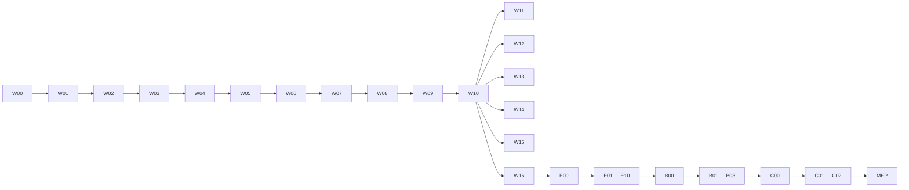

# Plan d'implémentation — FluxyRH

Créé le 2026-10-27 · RIYADA ONE TECHNOLOGIES SARL

Ce dossier fixe **l'ordre exact** du développement de FluxyRH : quelle application, quel module, quelle étape, dans quel ordre, avec quel critère de fin. Il s'appuie sur le PRD (ce qui est voulu), le TRD (comment), l'APPFLOW (parcours), l'UX/UI DESIGN (interface) et le BACKEND SCHEMA (tables). Il ne les répète pas : il y renvoie.

Le statut de chaque module est suivi dans `../ROADMAP.md`, et seulement là.

---

## 1. Décisions de découpage (2026-10-27)

| Sujet | Décision |
|---|---|
| Ordre des applications | **Application web complète d'abord** (`FluxyRH-web/app/`), puis **FluxyRH Entreprise**, **FluxyRH Borne** et **FluxyRH Console**, dans cet ordre. Remplace la règle du PRD §8.5 « écrans mobiles d'un domaine dans la même phase que ses écrans web » |
| Contenu du « web » | L'application Laravel complète : écrans Livewire **et API `/api/v1`** de chaque module. Les services sont partagés entre web et API (TRD §4.3), les refus sont testés des deux côtés (T-05). Les phases mobiles ne construisent que les écrans et le fonctionnement hors ligne |
| Unité de travail | **Un fichier = un module** (ex. Contrats), terminé avant de passer au suivant, dans l'ordre des dépendances |
| Gros modules | Découpés **par rôle**, dans l'ordre où la donnée circule : chaque sous-fichier couvre ce qu'un rôle fait avant de passer la main au suivant par un changement de statut |
| Développement vertical | Une table, une colonne, un paquet, un écran n'est créé qu'au module qui en a besoin, jamais pour un module futur |

---

## 2. Codes et numérotation

| Préfixe | Application | Dossier |
|---|---|---|
| `W` | Application web (Laravel, web + API) | `web/` |
| `E` | FluxyRH Entreprise (React Native, marque blanche) | `mobile-entreprise/` |
| `B` | FluxyRH Borne (React Native, mode kiosque) | `mobile-borne/` |
| `C` | FluxyRH Console (React Native, RIYADA ONE) | `mobile-console/` |
| `MEP` | Mise en production | `mise-en-production.md` |

Identifiant d'une étape : `<préfixe><module>.<sous-fichier>.<étape>` pour un module découpé par rôle (ex. `W09.4.2` = web, Paie, calcul et contrôle, étape 2), `<préfixe><module>.<étape>` sinon (ex. `W07.3`). Ces identifiants sont repris dans les livraisons et les messages de commit.

---

## 3. Ordre global

### 3.1 Application web

| Code | Fichier | Contenu | Exigences | Dépend de |
|---|---|---|---|---|
| W00 | `web/00-amorcage.md` | Projet Laravel, multi-entreprise, chiffrement, journal, files, e-mails, langues, interface de base, outillage de tests | T-01 à T-08, T-16, T-17, T-19 | — |
| W01 | `web/01-plateforme.md` | Espace plateforme : connexion, entreprises, provisionnement, abonnements, modules, factures, tableau de bord, fiche app mobile, page d'accueil publique | F-PLT-01 à 04, 07, 08 | W00 |
| W02 | `web/02-administration-acces.md` | Connexion entreprise, invitation et rattachement, matrice des droits, champs sensibles, mot de passe, 2FA, connectés, configuration, journal, API d'authentification | F-ADM-01 à 09, F-COM-02 | W01 |
| W03 | `web/03-organisation.md` | Structure, postes, sites, organigramme, bornes (côté serveur), rendu PDF neutre | F-ORG-01 à 03, 05 à 07, F-IDN-01 | W02 |
| W04 | `web/04-dossier-employe/` | Dossier authentique | F-EMP-01 à 07, 09, 10, F-COM-01 (cloche) | W03 |
| W04.1 | `01-rh-invitation-affectation.md` | RH : types d'employé et de documents, pièces obligatoires, invitation avec affectation, matricule, création du dossier, hiérarchie, sortie simple | F-EMP-01, 02, 05, 07, F-ORG-04 | |
| W04.2 | `02-employe-completion.md` | Employé : complétion, nouvelles versions `À vérifier`, justificatifs | F-EMP-03 | W04.1 |
| W04.3 | `03-verification.md` | RH / PAIE / DIR : liste de travail, vérification, rejet, complétude, relances, notifications in-app | F-EMP-03, 04, 06, 09, 10 | W04.2 |
| W05 | `web/05-cartes-nfc.md` | Cycle de la carte (côté serveur), file d'encodage, badge public, connexion carte + PIN, signature d'actions, design neutre, cartes de test | F-NFC-01 à 07, F-PLT-05 | W04 |
| W06 | `web/06-temps-pointage/` | Temps de travail | F-TPS-01 à 07 | W05 |
| W06.1 | `01-parametrage.md` | ADM / RH : plannings, jours fériés, règles d'heures sup, réglages du pointage | F-TPS-01, 06 | |
| W06.2 | `02-pointage.md` | EMP / SYS : code temporel, API de pointage (téléphone et borne), hors ligne, calculs journaliers, heures sup réalisées | F-TPS-02, 03, 04, 06 | W06.1 |
| W06.3 | `03-manager.md` | MGR : présences de l'équipe, corrections, heures sup établies à l'avance | F-TPS-05, 06 | W06.2 |
| W06.4 | `04-rh.md` | RH : validation des heures sup, feuilles de temps, exports | F-TPS-06, 07 | W06.3 |
| W07 | `web/07-conges.md` | Types, demande EMP → MGR → RH, calcul des jours, soldes, calendrier d'équipe, blocage dossier incomplet | F-ABS-01 à 04 | W06 |
| W08 | `web/08-contrats/` | Contrats | F-CTR-01 à 04 | W07 |
| W08.1 | `01-blocs.md` | RH : bibliothèque de blocs, règles de proposition, champs de fusion | F-CTR-01 | |
| W08.2 | `02-redaction.md` | RH : rédaction par blocs proposés, signataires, `Brouillon` → `À signer`, rémunération contractuelle, PDF | F-CTR-02, 04 | W08.1 |
| W08.3 | `03-signature.md` | Signataires : copies papier et signature dans le système (carte ou mot de passe) dans l'ordre, `Signé`, PDF figé | F-CTR-02, F-NFC-06 | W08.2 |
| W08.4 | `04-vie-du-contrat.md` | SYS / RH : activation, avenants, échéances, terminaison, résiliation | F-CTR-02, 03 | W08.3 |
| W09 | `web/09-paie/` | Paie | F-PAY-01 à 10, F-EMP-08 | W08 |
| W09.1 | `01-parametrage.md` | PAIE : rubriques, formules, versions datées, fréquences (aucun paramétrage de pays) | F-PAY-01, 02, 03 | |
| W09.2 | `02-elements-employe.md` | PAIE : rubriques fixes par employé, salaire de base issu du contrat | F-PAY-04 | W09.1 |
| W09.3 | `03-variables.md` | RH : ouverture de période, checklist, `Variables validées` | F-PAY-05, 06 | W09.2 |
| W09.4 | `04-calcul-controle.md` | PAIE : moteur de paie, `Calculée` → `Contrôlée`, retour arrière | F-PAY-05 | W09.3 |
| W09.5 | `05-approbation.md` | DIR : `Approuvée` | F-PAY-05 | W09.4 |
| W09.6 | `06-cloture-bulletins-paiements.md` | PAIE / SYS : clôture, bulletins publiés, accusé de réception, paiements enregistrés (faits hors système), cumuls annuels | F-PAY-05 à 08, F-EMP-08 | W09.5 |
| W09.7 | `07-avances-prets.md` | EMP → PAIE → DIR → SYS | F-PAY-10 | W09.6 |
| W09.8 | `08-journaux-etats.md` | Journal de paie, états de cotisations, exports | F-PAY-09 | W09.6 |
| W10 | `web/10-communication-aide.md` | Annonces, cloche complète, push, accueils par rôle, centre d'aide | F-COM-01, 03, F-AID-01 | W09 |
| W11 | `web/11-conformite.md` | Module Conformité | F-CNF-01 à 04 | W10 |
| W12 | `web/12-processus-rh/` | Module Processus RH | F-PRO-01 à 04 | W11 |
| W12.1 | `01-evenements.md` | MGR propose → RH décide | F-PRO-01 | |
| W12.2 | `02-workflows.md` | Entrée, sortie, mutation : tâches par acteur | F-PRO-02, F-EMP-07 | W12.1 |
| W12.3 | `03-courriers-formulaires.md` | RH : courriers en masse ; EMP → RH : formulaires types | F-PRO-03, 04 | W12.2 |
| W13 | `web/13-pilotage.md` | Module Pilotage | F-PIL-01 à 04 | W12 |
| W14 | `web/14-masse-salariale.md` | Module Masse salariale | F-MSA-01 à 04 | W13 |
| W15 | `web/15-talents.md` | Module Talents | F-TAL-01 à 04 | W14 |
| W16 | `web/16-identite.md` | Module Identité | F-IDN-02 à 06, F-NFC-07 | W15 |

Les modules W11 à W16 suivent l'ordre du PRD §8.5. Leurs dépendances fonctionnelles réelles sont plus larges (§4) : l'ordre peut être revu sans toucher au socle.

### 3.2 Applications mobiles

| Code | Fichier | Contenu | Exigences | Dépend de |
|---|---|---|---|---|
| E00 | `mobile-entreprise/00-amorcage.md` | Projet React Native, thème, i18n, client API typé, stockage chiffré, cache hors ligne, version minimale, modules masqués | F-MOB-03, 06 | W16 |
| E01 | `mobile-entreprise/01-connexion-acces.md` | Connexion mot de passe et carte + PIN, verrouillage, profil, écrans d'administration (utilisateurs, invitations, bornes, journal) | F-MOB-05, F-NFC-05 | E00 |
| E02 | `mobile-entreprise/02-dossier.md` | Mon dossier, complétion, vérifications (RH) | F-EMP-03, 04, F-MOB-04 | E01 |
| E03 | `mobile-entreprise/03-carte-nfc.md` | Activation de la carte, accès rapide au dossier, signature d'actions | F-NFC-02, 04, 06 | E02 |
| E04 | `mobile-entreprise/04-pointage-temps.md` | Scan du QR + carte, hors ligne, plannings, heures sup (MGR, RH) | F-MOB-02, F-TPS-02, 03, F-MOB-04 | E03 |
| E05 | `mobile-entreprise/05-conges.md` | Demandes, approbations, soldes, calendrier | F-ABS-02 à 04, F-MOB-04 | E04 |
| E06 | `mobile-entreprise/06-contrats.md` | Consultation, signature (carte, code ou biométrie) | F-CTR-02 | E05 |
| E07 | `mobile-entreprise/07-paie.md` | Bulletins, accusé de réception, cumuls, avances | F-PAY-07, 10, F-EMP-08 | E06 |
| E08 | `mobile-entreprise/08-communication.md` | Push, notifications, annonces, centre d'aide | F-COM-01, 03, F-AID-01 | E07 |
| E09 | `mobile-entreprise/09-modules.md` | Écrans mobiles des modules (formulaires types, événements, évaluations, tableaux de bord) | F-MOB-06 | E08 |
| E10 | `mobile-entreprise/10-marque-blanche-publication.md` | Une app par entreprise sur Android et iOS, Firebase par app, App Links et Universal Links, signature, Google Play et App Store | F-MOB-01, F-PLT-08 | E09 |
| B00 | `mobile-borne/00-amorcage.md` | Projet, mode kiosque, thème clair forcé | — | E10 |
| B01 | `mobile-borne/01-appairage.md` | Appairage par QR unique, clé non exportable, requêtes signées, signal de vie | F-ORG-03, 07 | B00 |
| B02 | `mobile-borne/02-pointage.md` | QR généré localement, lecture des cartes, file hors ligne | F-ORG-06, F-MOB-02, F-TPS-02, 03 | B01 |
| B03 | `mobile-borne/03-activation-carte-secours.md` | Activation de carte par PIN, pointage de secours | F-NFC-02, 05 | B02 |
| C00 | `mobile-console/00-amorcage.md` | Projet, connexion plateforme | — | B03 |
| C01 | `mobile-console/01-encodage-cartes.md` | File des cartes, écriture et verrouillage de la puce, livraison | F-PLT-05, F-NFC-01, 02 | C00 |
| C02 | `mobile-console/02-suivi-entreprises.md` | Suivi des entreprises | F-PLT-04 | C01 |
| MEP | `mise-en-production.md` | Serveur, `deploy/debian`, sauvegardes, supervision, dimensionnement, publication des apps | F-PLT-06, NF-09, NF-10, T-18 | C02 |

---

## 4. Dépendances

| Module | Pourquoi il vient après |
|---|---|
| W04 Dossier | L'invitation (W02) porte l'affectation, qui demande la structure, le site et le manager (W03) |
| W05 Cartes | Une carte appartient à un employé (W04) |
| W06 Pointage | Le pointage exige la carte (W05) et un site (W03) |
| W07 Congés | Le décompte des jours utilise les plannings et les jours fériés (W06.1) |
| W08 Contrats | La signature d'actions vient de W05 ; le dossier vérifié alimente les champs de fusion (W04) |
| W09 Paie | Salaire de base du contrat actif (W08), présences et heures sup (W06), congés (W07) |
| W10 Communication | Les notifications push couvrent les événements de tous les modules précédents |
| W11 à W16 | Lisent la paie clôturée, les contrats ou le dossier ; aucun ne dépend d'un autre module payant |

---

## 5. Gabarit d'un fichier de module

Chaque fichier suit cette structure :

1. **Objet** — une phrase.
2. **Exigences couvertes** — `F-*`, `NF-*`, `T-*`, avec les sections du TRD, de l'APPFLOW, de l'UX/UI et du BACKEND SCHEMA à lire avant de commencer.
3. **Prérequis** — modules livrés, décisions prises, paquets à installer (commandes pour le développeur).
4. **Rôles et statuts traversés** — cycle de vie concerné et acteur de chaque transition (pour un sous-fichier par rôle : ce que le rôle reçoit, ce qu'il produit, à qui il passe la main).
5. **Étapes ordonnées** — numérotées, dans cet ordre de couches :
   enums → migrations → models et factories → services et transitions → autorisations (permissions d'écran, `FieldAccess`, périmètre) → écrans Livewire → API `/v1` et contrat Scramble → notifications, jobs, tâches planifiées → seeders → tests.
   Chaque étape indique les fichiers créés ou modifiés et son **critère de fin**.
6. **Tests attendus** — nominal, refus (rôle, permission, module, champ sensible, périmètre, autre entreprise), transitions interdites, cas limites (TRD §24).
7. **Critères de sortie** — tests ciblés verts, Pint, recette des parcours APPFLOW du module, livraison dans `06-livraisons/`, référence `02-reference/` à jour, statut ROADMAP.
8. **Reporté aux phases mobiles** — ce qui ne peut être vérifié qu'avec une app (carte, QR, push).
9. **Décisions à prendre avant de démarrer** — s'il y en a.

---

## 6. Règles d'exécution

- Un module à la fois, jusqu'à sa livraison ; dans un module découpé par rôle, un sous-fichier à la fois.
- Avant chaque module : proposition dans le terminal (format du `CLAUDE.md`), puis « go ».
- Une livraison par fichier de module ou de sous-fichier : `06-livraisons/AAAA-MM-JJ-NNN-titre.md` + ligne au `JOURNAL.md`.
- Tests ciblés (`--filter`) pendant le travail ; la suite complète est lancée par le développeur avant la livraison.
- `vendor/bin/pint --dirty --format agent` après toute modification PHP.
- Commandes git, `composer` (installation de paquets), `npm`, `npx` et Gradle : données au développeur, une par ligne, pour cmd.exe.
- Si un module révèle un manque dans les spécifications : on s'arrête, on complète la spécification (ou une extension datée), puis on reprend.

---

## 7. Ce qui attend les applications mobiles

Le web livre le serveur de toutes les fonctions, mais certaines ne peuvent être **recettées de bout en bout** qu'avec une app. Elles sont couvertes par des tests PHPUnit sur l'API pendant la phase web, et recettées sur le terrain dans la phase mobile indiquée.

| Fonction | Construite en | Recette terrain en |
|---|---|---|
| Activation d'une carte par PIN | W05 | E03, B03 |
| Connexion carte + PIN | W05 | E01 |
| Pointage QR + carte, hors ligne | W06.2 | E04, B02 |
| Signature d'un contrat par carte (dans l'app) | W08.3 | E06 |
| Accusé de réception d'un bulletin | W09.6 | E07 |
| Notifications push | W04.3 (in-app), W10 | E08 |
| Encodage des cartes | W05 (file, API) | C01 |

**Cartes de test** : la Console arrivant en dernier, W05 fournit une commande de développement qui crée des cartes à l'état `Livrée` avec leur URI. Ces URI sont écrites sur des cartes NTAG de test avec une application NFC générique, ce qui permet de recetter l'app Entreprise et la Borne avant la Console.

---

## 8. Matrice de couverture

### 8.1 Exigences fonctionnelles

| Exigence | Module(s) |
|---|---|
| F-PLT-01 Création et provisionnement d'une entreprise | W01 |
| F-PLT-02 Abonnement | W01 |
| F-PLT-03 Modules par entreprise | W01 |
| F-PLT-04 Tableau de bord plateforme | W01, C02 |
| F-PLT-05 File des cartes à encoder | W05, C01 |
| F-PLT-06 Sauvegardes (archives demandées : hors système) | MEP |
| F-PLT-07 Page d'accueil publique | W01 |
| F-PLT-08 Fiche « Application mobile » | W01, E10 |
| F-ADM-01 Invitations | W02 |
| F-ADM-02 Rattachement | W02 |
| F-ADM-03 Matrice des droits par écran | W02 |
| F-ADM-04 Droits par donnée (champs sensibles) | W02 (mécanique), chaque module (application) |
| F-ADM-05 Politique de mot de passe, 2FA | W02 |
| F-ADM-06 Utilisateurs connectés | W02 |
| F-ADM-07 Configuration de l'entreprise | W02 |
| F-ADM-08 Journal d'audit | W00 (écriture), W02 (écran) |
| F-ADM-09 Corbeille | W00 (composant), chaque liste |
| F-ORG-01, 02 Structure, sites | W03 (sites de pointage de l'employé : W04.1) |
| F-ORG-04 Hiérarchie | W04.1 |
| F-ORG-05 Organigramme | W03 (structure), W04.1 (personnes) |
| F-ORG-03, 07 Bornes | W03, B01 |
| F-ORG-06 Borne hors ligne | W03 (clés), W06.2 (réception), B02 |
| F-EMP-01, 02, 05 Invitation avec affectation, types | W04.1 |
| F-EMP-03 Complétion et vérification | W04.2, W04.3, E02 |
| F-EMP-04 Liste de travail du vérificateur | W04.3, E02 |
| F-EMP-06 Taux de complétude | W04.3 |
| F-EMP-07 Cycle de l'employé | W04.1, W12.2 |
| F-EMP-08 Cumuls annuels | W09.6, E07 |
| F-EMP-09 Pièces obligatoires et blocages | W04.3 (complétude), W07, W09.6, W12.3 (blocages) |
| F-EMP-10 Relances | W04.3 |
| F-NFC-01 à 06 Cartes | W05, E01, E03, B03, C01 |
| F-NFC-07 Design de la carte | W05 (neutre), W16 |
| F-TPS-01 Plannings, jours fériés | W06.1 |
| F-TPS-02, 03 Pointage, hors ligne | W06.2, E04, B02 |
| F-TPS-04 Calculs | W06.2 |
| F-TPS-05 Corrections | W06.3 |
| F-TPS-06 Heures supplémentaires | W06.1, W06.2, W06.3, W06.4 |
| F-TPS-07 Feuille de temps | W06.4 |
| F-ABS-01 à 04 Congés et absences | W07, E05 |
| F-CTR-01 Bibliothèque de blocs | W08.1 |
| F-CTR-02 Cycle du contrat | W08.2, W08.3, W08.4, E06 |
| F-CTR-03 Contrat actif, avenants, échéances | W08.4 |
| F-CTR-04 PDF, rémunération contractuelle | W08.2 |
| F-PAY-01 à 03 Paramétrage, versions (aucun paramétrage de pays, décision 0002) | W09.1 |
| F-PAY-04 Éléments par employé | W09.2 |
| F-PAY-05 Période de paie | W09.3, W09.4, W09.5, W09.6 |
| F-PAY-06 Checklist | W09.3, W09.6 |
| F-PAY-07 Bulletin | W09.6, E07 |
| F-PAY-08 Paiements enregistrés (faits hors système) | W09.6 |
| F-PAY-09 Journal, états | W09.8 |
| F-PAY-10 Avances et prêts | W09.7, E07 |
| F-MSA-01 à 04 | W14 |
| F-PRO-01 | W12.1 |
| F-PRO-02 | W12.2 |
| F-PRO-03, 04 | W12.3 |
| F-TAL-01 à 04 | W15 |
| F-CNF-01 à 04 | W11 |
| F-COM-01 Notifications in-app et push | W04.3, W10, E08 |
| F-COM-02 E-mails transactionnels | W00 (infrastructure), W02 (premier usage) |
| F-COM-03 Annonces | W10, E08 |
| F-PIL-01 à 04 | W13 |
| F-AID-01 Centre d'aide | W10, E08 |
| F-MOB-01 Marque blanche | E10 |
| F-MOB-02 Pointage, mode borne | E04, B02 |
| F-MOB-03 Hors ligne | E00, puis chaque module E |
| F-MOB-04 Validations MGR et RH | E02, E04, E05 |
| F-MOB-05 Verrouillage, version minimale | W02 (version minimale côté API), E01 |
| F-MOB-06 Modules masqués | E00, E09 |
| F-IDN-01 Charte neutre | W03 (premier PDF) |
| F-IDN-02 à 06 | W16 |

### 8.2 Exigences non fonctionnelles

| Exigence | Où elle est construite | Où elle est vérifiée |
|---|---|---|
| NF-01 Cloisonnement | W00 | Test « autre entreprise » dans chaque module |
| NF-02 Confidentialité des rémunérations | W00 (chiffrement), W02 (`FieldAccess`) | Suite de non-fuite, enrichie à chaque module touchant un champ sensible |
| NF-03 Traçabilité | W00 (`ActivityLogger`), W02 (écran) | Chaque transition journalisée |
| NF-04 Cycles de vie | Chaque module | Tests des transitions interdites |
| NF-05 Anti-fraude du pointage | W06.2 | Suite « codes temporels », recette E04, B02 |
| NF-06 Connectivité faible | E00, B02 | Recette terrain |
| NF-07 Multilingue | W00 | Chaque écran livré en fr, en, ar |
| NF-08 Sécurité des accès | W02 | Tests de refus |
| NF-09 Sauvegardes | MEP | Test de restauration |
| NF-10 Disponibilité | MEP | Supervision |
| NF-11 Performance | W09.4 (paie de 200 employés < 1 min) | Mesure avant MEP |
| NF-12 Qualité | Chaque module | Critères de sortie |
| NF-13 Conservation | W00 (suppression logique) | Aucune suppression définitive dans les services |

### 8.3 Exigences techniques (TRD §28)

| Exigence | Module |
|---|---|
| T-01, T-02, T-03, T-17 Multi-entreprise, jobs, migrations | W00 |
| T-04 Transitions par services | Chaque module |
| T-05 Contrôles côté serveur | W02 (mécanique), chaque module |
| T-06 Conventions de schéma | W00 |
| T-07 Trois langues | W00, chaque écran |
| T-08 `Money`, aucun montant en dur | W00 |
| T-09 Champs sensibles | W00 (chiffrement), W02 (`FieldAccess`) |
| T-10 Données vérifiables | W04 |
| T-11 Pointage | W06.2 |
| T-11b Bornes | W03, B01 |
| T-12 Paie | W09 |
| T-13 Documents signés figés | W08.3 |
| T-14 API `/v1` stable, contrat Scramble | W02 (mise en place), chaque module |
| T-15 Écritures hors ligne idempotentes | W06.2 (serveur), E00, B02 |
| T-16 Secrets | W00 |
| T-18 Sauvegardes | MEP |
| T-19 Pint, `npm run check` | W00, E00, B00, C00 |
| T-20 `DocumentRenderer` | W01 (création, factures), W03 (documents de l'entreprise), W16 (chartes) |
